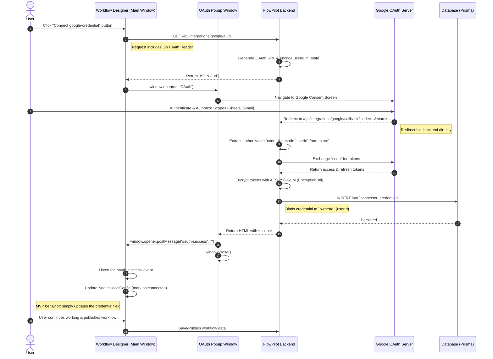

# Google OAuth Flow

## Contract Resolution

This documented diagram reflects the **exact backend and frontend implementation**:
- **Security:** The OAuth tokens are never transmitted to the frontend. The backend creates the `connector_credentials` database record immediately during the Google callback.
- **Inter-Window Communication:** The callback endpoint returns an HTML script that uses `window.opener.postMessage` to securely notify the main UI window without passing sensitive payload data.
- **Frontend State:** Upon receiving the `oauth-success` message, the frontend implicitly maps the success to the node configuration.
