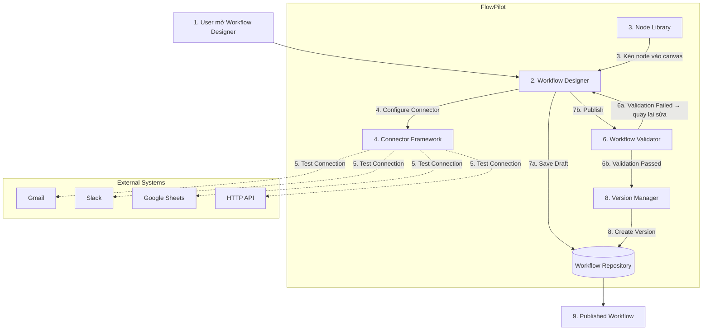
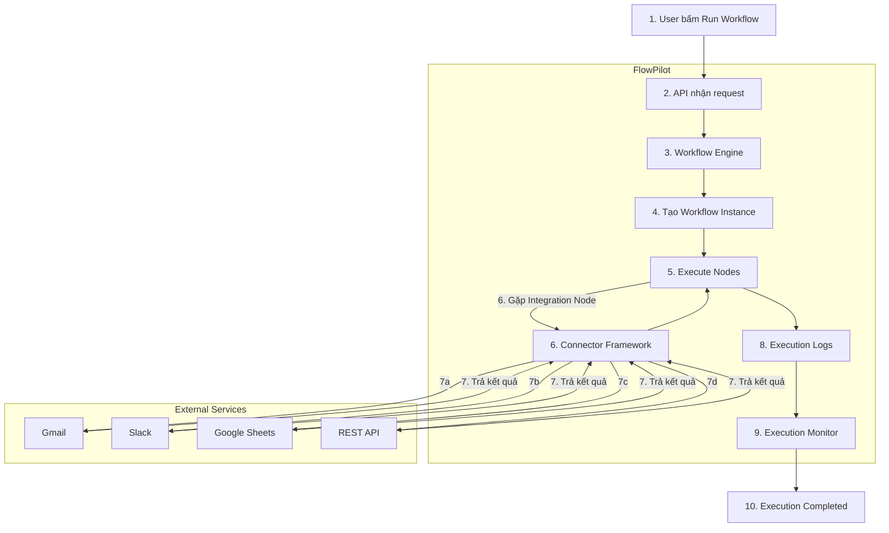
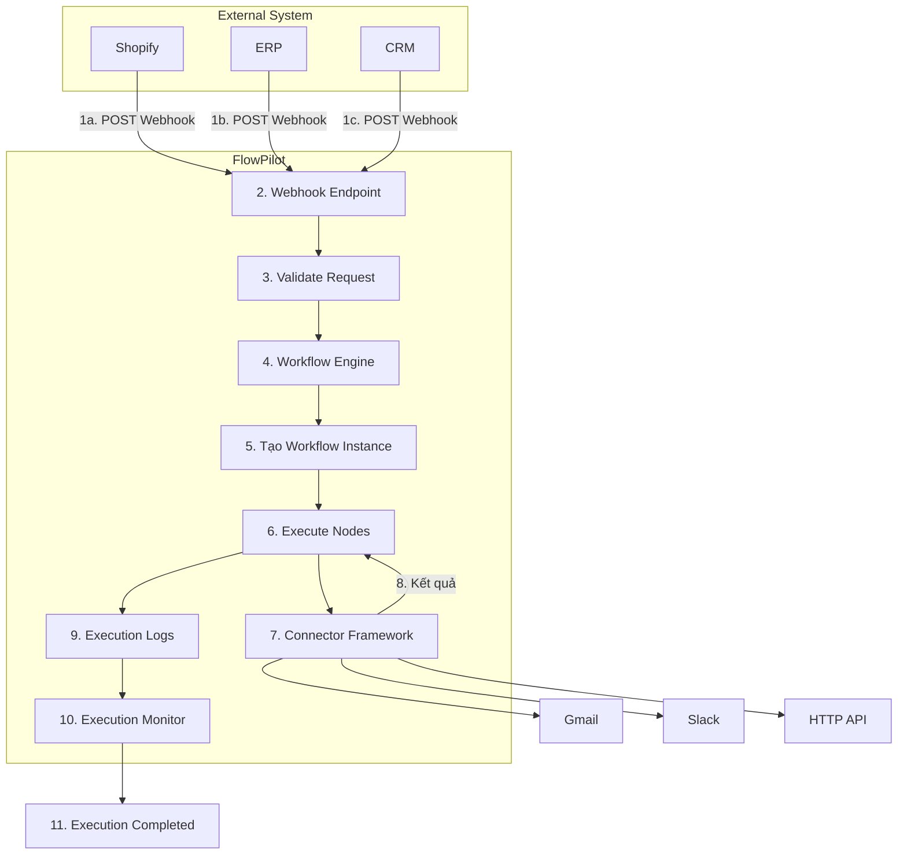
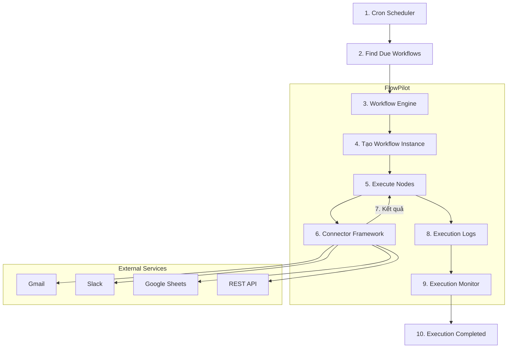
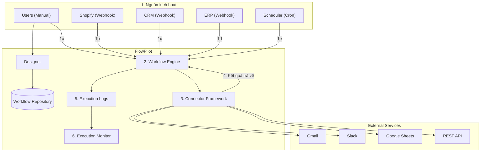

# High-Level-Flow
---

## 1. Workflow Creation Flow — Luồng tạo Workflow

**Các bước:**

1. Người dùng mở **Workflow Designer**.
2. Kéo node từ **Node Library** vào workflow.
3. Chọn **Connector** (Gmail, Slack, Sheets, HTTP API...).
4. **Connector Framework** kiểm tra credential.
5. Test kết nối tới hệ thống ngoài tương ứng.
6. Người dùng bấm **Save Draft** (lưu tạm) hoặc **Publish** (gửi kiểm tra).
7. **Workflow Validator** kiểm tra: nếu **fail** → quay về Designer; nếu **pass** → chuyển tiếp.
8. **Version Manager** tạo phiên bản mới, lưu vào **Repository**.
9. Workflow trở thành **Published Workflow**, sẵn sàng chạy.

---

## 2. Workflow Execution Flow — Manual Trigger

**Các bước:**

1. Người dùng bấm **Run Workflow**.
2. Request được gửi tới **API**.
3. API chuyển tới **Workflow Engine**.
4. Engine **tạo Workflow Instance** mới.
5. Engine bắt đầu **thực thi các node** tuần tự.
6. Gặp node tích hợp → gọi **Connector Framework**.
7. Connector gửi request tới Gmail / Slack / Sheets / HTTP API và nhận kết quả trả về.
8. Kết quả được đưa trở lại **Execute Nodes**, ghi vào **Execution Logs**.
9. **Execution Monitor** theo dõi trạng thái.
10. Workflow hoàn tất — **Execution Completed**.

---

## 3. Workflow Execution Flow — Webhook Trigger

**Các bước:**

1. Hệ thống ngoài (**Shopify, ERP, CRM**) phát sinh sự kiện, gửi **HTTP POST** tới Webhook Endpoint.
2. **Gateway** tiếp nhận request.
3. Gateway **Validate Request** (kiểm tra chữ ký/token, đảm bảo hợp lệ và đáng tin).
4. Request hợp lệ được chuyển vào **Workflow Engine**.
5. Engine **tạo Workflow Instance** ứng với webhook đó.
6. Engine **thực thi các node**.
7. Gặp node tích hợp → gọi **Connector Framework** (Gmail, Slack, HTTP API...).
8. Connector trả kết quả về lại Execute Nodes.
9. Ghi **Execution Logs**.
10. **Execution Monitor** cập nhật trạng thái.
11. Kết thúc — **Execution Completed**.

---

## 4. Workflow Execution Flow — Scheduled Trigger

**Các bước:**

1. **Cron Scheduler** chạy theo lịch định kỳ (ví dụ mỗi ngày 8h sáng).
2. Scheduler thực hiện **Find Due Workflows** — quét các workflow đến hạn.
3. Gửi yêu cầu chạy tới **Workflow Engine**.
4. Engine **tạo Workflow Instance**.
5. Engine **thực thi các node**.
6. Gặp node tích hợp → gọi **Connector Framework**.
7. Connector gọi Gmail/Slack/Sheets/HTTP API và nhận kết quả.
8. Ghi **Execution Logs**.
9. **Execution Monitor** cập nhật trạng thái.
10. Kết thúc — **Execution Completed**.

---

## 5. Tổng quan kiến trúc Run-time

**Các bước / điểm kiến trúc chính:**

1. Có 5 nguồn có thể kích hoạt hệ thống: **Users** (chạy tay), **Shopify / CRM / ERP** (webhook), **Scheduler** (lịch trình). Riêng luồng thiết kế: Users dùng **Designer** để tạo workflow, lưu vào **Repository**.
2. Dù đến từ nguồn nào, tất cả đều hội tụ về **Workflow Engine** — điểm xử lý trung tâm duy nhất.
3. Engine gọi ra ngoài luôn thông qua **Connector Framework** — không có đường tắt nào bỏ qua lớp này.
4. Connector gọi tới Gmail / Slack / Google Sheets / REST API, rồi trả kết quả ngược về Engine.
5. Toàn bộ hoạt động được ghi vào **Execution Logs**.
6. **Execution Monitor** đọc log để giám sát trạng thái thực thi theo thời gian thực.