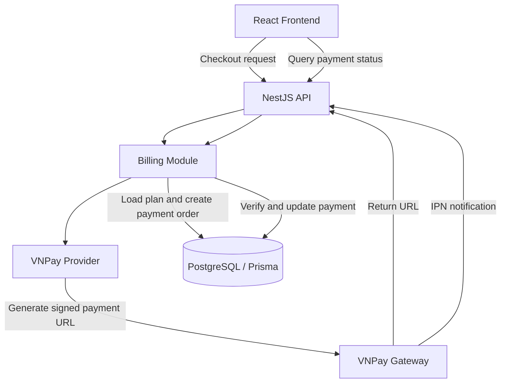
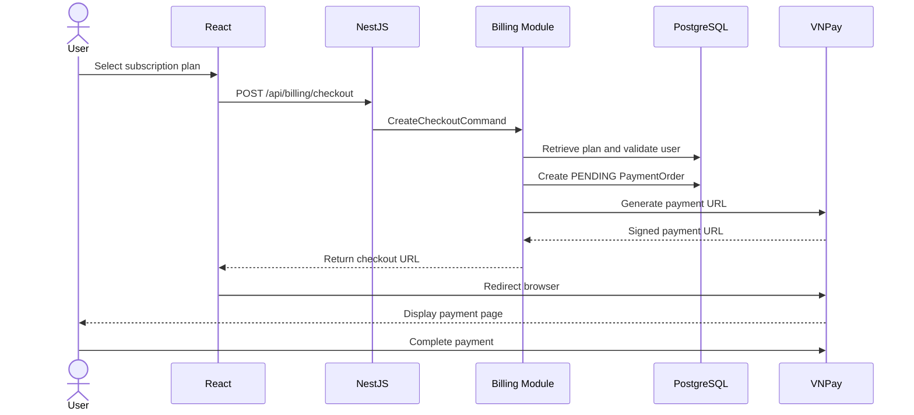
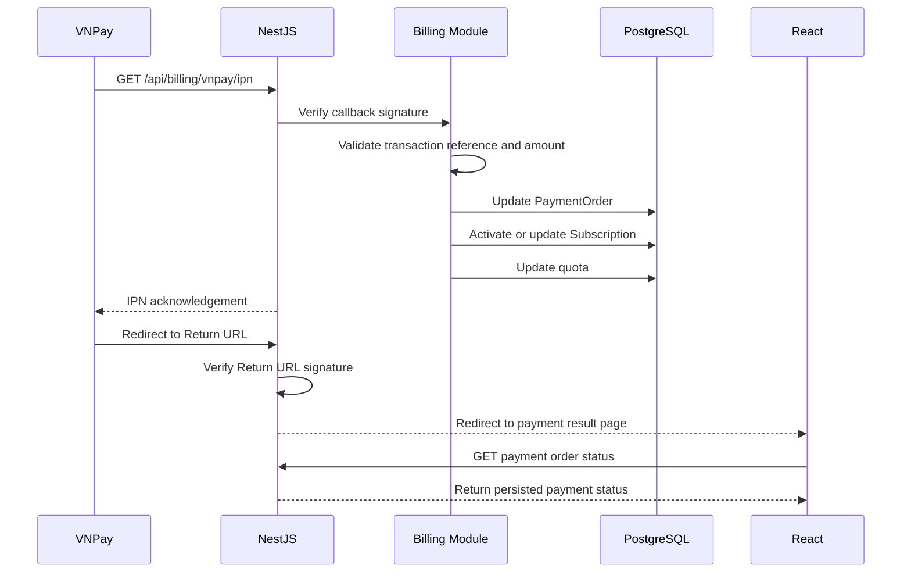

# VNPay Sandbox Integration Guide for FlowPilot

A practical guide to integrating VNPay Sandbox into the FlowPilot application using **NestJS, React, Prisma, and PostgreSQL**.

This document is tailored to FlowPilot's existing modular-monolith architecture and subscription-billing requirements. It explains how to implement the backend payment integration, connect it to the subscription domain, and build the frontend checkout experience.

The implementation follows one core principle:

> VNPay handles payment processing. FlowPilot remains responsible for subscription management, payment records, and execution quota allocation.

---

# Table of Contents

1. [Project Context](#1-project-context)
2. [Payment Integration Architecture](#2-payment-integration-architecture)
3. [VNPay Sandbox Setup](#3-vnpay-sandbox-setup)
4. [Backend Configuration](#4-backend-configuration)
5. [Backend Implementation](#5-backend-implementation)
6. [Integrating with FlowPilot Billing](#6-integrating-with-flowpilot-billing)
7. [Frontend Implementation](#7-frontend-implementation)
8. [Payment Lifecycle and IPN Handling](#8-payment-lifecycle-and-ipn-handling)
9. [Testing](#9-testing)
10. [Troubleshooting](#10-troubleshooting)
11. [Security and Best Practices](#11-security-and-best-practices)
12. [Production Migration Checklist](#12-production-migration-checklist)
13. [Official References](#13-official-references)

---

# 1. Project Context

## 1.1. Existing technology stack

The VNPay integration should follow FlowPilot's existing technologies rather than introducing another backend or frontend architecture.

| Layer | Technology |
|---|---|
| Backend framework | NestJS 11 |
| Backend language | TypeScript |
| Architecture | Modular Monolith |
| Application patterns | CQRS / Command Bus / Query Bus |
| Database | PostgreSQL |
| ORM | Prisma |
| Background jobs | BullMQ / Redis |
| Frontend framework | React 19 |
| Frontend language | TypeScript |
| Build tool | Vite |
| API client | Axios |
| Server state | TanStack Query |
| Client state | Zustand |
| Routing | React Router |
| UI | Tailwind CSS / shadcn/ui |

## 1.2. Existing project structure

The backend already follows a modular-monolith structure:

```text
monolith-backend/
├── apps/
│   └── api/
│       └── src/
│           ├── app.module.ts
│           └── main.ts
│
├── libs/
│   ├── admin/
│   ├── apps/
│   ├── auth/
│   ├── connector/
│   ├── database/
│   ├── designer/
│   ├── execution/
│   ├── integrations/
│   ├── node-library/
│   ├── shared/
│   └── triggers/
│
├── prisma/
│   └── schema.prisma
│
└── package.json
```

The frontend follows a feature-oriented structure:

```text
frontend/
└── src/
    ├── app/
    ├── features/
    │   ├── auth/
    │   ├── workflow/
    │   └── ...
    ├── shared/
    │   ├── api/
    │   └── ...
    └── main.tsx
```

The integration should preserve these conventions.

## 1.3. Where should VNPay belong?

VNPay is a payment provider, not a workflow connector.

FlowPilot already has an `integrations` module for external application integrations, including Google OAuth and connector-related functionality.

Do not put subscription payment processing into the existing connector integration logic.

Instead, introduce a dedicated billing module:

```text
monolith-backend/libs/
└── billing/
    └── src/
        ├── billing.module.ts
        │
        ├── presentation/
        │   └── http/
        │       ├── billing.controller.ts
        │       ├── payment.controller.ts
        │       └── dtos/
        │
        ├── application/
        │   ├── commands/
        │   ├── queries/
        │   ├── services/
        │   └── ports/
        │
        ├── domain/
        │   ├── entities/
        │   ├── enums/
        │   └── interfaces/
        │
        └── infrastructure/
            ├── payment/
            │   └── vnpay/
            │       ├── vnpay.service.ts
            │       ├── vnpay.util.ts
            │       ├── vnpay.config.ts
            │       └── vnpay.types.ts
            │
            └── persistence/
                └── ...
```

This is a proposed structure for the billing feature, not a claim that these files already exist.

### Responsibilities

| Component | Responsibility |
|---|---|
| PaymentController | Handle checkout and VNPay callbacks |
| BillingController | Expose subscription and billing APIs |
| VNPayService | Communicate with VNPay |
| VNPayUtil | Generate and verify signatures |
| Billing application services | Coordinate payment and subscription operations |
| Prisma persistence | Store payment orders and subscriptions |
| React billing features | Display plans, checkout, and payment results |

The VNPay provider should not directly manage workflow executions or execution quotas.

---

# 2. Payment Integration Architecture

## 2.1. High-level architecture



## 2.2. Checkout flow



## 2.3. Payment result flow



## 2.4. Return URL vs IPN

These endpoints have different responsibilities.

| Mechanism | Purpose | FlowPilot responsibility |
|---|---|---|
| Return URL | Redirects the customer's browser | Redirect to the frontend result page |
| IPN | Server-to-server payment notification | Verify and persist the payment result |

**Important:** Only a verified server-side payment notification should confirm a successful payment and activate a subscription.

The frontend must never activate a subscription based on query parameters returned by VNPay.

---

# 3. VNPay Sandbox Setup

## 3.1. Register a Sandbox account

Visit:

https://sandbox.vnpayment.vn/

Register a Sandbox merchant account and obtain:

| Credential | Description |
|---|---|
| `VNPAY_TMN_CODE` | Merchant identifier |
| `VNPAY_HASH_SECRET` | Secret used for HMAC-SHA512 signatures |

Keep these credentials private.

## 3.2. VNPay Sandbox payment URL

```text
https://sandbox.vnpayment.vn/paymentv2/vpcpay.html
```

## 3.3. Configure callback URLs

For FlowPilot local development:

```text
Return URL:
http://localhost:8080/api/billing/vnpay/return

IPN URL:
https://your-public-domain.com/api/billing/vnpay/ipn
```

The Return URL points to the NestJS backend. The backend verifies the callback and redirects the browser to the frontend.

The IPN URL must be publicly accessible over HTTPS.

For local development, use ngrok or Cloudflare Tunnel:

```bash
ngrok http 8080
```

Example public IPN URL:

```text
https://example.ngrok-free.app/api/billing/vnpay/ipn
```

Configure this URL in the VNPay Sandbox merchant portal.

## 3.4. Sandbox test card

VNPay provides test cards for Sandbox transactions.

Example NCB test card:

| Field | Value |
|---|---|
| Bank | NCB |
| Card number | `9704198526191432198` |
| Cardholder name | `NGUYEN VAN A` |
| Issue date | `07/15` |
| OTP | `123456` |

Check the official VNPay Sandbox documentation for current test credentials.

---

# 4. Backend Configuration

## 4.1. Add environment variables

Update:

`monolith-backend/.env.example`

Add:

```env
# VNPay Sandbox Configuration
VNPAY_TMN_CODE=your_tmn_code
VNPAY_HASH_SECRET=your_hash_secret

VNPAY_PAYMENT_URL=https://sandbox.vnpayment.vn/paymentv2/vpcpay.html

VNPAY_RETURN_URL=http://localhost:8080/api/billing/vnpay/return

VNPAY_IPN_URL=https://your-public-domain.com/api/billing/vnpay/ipn

# Frontend URL used after payment return
FRONTEND_URL=http://localhost:5173
```

The actual `.env` file must not be committed to Git.

All listed VNPay settings and `FRONTEND_URL` are required. The backend validates
them during startup and does not provide fallback values; set each value in the
backend `.env` file or deployment environment before starting the API.

The existing application loads environment variables in `apps/api/src/main.ts` using `process.loadEnvFile()`. Follow that configuration convention rather than introducing another configuration mechanism solely for VNPay.

## 4.2. Create VNPayConfig

File:

`monolith-backend/libs/billing/src/infrastructure/payment/vnpay/vnpay.config.ts`

```typescript
export interface VNPayConfig {
  tmnCode: string;
  hashSecret: string;
  paymentUrl: string;
  returnUrl: string;
  ipnUrl: string;
}

export function getVNPayConfig(): VNPayConfig {
  const required = [
    'VNPAY_TMN_CODE',
    'VNPAY_HASH_SECRET',
    'VNPAY_PAYMENT_URL',
    'VNPAY_RETURN_URL',
    'VNPAY_IPN_URL',
  ] as const;

  for (const key of required) {
    if (!process.env[key]) {
      throw new Error(`Missing environment variable: ${key}`);
    }
  }

  return {
    tmnCode: process.env.VNPAY_TMN_CODE!,
    hashSecret: process.env.VNPAY_HASH_SECRET!,
    paymentUrl: process.env.VNPAY_PAYMENT_URL!,
    returnUrl: process.env.VNPAY_RETURN_URL!,
    ipnUrl: process.env.VNPAY_IPN_URL!,
  };
}
```

Validate configuration during application startup. Do not wait until the first checkout request to discover missing credentials.

---

# 5. Backend Implementation

## 5.1. Install required dependencies

VNPay integration can use Node.js built-in modules for cryptographic signing and URL handling.

No additional VNPay SDK is required.

The backend already includes the following dependencies:

- `@nestjs/common`
- `@nestjs/core`
- `@nestjs/cqrs`
- `@prisma/client`
- `class-validator`
- `class-transformer`

Use Node.js built-in `crypto` for HMAC-SHA512.

## 5.2. Create VNPay types

File:

`libs/billing/src/infrastructure/payment/vnpay/vnpay.types.ts`

```typescript
export interface VNPayCreatePaymentParams {
  transactionReference: string;
  amount: number;
  orderInfo: string;
  ipAddress: string;
}

export interface VNPayCallbackParams {
  vnp_Amount: string;
  vnp_BankCode?: string;
  vnp_BankTranNo?: string;
  vnp_CardType?: string;
  vnp_OrderInfo?: string;
  vnp_PayDate?: string;
  vnp_ResponseCode: string;
  vnp_TmnCode: string;
  vnp_TransactionNo: string;
  vnp_TransactionStatus: string;
  vnp_TxnRef: string;
  vnp_SecureHash: string;
  vnp_SecureHashType?: string;
}

export interface VNPayPaymentResult {
  signatureValid: boolean;
  transactionReference: string;
  transactionId?: string;
  amount: number;
  responseCode: string;
  transactionStatus: string;
  successful: boolean;
}
```

These types describe the payment provider's data contract. Keep them independent of Prisma models.

## 5.3. Implement VNPayUtil

File:

`libs/billing/src/infrastructure/payment/vnpay/vnpay.util.ts`

```typescript
import { createHmac, timingSafeEqual } from 'node:crypto';

export class VNPayUtil {
  /**
   * Sort parameters alphabetically and URL-encode their values.
   * This follows the VNPay Node.js integration sample.
   */
  static sortAndEncode(
    params: Record<string, string>,
  ): Record<string, string> {
    const sorted: Record<string, string> = {};

    for (const key of Object.keys(params).sort()) {
      sorted[key] = encodeURIComponent(params[key]).replace(
        /%20/g,
        '+',
      );
    }

    return sorted;
  }

  /**
   * Build the canonical signing string.
   */
  static buildHashData(
    params: Record<string, string>,
  ): string {
    const sorted = this.sortAndEncode(params);

    return Object.keys(sorted)
      .map((key) => `${key}=${sorted[key]}`)
      .join('&');
  }

  /**
   * Generate HMAC-SHA512 signature.
   */
  static hmacSHA512(
    secret: string,
    data: string,
  ): string {
    return createHmac('sha512', secret)
      .update(data, 'utf8')
      .digest('hex');
  }

  /**
   * Verify signatures using constant-time comparison.
   */
  static verifySignature(
    calculatedHash: string,
    receivedHash: string,
  ): boolean {
    const expected = Buffer.from(
      calculatedHash.toLowerCase(),
      'hex',
    );

    const received = Buffer.from(
      receivedHash.toLowerCase(),
      'hex',
    );

    if (
      expected.length === 0 ||
      expected.length !== received.length
    ) {
      return false;
    }

    return timingSafeEqual(expected, received);
  }

  /**
   * Build the query string from already sorted and encoded values.
   * Do not encode the values a second time.
   */
  static buildQueryString(
    params: Record<string, string>,
  ): string {
    const sorted = this.sortAndEncode(params);

    return Object.keys(sorted)
      .map(
        (key) =>
          `${encodeURIComponent(key)}=${sorted[key]}`,
      )
      .join('&');
  }

  static getHash(
    params: Record<string, string>,
    secret: string,
  ): string {
    return this.hmacSHA512(
      secret,
      this.buildHashData(params),
    );
  }
}
```

**Important:** Keep the canonical parameter construction consistent with the current official VNPay Node.js sample. VNPay signature generation is sensitive to parameter ordering and encoding. Do not encode values twice or include `vnp_SecureHash` in the hash data.

## 5.4. Implement VNPayService

File:

`libs/billing/src/infrastructure/payment/vnpay/vnpay.service.ts`

```typescript
import { Injectable } from '@nestjs/common';
import { VNPayUtil } from './vnpay.util';
import { getVNPayConfig } from './vnpay.config';
import { VNPayCreatePaymentParams } from './vnpay.types';

@Injectable()
export class VNPayService {
  private readonly config = getVNPayConfig();

  createPaymentUrl(
    request: VNPayCreatePaymentParams,
  ): string {
    const {
      transactionReference,
      amount,
      orderInfo,
      ipAddress,
    } = request;

    if (!Number.isSafeInteger(amount) || amount <= 0) {
      throw new Error('Invalid payment amount');
    }

    const now = new Date();

    const params: Record<string, string> = {
      vnp_Version: '2.1.0',
      vnp_Command: 'pay',
      vnp_TmnCode: this.config.tmnCode,
      vnp_Amount: String(amount * 100),
      vnp_CurrCode: 'VND',
      vnp_TxnRef: transactionReference,
      vnp_OrderInfo: orderInfo,
      vnp_OrderType: 'other',
      vnp_Locale: 'vn',
      vnp_ReturnUrl: this.config.returnUrl,
      vnp_IpAddr: ipAddress,
      vnp_CreateDate: this.formatVNPayDate(now),
      vnp_ExpireDate: this.formatVNPayDate(
        new Date(now.getTime() + 15 * 60 * 1000),
      ),
    };

    const hashData = VNPayUtil.buildHashData(params);

    const secureHash = VNPayUtil.hmacSHA512(
      this.config.hashSecret,
      hashData,
    );

    const queryString = VNPayUtil.buildQueryString(params);

    return (
      `${this.config.paymentUrl}?${queryString}` +
      `&vnp_SecureHash=${secureHash}`
    );
  }

  verifyCallback(
    callback: Record<string, string>,
  ): boolean {
    const receivedHash = callback.vnp_SecureHash;

    if (!receivedHash) {
      return false;
    }

    const params = { ...callback };

    delete params.vnp_SecureHash;
    delete params.vnp_SecureHashType;

    const calculatedHash = VNPayUtil.getHash(
      params,
      this.config.hashSecret,
    );

    return VNPayUtil.verifySignature(
      calculatedHash,
      receivedHash,
    );
  }

  private formatVNPayDate(date: Date): string {
    const parts = new Intl.DateTimeFormat('en-GB', {
      timeZone: 'Asia/Ho_Chi_Minh',
      year: 'numeric',
      month: '2-digit',
      day: '2-digit',
      hour: '2-digit',
      minute: '2-digit',
      second: '2-digit',
      hourCycle: 'h23',
    }).formatToParts(date);

    const values = Object.fromEntries(
      parts.map((part) => [part.type, part.value]),
    );

    return (
      values.year +
      values.month +
      values.day +
      values.hour +
      values.minute +
      values.second
    );
  }
}
```

The service is responsible for VNPay-specific operations only:

- Creating payment parameters.
- Converting VND amounts.
- Generating payment URLs.
- Signing requests.
- Verifying callback signatures.

It must not activate subscriptions or modify execution quotas.

## 5.5. Create a payment DTO

File:

`libs/billing/src/presentation/http/dtos/create-checkout.dto.ts`

```typescript
import { IsUUID } from 'class-validator';

export class CreateCheckoutDto {
  @IsUUID()
  planId: string;
}
```

The frontend sends only the selected plan identifier.

Do not accept the payment amount or subscription quota as trusted frontend input.

## 5.6. Create the payment controller

File:

`libs/billing/src/presentation/http/payment.controller.ts`

The controller should expose:

| Method | Endpoint | Purpose |
|---|---|---|
| POST | `/api/billing/checkout` | Create a payment order and return a VNPay URL |
| GET | `/api/billing/vnpay/return` | Verify the browser callback and redirect to React |
| GET | `/api/billing/vnpay/ipn` | Receive VNPay server-to-server notifications |
| GET | `/api/billing/payment-orders/:txnRef` | Retrieve the authenticated user's payment status |

Example controller structure:

```typescript
import {
  Controller,
  Get,
  Post,
  Body,
  Query,
  Req,
  Res,
  UseGuards,
} from '@nestjs/common';
import { CommandBus, QueryBus } from '@nestjs/cqrs';
import type { Request, Response } from 'express';

import { JwtAuthGuard } from '@app/auth/infrastructure/guards/jwt-auth.guard';
import { CreateCheckoutDto } from './dtos/create-checkout.dto';

@Controller('api/billing')
export class PaymentController {
  constructor(
    private readonly commandBus: CommandBus,
    private readonly queryBus: QueryBus,
  ) {}

  @Post('checkout')
  @UseGuards(JwtAuthGuard)
  async checkout(
    @Body() dto: CreateCheckoutDto,
    @Req() req: Request & { user: { id: string } },
  ) {
    // Execute CreateCheckoutCommand.
    // The command handler:
    // 1. Retrieves the plan.
    // 2. Creates a PENDING PaymentOrder.
    // 3. Generates a unique transaction reference.
    // 4. Requests a VNPay payment URL.
    // 5. Returns the payment URL.

    return this.commandBus.execute(
      new CreateCheckoutCommand(
        req.user.id,
        dto.planId,
        req.ip ?? '127.0.0.1',
      ),
    );
  }

  @Get('vnpay/ipn')
  async ipn(@Query() params: Record<string, string>) {
    return this.commandBus.execute(
      new HandleVNPayIpnCommand(params),
    );
  }

  @Get('vnpay/return')
  async paymentReturn(
    @Query() params: Record<string, string>,
    @Res() res: Response,
  ) {
    const result = await this.commandBus.execute(
      new VerifyVNPayReturnCommand(params),
    );

    const frontendUrl = process.env.FRONTEND_URL;

    return res.redirect(
      `${frontendUrl}/billing/payment-result?txnRef=${encodeURIComponent(
        result.transactionReference,
      )}`,
    );
  }
}
```

`CreateCheckoutCommand`, `HandleVNPayIpnCommand`, and `VerifyVNPayReturnCommand` represent application commands to implement. They should be registered in the billing module's CQRS handlers.

The controller is a presentation layer: it should not contain payment persistence, subscription activation, or signature-building logic.

For production, validate callback query values and restrict the Return URL redirect to the configured frontend origin.

## 5.7. Register BillingModule

File:

`libs/billing/src/billing.module.ts`

```typescript
import { Module } from '@nestjs/common';
import { CqrsModule } from '@nestjs/cqrs';

import { PaymentController } from './presentation/http/payment.controller';
import { VNPayService } from './infrastructure/payment/vnpay/vnpay.service';

const CommandHandlers = [
  CreateCheckoutHandler,
  HandleVNPayIpnHandler,
  VerifyVNPayReturnHandler,
];

const QueryHandlers = [
  GetPaymentOrderHandler,
];

@Module({
  imports: [CqrsModule],
  controllers: [PaymentController],
  providers: [
    VNPayService,
    ...CommandHandlers,
    ...QueryHandlers,
  ],
})
export class BillingModule {}
```

Import the module into:

`monolith-backend/apps/api/src/app.module.ts`

```typescript
import { BillingModule } from '../../../libs/billing/src/billing.module';

@Module({
  imports: [
    // Existing modules
    BillingModule,
  ],
})
export class AppModule {}
```

The billing module can use the globally registered `PrismaModule` and other shared providers.

---

# 6. Integrating with FlowPilot Billing

This is the most important project-specific part.

FlowPilot is not simply collecting payments for orders. It sells subscription plans that determine users' workflow execution quotas.

## 6.1. Subscription plans

The current subscription specification defines the following example plans:

| Plan | Monthly price | Execution quota |
|---|---:|---:|
| Free | 0 VND | 100 |
| Starter | 99,000 VND | 1,000 |
| Pro | 299,000 VND | 5,000 |
| Power | 799,000 VND | 20,000 |

These are configurable MVP values, not fixed VNPay values.

Retrieve prices from the database. Never hardcode plan prices inside the VNPay service or trust prices submitted by React.

## 6.2. Payment order creation

When a user selects a subscription plan:

1. Validate the authenticated user.
2. Retrieve the selected plan from PostgreSQL.
3. Ensure the plan is active and purchasable.
4. Retrieve the plan price from the database.
5. Create a `PaymentOrder` with `PENDING` status.
6. Store a snapshot of the plan and price.
7. Generate a unique VNPay transaction reference.
8. Generate a signed payment URL.
9. Return the URL to the frontend.

Example application response:

```json
{
  "success": true,
  "data": {
    "transactionReference": "FP202611280001",
    "paymentUrl": "https://sandbox.vnpayment.vn/paymentv2/vpcpay.html?..."
  }
}
```

The transaction reference must be unique according to VNPay's requirements. VNPay documents a maximum length of 100 alphanumeric characters and requires unique references for transactions.

## 6.3. Recommended payment order data

A payment order should retain enough information to verify and audit the transaction later.

Recommended fields:

```text
PaymentOrder
├── id
├── userId
├── planId
├── transactionReference
├── amount
├── currency
├── planSnapshot
├── status
├── vnpayTransactionId
├── vnpayResponseCode
├── paidAt
├── createdAt
└── updatedAt
```

The exact Prisma model should follow the existing database schema conventions and billing specification.

A plan snapshot is important because an administrator may change a plan's price or quota after a payment order has been created.

## 6.4. Recommended payment statuses

```text
PENDING
   |
   +----> SUCCESS
   |
   +----> FAILED
   |
   +----> EXPIRED
```

Do not allow an unsuccessful or expired payment to activate a subscription.

## 6.5. Activate subscription after successful payment

When a valid IPN notification confirms a successful transaction:

1. Find the payment order using `vnp_TxnRef`.
2. Check the merchant code.
3. Validate the payment amount.
4. Verify `vnp_ResponseCode`.
5. Verify `vnp_TransactionStatus`.
6. Check whether the order has already been processed.
7. Update the payment order to `SUCCESS`.
8. Activate or upgrade the subscription.
9. Set the new billing cycle.
10. Reset the execution quota according to the subscription rules.

For FlowPilot's upgrade policy:

- The new subscription takes effect immediately after verified payment.
- A new billing cycle starts immediately.
- The new plan's quota is applied.
- Remaining time and unused quota from the previous plan are not carried over.
- If payment fails, the current subscription remains unchanged.

## 6.6. Use database transactions

Payment confirmation and subscription activation must be consistent.

Use Prisma transactions:

```typescript
await this.prisma.$transaction(async (tx) => {
  // 1. Retrieve and validate PaymentOrder.
  // 2. Ensure the payment has not already been processed.
  // 3. Update PaymentOrder to SUCCESS.
  // 4. Activate or upgrade Subscription.
  // 5. Reset execution quota.
});
```

Do not execute external network requests inside a long-running database transaction.

If a transaction fails, the application must not leave a successful payment order with an unactivated subscription.

For reliable event handling, consider an outbox or equivalent retryable post-commit mechanism if subscription activation triggers additional asynchronous work.

## 6.7. Idempotency

VNPay can send repeated IPN notifications.

A repeated notification must not:

- Activate the subscription again.
- Reset the quota multiple times.
- Extend the billing cycle multiple times.
- Create duplicate payment history records.

Enforce idempotency using:

- Unique transaction references.
- Database-level constraints.
- Atomic state transitions.
- Prisma transactions.
- A check that the payment order is still eligible for processing.

A simple in-memory boolean or cache check is not sufficient.

---

# 7. Frontend Implementation

## 7.1. Frontend feature structure

Create a billing feature using the existing feature-oriented frontend architecture:

```text
frontend/src/features/billing/
├── api/
│   └── billing.api.ts
│
├── hooks/
│   ├── usePlans.ts
│   ├── useCheckout.ts
│   └── usePaymentOrder.ts
│
├── components/
│   ├── plan-card.tsx
│   ├── checkout-button.tsx
│   └── payment-status.tsx
│
├── pages/
│   ├── billing-page.tsx
│   ├── payment-result-page.tsx
│   └── payment-history-page.tsx
│
└── types/
    └── billing.types.ts
```

This is a proposed feature structure. Follow existing naming and import conventions when integrating it into the current frontend.

## 7.2. Configure the API client

FlowPilot already has a shared Axios client:

```text
frontend/src/shared/api/http-client.ts
```

It already handles:

- API base URL.
- JWT access-token injection.
- Refresh-token handling.
- Authentication failures.

Reuse this client.

Do not create another Axios instance specifically for billing.

## 7.3. Create billing API methods

File:

`frontend/src/features/billing/api/billing.api.ts`

```typescript
import { apiClient } from '@/shared/api/http-client';

export interface SubscriptionPlan {
  id: string;
  name: string;
  price: number;
  executionQuota: number;
}

export interface CheckoutResponse {
  transactionReference: string;
  paymentUrl: string;
}

export interface PaymentOrder {
  id: string;
  transactionReference: string;
  amount: number;
  status: 'PENDING' | 'SUCCESS' | 'FAILED' | 'EXPIRED';
  createdAt: string;
  paidAt?: string;
}

export const billingApi = {
  getPlans: async (): Promise<SubscriptionPlan[]> => {
    const response = await apiClient.get('/api/billing/plans');
    return response.data.data;
  },

  createCheckout: async (
    planId: string,
  ): Promise<CheckoutResponse> => {
    const response = await apiClient.post(
      '/api/billing/checkout',
      { planId },
    );

    return response.data.data;
  },

  getPaymentOrder: async (
    transactionReference: string,
  ): Promise<PaymentOrder> => {
    const response = await apiClient.get(
      `/api/billing/payment-orders/${encodeURIComponent(
        transactionReference,
      )}`,
    );

    return response.data.data;
  },
};
```

Adjust response typing to match the existing FlowPilot API response wrapper.

## 7.4. Create a checkout hook

File:

`frontend/src/features/billing/hooks/useCheckout.ts`

```typescript
import { useMutation } from '@tanstack/react-query';
import { billingApi } from '../api/billing.api';

export function useCheckout() {
  return useMutation({
    mutationFn: (planId: string) =>
      billingApi.createCheckout(planId),

    onSuccess: ({ paymentUrl }) => {
      window.location.assign(paymentUrl);
    },
  });
}
```

The backend generates the payment URL. The frontend only redirects the browser.

Never generate the VNPay signature in React.

## 7.5. Checkout button

Example:

```tsx
import { useCheckout } from '../hooks/useCheckout';

interface CheckoutButtonProps {
  planId: string;
}

export function CheckoutButton({
  planId,
}: CheckoutButtonProps) {
  const checkout = useCheckout();

  return (
    <button
      disabled={checkout.isPending}
      onClick={() => checkout.mutate(planId)}
    >
      {checkout.isPending
        ? 'Redirecting...'
        : 'Choose Plan'}
    </button>
  );
}
```

In the actual FlowPilot UI, use the existing shadcn/ui button component and display API errors appropriately.

## 7.6. Payment result page

After VNPay redirects to the backend Return URL, NestJS redirects the browser to:

```text
/billing/payment-result?txnRef=FP202611280001
```

The React page should retrieve the persisted payment status from the backend.

File:

`frontend/src/features/billing/hooks/usePaymentOrder.ts`

```typescript
import { useQuery } from '@tanstack/react-query';
import { billingApi } from '../api/billing.api';

export function usePaymentOrder(
  transactionReference: string,
) {
  return useQuery({
    queryKey: ['payment-order', transactionReference],

    queryFn: () =>
      billingApi.getPaymentOrder(transactionReference),

    enabled: Boolean(transactionReference),

    refetchInterval: (query) => {
      const status = query.state.data?.status;

      return status === 'PENDING' ? 3000 : false;
    },
  });
}
```

The result page can display:

| Payment status | UI behavior |
|---|---|
| PENDING | Show payment confirmation in progress |
| SUCCESS | Show successful payment and updated subscription |
| FAILED | Show unsuccessful payment |
| EXPIRED | Show expired payment |

The frontend must not infer payment success from `vnp_ResponseCode=00` in the browser URL.

The status API should authenticate the user and verify ownership of the payment order.

## 7.7. Recommended frontend routes

```text
/billing
/billing/payment-result
/billing/payment-history
```

Add these routes using the existing React Router configuration.

---

# 8. Payment Lifecycle and IPN Handling

## 8.1. VNPay callback verification

VNPay sends payment information through callback query parameters.

Important fields include:

| Parameter | Description |
|---|---|
| `vnp_TmnCode` | Merchant identifier |
| `vnp_TxnRef` | FlowPilot transaction reference |
| `vnp_Amount` | Amount multiplied by 100 |
| `vnp_TransactionNo` | VNPay transaction identifier |
| `vnp_ResponseCode` | Payment response code |
| `vnp_TransactionStatus` | VNPay transaction status |
| `vnp_PayDate` | Payment timestamp |
| `vnp_SecureHash` | Callback signature |

Verify the signature before using any callback value.

Then validate:

1. Merchant code matches FlowPilot's configured merchant.
2. Transaction reference exists.
3. Payment order is associated with the expected user and plan.
4. Amount matches the stored payment order amount multiplied by 100.
5. Currency and other required transaction fields are valid.
6. The payment order is still eligible for processing.
7. Both response code and transaction status indicate success.

For a successful transaction:

```typescript
const successful =
  params.vnp_ResponseCode === '00' &&
  params.vnp_TransactionStatus === '00';
```

## 8.2. IPN response codes

The IPN endpoint must return the response structure expected by VNPay.

Example:

```json
{
  "RspCode": "00",
  "Message": "Confirm Success"
}
```

Common response scenarios:

| RspCode | Meaning / handling |
|---|---|
| `00` | Successfully processed |
| `01` | Transaction order not found |
| `02` | Transaction already confirmed |
| `04` | Invalid amount |
| `97` | Invalid signature |
| `99` | Unknown or unexpected error |

Use the latest official VNPay response-code documentation as the source of truth. Map your internal processing outcomes to the exact codes required by the current integration specification.

## 8.3. Return URL handling

The Return URL is a browser redirect, not the authoritative payment confirmation channel.

Recommended behavior:

1. Receive callback parameters.
2. Verify the signature.
3. Extract the transaction reference.
4. Redirect to the frontend payment result route.
5. Let React retrieve the payment order status from the authenticated backend API.

If IPN has not been processed yet, React should show `PENDING` and retry the status query for a limited period.

Do not update the subscription solely because the browser returned from VNPay.

## 8.4. Handle uncertain payment outcomes

A payment can be completed at VNPay while your backend fails to process the IPN notification.

The payment order may therefore remain `PENDING` temporarily.

Design for recovery:

- Log callback processing failures.
- Make IPN processing safely retryable.
- Do not acknowledge successful processing before database updates complete.
- Provide a reconciliation process for pending transactions.
- Use VNPay's supported transaction-query mechanism where appropriate.

---

# 9. Testing

## 9.1. Backend tests

Use the existing Jest setup.

Run:

```bash
cd monolith-backend
npm test
```

Recommended test coverage:

### VNPayUtil

- Sort parameters alphabetically.
- Encode parameter values correctly.
- Generate a valid HMAC-SHA512 signature.
- Reject an invalid signature.
- Exclude `vnp_SecureHash` and `vnp_SecureHashType` from callback signing.

### VNPayService

- Generate a valid payment URL.
- Convert VND amount to VNPay amount.
- Generate creation and expiration timestamps.
- Reject zero and negative amounts.
- Reject invalid or missing configuration.
- Verify valid callback signatures.
- Reject invalid callback signatures.

### Billing application layer

- Create a payment order for a valid plan.
- Reject an unavailable plan.
- Reject an unauthorized user.
- Use the backend plan price rather than frontend-supplied price.
- Activate a subscription after verified successful IPN.
- Do not activate a subscription after failed payment.
- Reject incorrect transaction amounts.
- Handle duplicate IPN notifications.
- Prevent multiple quota resets for the same transaction.

## 9.2. Frontend tests

Use the existing Vitest setup.

Run:

```bash
cd frontend
npm test
```

Recommended test coverage:

- Plans are loaded correctly.
- Checkout mutation sends the selected `planId`.
- Successful checkout redirects to VNPay.
- Checkout failures display an error.
- Pending payment status is refreshed.
- Successful payment displays the correct result.
- Failed or expired payments display the appropriate UI.
- Users cannot view another user's payment order.

## 9.3. End-to-end Sandbox test

1. Start PostgreSQL and Redis.
2. Start the NestJS backend.
3. Start the React frontend.
4. Configure VNPay Sandbox credentials.
5. Expose the backend IPN endpoint using a public HTTPS tunnel.
6. Configure the IPN URL in the VNPay merchant portal.
7. Log in to FlowPilot.
8. Open the Billing page.
9. Select a paid subscription plan.
10. Complete a Sandbox payment.
11. Verify the IPN callback.
12. Verify the payment order in PostgreSQL.
13. Verify subscription activation.
14. Verify execution quota allocation.
15. Verify payment history in the frontend.

---

# 10. Troubleshooting

| Problem | Possible cause | Solution |
|---|---|---|
| Invalid signature | Incorrect parameter sorting or URL encoding | Compare with the official Node.js signing sample |
| Invalid TMN Code | Wrong Sandbox credentials | Check environment variables |
| Incorrect amount | Missing multiplication by 100 | Convert the VND amount before signing |
| IPN not received | Backend is not publicly accessible | Configure an HTTPS tunnel |
| Payment remains PENDING | IPN callback failed or was not configured | Inspect backend logs and merchant settings |
| Duplicate subscription activation | Missing idempotency protection | Use atomic database state transitions |
| Incorrect payment result | Return URL treated as authoritative | Use verified IPN for payment confirmation |
| Missing environment variable | Backend configuration incomplete | Check `.env` |
| Payment URL invalid | Incorrect URL or signature construction | Validate parameters against VNPay documentation |
| Subscription quota incorrect | Payment and subscription updates are inconsistent | Review the Prisma transaction |

---

# 11. Security and Best Practices

## 11.1. Backend owns payment data

The frontend must not decide:

- Subscription price.
- Execution quota.
- Payment status.
- Transaction reference.
- Subscription activation.

The backend retrieves and validates all relevant data.

## 11.2. Never expose the hash secret

`VNPAY_HASH_SECRET` must only exist in the backend environment.

Never include it in:

- React environment variables.
- API responses.
- Browser logs.
- Git commits.
- Client-side JavaScript.

## 11.3. Verify signatures before processing

Do not update a payment order or subscription before verifying the callback signature.

Use constant-time signature comparison.

## 11.4. Enforce authorization

Protect billing endpoints using FlowPilot's existing JWT authentication mechanism.

Users should only be able to:

- Purchase plans for their own accounts.
- View their own payment history.
- View their own subscriptions.
- Access their own payment-order status.

Admin billing operations should use the existing admin authorization policies.

## 11.5. Prevent duplicate processing

Use database-level constraints and transactions.

A successful payment order must not be processed again.

## 11.6. Keep provider logic independent

The VNPay service should only handle payment-provider communication.

The billing application layer handles subscription and quota business rules.

This separation will make it easier to introduce another payment provider later without rewriting subscription logic.

---

# 12. Production Migration Checklist

### Configuration

- [ ] Obtain Production merchant credentials.
- [ ] Replace the Sandbox payment URL with the Production URL provided by VNPay.
- [ ] Configure the Production Return URL.
- [ ] Configure the Production IPN URL.
- [ ] Store secrets in a secure environment or secret manager.

### Backend

- [ ] Validate VNPay request signatures.
- [ ] Validate callback signatures.
- [ ] Validate merchant code.
- [ ] Validate transaction reference.
- [ ] Validate payment amount.
- [ ] Check both response code and transaction status.
- [ ] Implement idempotent IPN handling.
- [ ] Use Prisma transactions for payment and subscription updates.
- [ ] Implement recovery for pending or uncertain transactions.
- [ ] Protect billing endpoints with appropriate authorization.

### Frontend

- [ ] Reuse the existing Axios client.
- [ ] Use TanStack Query for billing server state.
- [ ] Redirect to VNPay using the backend-generated URL.
- [ ] Query payment status from the backend.
- [ ] Handle pending, successful, failed, and expired states.
- [ ] Never trust payment status from browser query parameters.

### Infrastructure

- [ ] Configure HTTPS.
- [ ] Ensure VNPay can reach the IPN endpoint.
- [ ] Configure reverse-proxy headers correctly.
- [ ] Monitor payment callback failures.
- [ ] Protect payment logs and credentials.

---

# 13. Official References

| Resource | URL |
|---|---|
| VNPay Sandbox | https://sandbox.vnpayment.vn/ |
| VNPay Introduction | https://sandbox.vnpayment.vn/apis/docs/gioi-thieu/ |
| VNPay Payment API | https://sandbox.vnpayment.vn/apis/docs/thanh-toan-pay/pay.html |
| VNPay FAQs | https://sandbox.vnpayment.vn/apis/docs/faqs/ |
| VNPay Merchant Portal | https://sandbox.vnpayment.vn/merchantv2/ |

Additional FlowPilot references:

- Backend module registration: `monolith-backend/apps/api/src/app.module.ts`
- Backend bootstrap and environment loading: `monolith-backend/apps/api/src/main.ts`
- Existing integration module: `monolith-backend/libs/integrations/src/integrations.module.ts`
- Prisma schema: `monolith-backend/prisma/schema.prisma`
- Frontend HTTP client: `frontend/src/shared/api/http-client.ts`
- Frontend application entry point: `frontend/src/main.tsx`
- Subscription billing specification: `specs/subscription-billing/spec.md`

---

## Final Architecture Principle

The recommended FlowPilot payment architecture is:

```text
React Billing Feature
        |
        v
NestJS Billing Module
        |
        +----------------------+
        |                      |
        v                      v
Subscription Service     VNPay Provider
        |                      |
        v                      v
Prisma / PostgreSQL       VNPay Gateway
        |
        v
Execution Quota
```

**Keep these responsibilities separate:**

- VNPay Provider: payment URL generation, signatures, and callback verification.
- Billing Module: payment orders, subscription lifecycle, and payment history.
- Execution Module: execution acceptance and quota enforcement.
- React Billing Feature: plan selection, checkout redirection, and payment status display.

This design fits FlowPilot's modular-monolith architecture, keeps payment logic isolated from workflow execution, and allows the payment provider to be replaced or extended in the future without changing the core subscription domain.