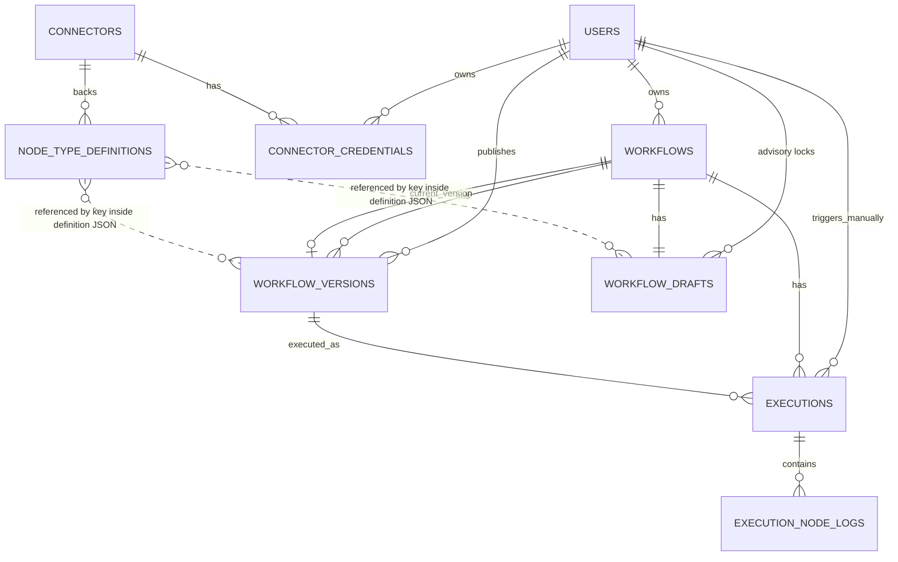

# FlowPilot – Database Schema Design Document

**DBMS:** PostgreSQL 15+
**ORM:** Prisma
**Phạm vi:** Các module thuộc "Phạm vi dự án" hiện tại (Designer, Node Library, Connector, Execution, Monitor, Logs, Version Management). Không bao gồm bảng cho FlowPilot AI — xem mục 9 (Khả năng mở rộng).

---

## 1. Quy ước thiết kế

| Quy ước | Giá trị |
| --- | --- |
| Primary key | `UUID` (`gen_random_uuid()` / Prisma `@default(uuid())`) — tránh lộ thứ tự tạo record, dễ merge dữ liệu khi tách microservice sau này |
| Naming | Bảng: `snake_case`, số nhiều (`workflows`, `execution_node_logs`) |
| Timestamp | `created_at`, `updated_at` dùng `TIMESTAMPTZ`, luôn lưu UTC |
| Soft-delete | Không áp dụng ở giai đoạn này — dùng cột `status`/`is_active` để ẩn thay vì xoá, trừ bảng log (xem mục 8) |
| JSON | Dùng kiểu `JSONB` (PostgreSQL) cho các trường cấu trúc động (workflow graph, JSON schema, input/output node) — có index GIN khi cần truy vấn sâu |
| Encryption | Dữ liệu nhạy cảm (`connector_credentials.encrypted_secret`) mã hoá ở tầng ứng dụng (AES-256-GCM) trước khi ghi xuống DB — DB không giữ khoá giải mã |

Sơ đồ được nhóm theo **bounded context**, khớp với NFR-01 (modular monolith): mỗi nhóm bảng tương ứng 1 module trong kiến trúc, để khi tách microservice chỉ cần tách theo ranh giới này.

---

## 2. Sơ đồ quan hệ tổng quan (ERD)



*Lưu ý:* `NODE_TYPE_DEFINITIONS` không có foreign key vật lý tới các node instance trong `workflow_versions.definition` — instance nằm trong JSON, tham chiếu tới catalog qua trường `key` (xem mục 8 để hiểu lý do).

---

## 3. Identity — bảng dùng chung

### `users`

| Cột | Kiểu | Ràng buộc | Mô tả |
| --- | --- | --- | --- |
| id | UUID | PK | |
| email | VARCHAR(255) | UNIQUE, NOT NULL | |
| password_hash | VARCHAR(255) | NOT NULL | bcrypt/argon2 |
| name | VARCHAR(255) | NOT NULL | |
| role | ENUM(`ADMIN`, `DEVELOPER`, `BUSINESS_USER`) | NOT NULL, DEFAULT `DEVELOPER` | 2.2 — Developer & Business User dùng chung quyền ở MVP, Admin quản trị hệ thống/connector/phân quyền |
| is_active | BOOLEAN | DEFAULT true | khoá tài khoản mà không xoá |
| created_at | TIMESTAMPTZ | DEFAULT now() | |
| updated_at | TIMESTAMPTZ | auto | |

**Index:** `UNIQUE(email)` (đã có do constraint).

---

## 4. Designer Module — FR-WD-*

### `workflows`

| Cột | Kiểu | Ràng buộc | Mô tả |
| --- | --- | --- | --- |
| id | UUID | PK | |
| name | VARCHAR(255) | NOT NULL | FR-WD-01 |
| description | TEXT | NULL | |
| status | ENUM(`DRAFT`, `PUBLISHED`, `ARCHIVED`) | DEFAULT `DRAFT` | |
| owner_id | UUID | FK → users.id, NOT NULL | |
| current_version_id | UUID | FK → workflow_versions.id, NULL, UNIQUE | version đang publish/thực thi được (FR-WD-07); null nếu chưa publish lần nào |
| created_at | TIMESTAMPTZ | DEFAULT now() | |
| updated_at | TIMESTAMPTZ | auto | |

**Index:** `(owner_id)`, `(status)` — lọc danh sách workflow theo chủ sở hữu/trạng thái.

### `workflow_drafts`

Bảng chứa trạng thái đang chỉnh sửa hiện tại của workflow. Mỗi workflow có đúng 1 dòng (1:1), được cập nhật liên tục (autosave) và có thể invalid.

| Cột | Kiểu | Ràng buộc | Mô tả |
| --- | --- | --- | --- |
| workflow_id | UUID | PK, FK → workflows.id, ON DELETE CASCADE | 1:1 — mỗi workflow có đúng 1 draft |
| definition | JSONB | NOT NULL, DEFAULT `{}` | graph hiện tại, được phép invalid/thiếu config |
| validation_errors | JSONB | NULL | kết quả validate lần gần nhất, hiển thị lại marker lỗi khi mở lại editor |
| locked_by_id | UUID | FK → users.id, NULL | advisory lock, không enforce ở DB |
| locked_at | TIMESTAMPTZ | NULL | dùng để tự hết hạn lock sau X phút không hoạt động |
| updated_at | TIMESTAMPTZ | auto | dùng làm optimistic-concurrency token |

### `workflow_versions`

Bảng chứa các phiên bản đã được publish (bất biến, không bao giờ update). Mọi row trong bảng này luôn là bản đã publish, không có trạng thái trung gian.

| Cột | Kiểu | Ràng buộc | Mô tả |
| --- | --- | --- | --- |
| id | UUID | PK | |
| workflow_id | UUID | FK → workflows.id, NOT NULL, ON DELETE CASCADE | |
| version_number | INTEGER | NOT NULL | tăng dần theo workflow |
| definition | JSONB | NOT NULL | graph tại thời điểm publish — bất biến, không update sau khi insert |
| published_at | TIMESTAMPTZ | NOT NULL, DEFAULT now() | luôn có giá trị (không NULL) — vì row chỉ tồn tại khi đã publish |
| published_by_id | UUID | FK → users.id, NOT NULL | |
| created_at | TIMESTAMPTZ | DEFAULT now() | |

**Ràng buộc:** `UNIQUE(workflow_id, version_number)` — đảm bảo không có 2 version trùng số cho cùng 1 workflow.
**Index:** `(workflow_id)`; cân nhắc GIN index trên `definition` nếu sau này cần tìm kiếm workflow theo loại node bên trong (không cần ở MVP).

### Cấu trúc JSON của trường `definition` (React Flow Graph)

Cả `workflow_drafts` và `workflow_versions` đều lưu trữ đồ thị (graph) dưới dạng JSON trong cột `definition`. Cấu trúc này bám sát định dạng của React Flow:

```json
{
  "nodes": [
    {
      "id": "string (UUID sinh tại client)",
      "type": "string (khớp với node_type_definitions.key)",
      "position": { "x": "number", "y": "number" },
      "data": {
        "name": "string (tên hiển thị do user đặt)",
        "config": {
          // Các giá trị cấu hình theo node_type_definitions.config_schema
        }
      }
    }
  ],
  "edges": [
    {
      "id": "string",
      "source": "string (node id nguồn)",
      "target": "string (node id đích)",
      "sourceHandle": "string (nếu có nhiều output)",
      "targetHandle": "string (nếu có nhiều input)"
    }
  ],
  "viewport": {
    "x": "number",
    "y": "number",
    "zoom": "number"
  }
}
```

**Ví dụ thực tế (Sample Data):**
Dưới đây là một ví dụ minh hoạ cấu trúc JSON cho một workflow đơn giản: **Chạy định kỳ (Schedule) -> Gửi thông báo tới Slack (Integration)**.

```json
{
  "nodes": [
    {
      "id": "node_1a2b3c4d",
      "type": "trigger.schedule",
      "position": { "x": 100, "y": 150 },
      "data": {
        "name": "Chạy mỗi buổi sáng",
        "config": {
          "cronExpression": "0 8 * * *",
          "timezone": "Asia/Ho_Chi_Minh"
        }
      }
    },
    {
      "id": "node_5e6f7g8h",
      "type": "integration.slack.postMessage",
      "position": { "x": 400, "y": 150 },
      "data": {
        "name": "Gửi tin nhắn chào buổi sáng",
        "config": {
          "credential_id": "cred_uuid_1234",
          "channel": "#general",
          "text": "Chào buổi sáng mọi người! Chúc một ngày làm việc hiệu quả."
        }
      }
    }
  ],
  "edges": [
    {
      "id": "edge_node1_to_node2",
      "source": "node_1a2b3c4d",
      "target": "node_5e6f7g8h"
    }
  ],
  "viewport": {
    "x": 0,
    "y": 0,
    "zoom": 1.2
  }
}
```

> **So sánh & Rollback (FR-VM-02, FR-VM-03):** Compare = diff hai giá trị `definition` JSONB ở service layer. Rollback = tạo **version mới** copy `definition` từ version cũ rồi publish — lịch sử không bao giờ bị ghi đè, đồng thời reset `workflow_drafts` về version đó.

---

## 5. Node Library Module — FR-NL-*

### `node_type_definitions`

Đây là **catalog** các loại node có sẵn trong palette (FR-NL-01..06), khác với *instance* node nằm trong `workflow_versions.definition`.

| Cột | Kiểu | Ràng buộc | Mô tả |
| --- | --- | --- | --- |
| id | UUID | PK | |
| key | VARCHAR(150) | UNIQUE, NOT NULL | vd. `trigger.schedule`, `logic.condition`, `integration.slack.postMessage` — instance JSON tham chiếu qua key này |
| display_name | VARCHAR(255) | NOT NULL | tên hiển thị trên UI |
| icon | VARCHAR(255) | NULL | icon hiển thị trên UI |
| color | VARCHAR(50) | NULL | màu sắc hiển thị trên UI |
| category | ENUM(`TRIGGER`, `LOGIC`, `DATA_PROCESSING`, `INTEGRATION`) | NOT NULL | FR-NL-01 |
| description | TEXT | NULL | hiển thị khi tìm kiếm (FR-NL-06) |
| config_schema | JSONB | NOT NULL | JSON Schema để validate tham số cấu hình node (FR-WD-05, FR-WD-06) |
| input_schema | JSONB | NULL | JSON Schema định nghĩa dữ liệu đầu vào |
| output_schema | JSONB | NULL | JSON Schema định nghĩa dữ liệu trả về |
| connector_id | UUID | FK → connectors.id, NULL | chỉ set khi `category = INTEGRATION` |
| is_active | BOOLEAN | DEFAULT true | ẩn node type khỏi palette mà không xoá lịch sử |
| created_at / updated_at | TIMESTAMPTZ | | |

**Index:** `(category)` — phục vụ hiển thị theo 4 nhóm (FR-NL-01).

---

## 6. Connector Framework Module — FR-CF-*

### `connectors`

Catalog cố định ở MVP: HTTP, Webhook, PostgreSQL, Gmail, Google Sheet, Google Drive, Slack, OpenAI.

| Cột | Kiểu | Ràng buộc | Mô tả |
| --- | --- | --- | --- |
| id | UUID | PK | |
| key | VARCHAR(100) | UNIQUE, NOT NULL | `http`, `webhook`, `postgresql`, `gmail`, `google_sheet`, `google_drive`, `slack`, `openai` |
| name | VARCHAR(255) | NOT NULL | |
| auth_type | ENUM(`NONE`, `API_KEY`, `OAUTH2`, `BASIC`) | NOT NULL | |
| config_schema | JSONB | NOT NULL | schema cho các field cấu hình credential (FR-CF-03) |
| is_active | BOOLEAN | DEFAULT true | |
| created_at | TIMESTAMPTZ | | |

### `connector_credentials`

| Cột | Kiểu | Ràng buộc | Mô tả |
| --- | --- | --- | --- |
| id | UUID | PK | |
| connector_id | UUID | FK → connectors.id, NOT NULL | |
| owner_id | UUID | FK → users.id, NOT NULL | |
| name | VARCHAR(255) | NOT NULL | nhãn hiển thị, vd. "Gmail công ty" |
| encrypted_secret | TEXT | NOT NULL | credential đã mã hoá AES-256-GCM ở tầng ứng dụng — **không bao giờ** lưu plaintext (NFR-04) |
| last_tested_at | TIMESTAMPTZ | NULL | FR-CF-04 |
| last_test_status | ENUM(`UNTESTED`, `SUCCESS`, `FAILED`) | DEFAULT `UNTESTED` | |
| created_at / updated_at | TIMESTAMPTZ | | |

**Index:** `(connector_id, owner_id)` — tra cứu credential của 1 user cho 1 connector cụ thể.
**Bảo mật (NFR-04):** không có cột nào của bảng này được ghi ra `execution_node_logs`; secret chỉ được giải mã trong bộ nhớ tại thời điểm Execution Engine gọi connector, không log lại giá trị.

---

## 7. Execution Module — FR-EX-*, FR-EM-*

### `executions`

Đại diện cho **một lần chạy** của workflow — phục vụ cả Execution Engine lẫn Execution Monitor.

| Cột | Kiểu | Ràng buộc | Mô tả |
| --- | --- | --- | --- |
| id | UUID | PK | |
| workflow_id | UUID | FK → workflows.id, NOT NULL | |
| workflow_version_id | UUID | FK → workflow_versions.id, NOT NULL | version cụ thể được thực thi — quan trọng để tra cứu lại đúng definition đã publish tại thời điểm chạy, kể cả khi workflow đã có version mới hơn sau đó |
| trigger_type | ENUM(`SCHEDULE`, `WEBHOOK`, `MANUAL`) | NOT NULL | FR-EX-07 |
| status | ENUM(`RUNNING`, `SUCCESS`, `FAILED`, `CANCELLED`) | DEFAULT `RUNNING` | FR-EM-01 |
| triggered_by_id | UUID | FK → users.id, NULL | null với schedule/webhook |
| started_at | TIMESTAMPTZ | DEFAULT now() | |
| finished_at | TIMESTAMPTZ | NULL | |
| duration_ms | INTEGER | NULL | FR-EM-02, tính sẵn khi finish để tránh tính lại mỗi lần hiển thị |
| context | JSONB | NULL | Biến môi trường hoặc context đầu vào của execution |

**Index:** `(workflow_id, started_at DESC)` — phục vụ danh sách execution gần nhất theo workflow (FR-EM-04); `(status)` — lọc theo trạng thái.

---

## 8. Logging Module — FR-LG-*

### `execution_node_logs`

| Cột | Kiểu | Ràng buộc | Mô tả |
| --- | --- | --- | --- |
| id | UUID | PK | |
| execution_id | UUID | FK → executions.id, NOT NULL, ON DELETE CASCADE | |
| node_id | VARCHAR(100) | NOT NULL | id của node instance trong `workflow_versions.definition` — **không phải FK vật lý** vì node instance sống trong JSON |
| node_key | VARCHAR(150) | NOT NULL | copy `node_type_definitions.key` tại thời điểm chạy — denormalize để lịch sử không vỡ nếu sau này đổi/xoá node type |
| status | ENUM(`RUNNING`, `SUCCESS`, `FAILED`, `SKIPPED`, `TIMEOUT`) | DEFAULT `RUNNING` | |
| input | JSONB | NULL | FR-LG-01 |
| output | JSONB | NULL | FR-LG-01 |
| error_message | TEXT | NULL | FR-LG-04 |
| error_stack | TEXT | NULL | FR-LG-04 |
| retry_count | INTEGER | DEFAULT 0 | FR-EM-03, FR-EX-04 |
| started_at | TIMESTAMPTZ | DEFAULT now() | FR-LG-03 |
| finished_at | TIMESTAMPTZ | NULL | FR-LG-03 |
| duration_ms | INTEGER | NULL | |

**Index:** `(execution_id)`; `(execution_id, status)` — hỗ trợ tra cứu/lọc log (FR-LG-05).

**Vì sao không tách bảng riêng cho "input" và "output":** input/output là dữ liệu bất định hình theo từng loại node (payload API, hàng dữ liệu SQL, message Slack...) — chuẩn hoá thành bảng quan hệ sẽ đòi hỏi schema động không khả thi. JSONB cho phép lưu nguyên trạng mà vẫn query được (`->>`, GIN index) khi cần.

**Tăng trưởng dữ liệu (NFR-07):** đây là bảng lớn nhất và tăng nhanh nhất hệ thống. Khuyến nghị:
- **Partition theo thời gian** (`started_at`, range monthly) ngay từ đầu hoặc khi vượt vài triệu row, để query "log gần đây" không phải quét toàn bảng.
- Cân nhắc archive/xoá log cũ (vd. > 6-12 tháng) sang cold storage (S3/Blob) thay vì giữ vĩnh viễn trong PostgreSQL.
- Không đánh index tràn lan trên `input`/`output` JSONB — chỉ thêm GIN index nếu có yêu cầu tìm kiếm nội dung log cụ thể, tránh phình kích thước index.

---

## 9. Khả năng mở rộng (không tạo bảng ở giai đoạn hiện tại)

Các điểm sau **chưa cần thiết kế bảng** nhưng schema hiện tại đã chừa chỗ để mở rộng mà không phải viết lại:

- **Multi-tenant (Organization/Team):** hiện tại `workflows.owner_id` và `connector_credentials.owner_id` gắn trực tiếp vào `users`. Nếu sau này cần nhiều tổ chức dùng chung 1 instance, thêm bảng `organizations` + `organization_members`, và đổi owner từ `user_id` sang `organization_id` (hoặc thêm cột song song) — không ảnh hưởng các bảng khác.
- **Tách Execution Module thành microservice riêng** (đã nêu trong SRS mục 5/6): `executions` và `execution_node_logs` là ứng viên tách trước tiên do tải nặng nhất. Vì hai bảng này chỉ tham chiếu `workflow_id`/`workflow_version_id` (không có FK ngược từ Designer sang Execution), có thể tách sang database riêng và giao tiếp qua event (Kafka) mà không cần đổi cấu trúc bảng, chỉ đổi FK thành "reference id" thay vì constraint vật lý.
- **FlowPilot AI ("Phase Sau"):** khi triển khai, dự kiến thêm các bảng độc lập không đụng tới schema hiện tại, vd. `ai_generation_requests` (prompt, generated definition, accepted/rejected), `ai_review_findings` (workflow_version_id, node_id, severity, message) — tách riêng vì đây là tính năng bổ trợ, không bắt buộc để hệ thống vận hành (đúng tinh thần PRD mục 1.1).
- **Webhook trigger:** nếu cần định danh public URL cho từng webhook node, có thể thêm bảng `webhook_endpoints` (workflow_version_id, node_id, public_token) riêng thay vì nhét vào `node_type_definitions`.

---

## 10. Tổng hợp mapping Module ↔ Bảng

| Module (kiến trúc mục 5, SRS) | Bảng |
| --- | --- |
| Designer Module | `workflows`, `workflow_drafts`, `workflow_versions` |
| Node Library (catalog) | `node_type_definitions` |
| Connector Module | `connectors`, `connector_credentials` |
| Execution Module | `executions` |
| Monitoring Module | *(dùng chung `executions`, không cần bảng riêng — trạng thái thời gian thực đọc trực tiếp từ đây)* |
| Logging Module | `execution_node_logs` |
| Versioning Module | *(dùng chung `workflow_versions`, không cần bảng riêng)* |

Mapping 1-1 này giúp việc tách module thành microservice sau này (NFR-01) rõ ràng: mỗi service sở hữu đúng nhóm bảng của mình, không có bảng nào bị 2 module cùng ghi trực tiếp.