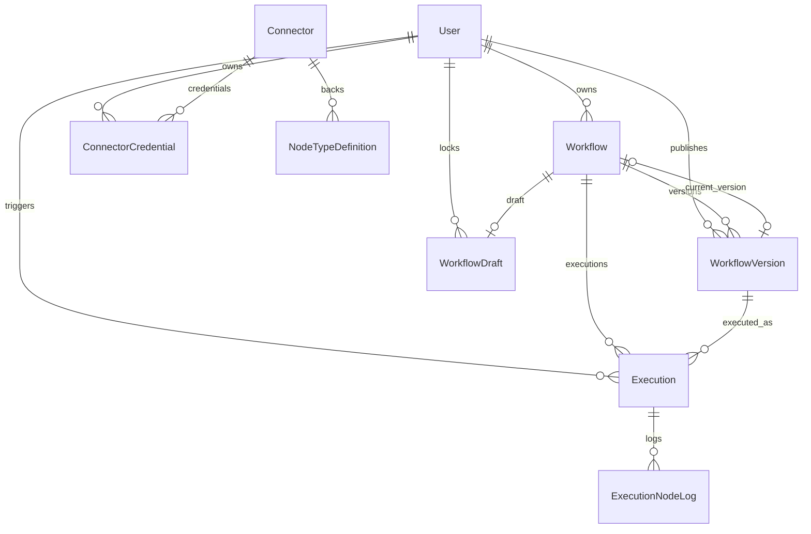

# Database Schema

This document describes the database models currently defined by Prisma. It replaces the earlier conceptual design, which included fields, enum values, and examples that no longer match the application.

## Source of truth

- Prisma models and enums: [`monolith-backend/prisma/schema.prisma`](../../monolith-backend/prisma/schema.prisma)
- Database migration history: [`monolith-backend/prisma/migrations`](../../monolith-backend/prisma/migrations/)
- Seeded MVP node and connector schemas: [`monolith-backend/prisma/mvp-node-schemas.ts`](../../monolith-backend/prisma/mvp-node-schemas.ts) and [`monolith-backend/prisma/seed-mvp.ts`](../../monolith-backend/prisma/seed-mvp.ts)
- Example workflow definition: [`definition-saved-draft.json`](../../definition-saved-draft.json)
- JSON Schema conventions for connector and node configuration: [`rule-for-config-schema.md`](rule-for-config-schema.md)

Update this document when the Prisma schema or persisted definition format changes. The Prisma schema describes database types and relations; the application is responsible for validating JSON values and enforcing workflow behavior.

## Database conventions

- Database: PostgreSQL, accessed through Prisma.
- Model names are singular PascalCase; mapped table names are plural `snake_case`.
- IDs are UUID strings generated by Prisma with `@default(uuid())`.
- Created and updated timestamps use PostgreSQL `Timestamptz`. `updatedAt` is maintained by Prisma's `@updatedAt` behavior.
- Flexible data is stored in Prisma `Json` fields, represented by PostgreSQL JSON/JSONB according to the provider. The database does not validate those values against the application JSON Schemas.
- Enum values are case-sensitive and are listed below.

## Entity relationships



A node instance inside a workflow definition is JSON, not a row with a foreign key to `NodeTypeDefinition`. Its `data.key` identifies the catalog node type. `ExecutionNodeLog.nodeId` and `nodeKey` are stored as values, not relations.

## Models

### Identity

**`User` → `users`**

| Field | Database mapping / constraint | Notes |
| --- | --- | --- |
| `id` | UUID, primary key | Generated UUID |
| `email` | `VarChar(255)`, unique | |
| `passwordHash` | `password_hash`, `VarChar(255)` | |
| `name` | `VarChar(255)` | |
| `role` | `UserRole`, default `DEVELOPER` | |
| `isActive` | `is_active`, default `true` | |
| `createdAt`, `updatedAt` | `created_at`, `updated_at`, `Timestamptz` | `updatedAt` uses Prisma `@updatedAt` |

Relations: owns workflows and credentials; may publish versions, lock drafts, and trigger executions.

### Workflow design and versions

**`Workflow` → `workflows`**

| Field | Database mapping / constraint | Notes |
| --- | --- | --- |
| `id` | UUID, primary key | |
| `name` | `VarChar(255)` | |
| `description` | nullable text | |
| `status` | `WorkflowStatus`, default `DRAFT` | |
| `ownerId` | `owner_id`, UUID, required relation to `User` | |
| `currentVersionId` | `current_version_id`, nullable UUID, unique | Optional relation to the current `WorkflowVersion` |
| `createdAt`, `updatedAt` | timestamps | |

Indexes: `ownerId`, `status`. A workflow has an optional draft, many versions, and many executions.

**`WorkflowDraft` → `workflow_drafts`**

One row per workflow when a draft exists. `workflowId` is both the primary key and a relation to `Workflow`; deleting the workflow cascades to its draft.

| Field | Database mapping / constraint | Notes |
| --- | --- | --- |
| `workflowId` | `workflow_id`, UUID, primary key and required relation | |
| `definition` | JSON, default `{}` | Current editable graph; may be incomplete or invalid |
| `validationErrors` | `validation_errors`, nullable JSON | Most recent validation result |
| `lockedById` | `locked_by_id`, nullable UUID relation to `User` | Advisory editor-lock information |
| `lockedAt` | `locked_at`, nullable timestamp | |
| `updatedAt` | `updated_at`, timestamp | Updated by Prisma; used as an optimistic concurrency token |

**`WorkflowVersion` → `workflow_versions`**

| Field | Database mapping / constraint | Notes |
| --- | --- | --- |
| `id` | UUID, primary key | |
| `workflowId` | `workflow_id`, UUID, required relation to `Workflow` | Deleting the workflow cascades to its versions |
| `versionNumber` | `version_number`, integer | Unique per workflow together with `workflowId` |
| `definition` | required JSON | Definition captured for this version |
| `publishedAt` | `published_at`, timestamp, default now | Non-null in the model |
| `publishedById` | `published_by_id`, UUID, required relation to `User` | |
| `createdAt` | `created_at`, timestamp, default now | |

Indexes/constraints: unique `(workflowId, versionNumber)` and index on `workflowId`. A version row has no draft/published status field; publishing and immutability are application-level behavior.

### Node and connector catalog

**`NodeTypeDefinition` → `node_type_definitions`**

| Field | Database mapping / constraint | Notes |
| --- | --- | --- |
| `id` | UUID, primary key | |
| `key` | `VarChar(150)`, unique | Stable node type key, for example `ai.llm.generate` |
| `displayName` | `display_name`, `VarChar(255)` | |
| `icon`, `color` | nullable strings | Presentation metadata |
| `category` | `NodeCategory` | Includes `AI` |
| `description` | nullable text | |
| `configSchema` | `config_schema`, required JSON | Configuration form and validation metadata |
| `inputSchema`, `outputSchema` | nullable JSON | Data contract metadata |
| `connectorId` | `connector_id`, nullable UUID relation to `Connector` | Not required by a database constraint for a particular category |
| `isActive` | `is_active`, default `true` | |
| `createdAt`, `updatedAt` | timestamps | |

Index: `category`.

**`Connector` → `connectors`**

| Field | Database mapping / constraint | Notes |
| --- | --- | --- |
| `id` | UUID, primary key | |
| `key` | `VarChar(100)`, unique | Connector identifier, e.g. `google`, `openai`, `gemini` |
| `name` | `VarChar(255)` | |
| `authType` | `auth_type`, `ConnectorAuthType` | |
| `configSchema` | `config_schema`, required JSON | Connector credential/configuration metadata |
| `isActive` | `is_active`, default `true` | |
| `createdAt` | `created_at`, timestamp, default now | |

A connector may back node types and have credentials. The connector catalog is seeded in `seed-mvp.ts`; it is not limited to the old list of provider-specific connectors in the previous guide.

**`ConnectorCredential` → `connector_credentials`**

| Field | Database mapping / constraint | Notes |
| --- | --- | --- |
| `id` | UUID, primary key | |
| `connectorId` | `connector_id`, UUID, required relation to `Connector` | |
| `ownerId` | `owner_id`, UUID, required relation to `User` | |
| `name` | `VarChar(255)` | User-facing label |
| `encryptedSecret` | `encrypted_secret`, required string | Secret is intended to be encrypted by the application before persistence |
| `lastTestedAt` | `last_tested_at`, nullable timestamp | |
| `lastTestStatus` | `last_test_status`, `ConnectorTestStatus`, default `UNTESTED` | |
| `createdAt`, `updatedAt` | timestamps | |

Index: `(connectorId, ownerId)`. Encryption and preventing secrets from entering logs are application responsibilities, not database constraints.

### Execution and logs

**`Execution` → `executions`**

| Field | Database mapping / constraint | Notes |
| --- | --- | --- |
| `id` | UUID, primary key | |
| `workflowId` | `workflow_id`, UUID, required relation to `Workflow` | |
| `workflowVersionId` | `workflow_version_id`, UUID, required relation to `WorkflowVersion` | Version used for this run |
| `triggerType` | `trigger_type`, `TriggerType` | |
| `status` | `ExecutionStatus`, default `RUNNING` | |
| `triggeredById` | `triggered_by_id`, nullable UUID relation to `User` | Null for non-user triggers |
| `startedAt`, `finishedAt` | `started_at`, `finished_at`, timestamps | `finishedAt` nullable |
| `durationMs` | `duration_ms`, nullable integer | |
| `context` | nullable JSON | Run input/context |

Indexes: `(workflowId, startedAt DESC)` and `status`.

**`ExecutionNodeLog` → `execution_node_logs`**

| Field | Database mapping / constraint | Notes |
| --- | --- | --- |
| `id` | UUID, primary key | |
| `executionId` | `execution_id`, UUID, required relation to `Execution` | Deleting the execution cascades to its logs |
| `nodeId` | `node_id`, `VarChar(100)` | Node instance ID from the definition JSON; not a foreign key |
| `nodeKey` | `node_key`, `VarChar(150)` | Catalog key recorded for the run; not a foreign key |
| `status` | `NodeExecutionStatus`, default `RUNNING` | |
| `input`, `output` | nullable JSON | Node input and output data |
| `errorMessage`, `errorStack` | `error_message`, `error_stack`, nullable strings | |
| `retryCount` | `retry_count`, integer, default `0` | |
| `startedAt`, `finishedAt` | `started_at`, `finished_at`, timestamps | `finishedAt` nullable |
| `durationMs` | `duration_ms`, nullable integer | |

Indexes: `executionId` and `(executionId, status)`. The schema does not define partitioning or log-retention behavior.

## Enums

| Enum | Values |
| --- | --- |
| `UserRole` | `ADMIN`, `DEVELOPER`, `BUSINESS_USER` |
| `WorkflowStatus` | `DRAFT`, `PUBLISHED`, `ARCHIVED` |
| `NodeCategory` | `TRIGGER`, `LOGIC`, `DATA_PROCESSING`, `INTEGRATION`, `AI` |
| `ConnectorAuthType` | `NONE`, `API_KEY`, `OAUTH2`, `BASIC` |
| `ConnectorTestStatus` | `UNTESTED`, `SUCCESS`, `FAILED` |
| `TriggerType` | `SCHEDULE`, `WEBHOOK`, `MANUAL` |
| `ExecutionStatus` | `RUNNING`, `SUCCESS`, `FAILED`, `CANCELLED` |
| `NodeExecutionStatus` | `RUNNING`, `SUCCESS`, `FAILED`, `SKIPPED`, `TIMEOUT` |

## Workflow definition JSON

`WorkflowDraft.definition` and `WorkflowVersion.definition` are JSON values. The database does not impose a graph shape. The current saved draft demonstrates a React Flow graph with `nodes`, `edges`, and `viewport`:

```json
{
  "nodes": [
    {
      "id": "triggerNode-1",
      "type": "triggerNode",
      "position": { "x": 0, "y": 0 },
      "data": { "key": "trigger.manual", "name": "Manual Trigger", "config": {} }
    },
    {
      "id": "actionNode-1792220527195",
      "type": "actionNode",
      "position": { "x": 321.34, "y": 118.03 },
      "data": {
        "key": "ai.llm.generate",
        "name": "LLM",
        "config": {
          "provider": "gemini",
          "model": "gemini-3.5-flash-lite",
          "credential_id": "9318a77f-2cb0-431f-966c-f06d7e36dcaa",
          "prompt": "Summarize the input: {{$json.items}}"
        }
      }
    }
  ],
  "edges": [
    {
      "id": "xy-edge__trigger-action",
      "source": "triggerNode-1",
      "target": "actionNode-1792220527195",
      "sourceHandle": "right-source",
      "targetHandle": "left-target"
    }
  ],
  "viewport": { "x": 0, "y": 0, "zoom": 1 }
}
```

The sample is shortened for readability. Actual definitions may also include React Flow UI state such as node `selected`, `dragging`, `measured`, and edge `selected` fields.

Important distinctions:

- `node.type` identifies the React Flow renderer (for example, `actionNode` or `triggerNode`).
- `node.data.key` identifies the catalog type (for example, `integration.gmail.send` or `ai.llm.generate`).
- `node.data.name` is the displayed instance name; `node.data.config` contains values described by that catalog entry's `configSchema`.
- Edge endpoints (`source`, `target`) refer to node instance IDs. Handle IDs are optional and depend on the canvas connection.
- The catalog key, config shape, and expression hints are application-level contracts; they are not foreign keys or JSON constraints in PostgreSQL.

For supported JSON Schema extensions such as `x-propertyOrder`, `x-refType`, `x-connectorKey`, `x-connectorKeyFrom`, `x-allowExpression`, `x-secret`, and `x-dynamicSource`, see [`rule-for-config-schema.md`](rule-for-config-schema.md). That document describes their intended semantics; consult the implementation before assuming a particular runtime path enforces every rule.

## Migration and maintenance notes

The checked-in migrations include the initial schema, subsequent schema extensions, and a migration adding `AI` to `NodeCategory`. For database changes, update the Prisma model and create/apply a migration using the backend's established workflow; do not edit an already-applied migration to represent a new schema change.
