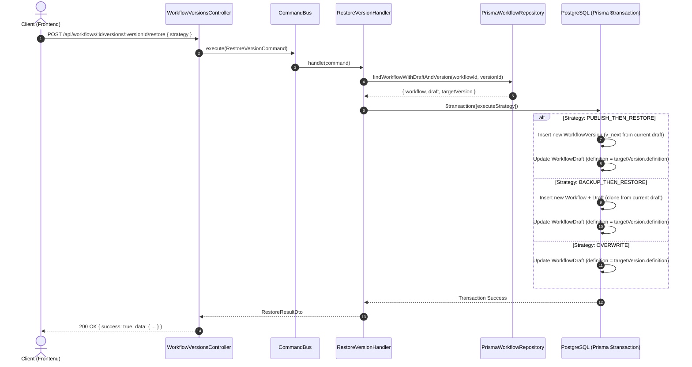

# Technical Design: Workflow Version Restore

## 1. Kiến trúc tổng thể (Architecture Overview)

Hệ thống tuân thủ **Modular Monolith** kết hợp **Clean Architecture** và **CQRS** ở Backend (NestJS), cùng kiến trúc **Feature-Based** ở Frontend (React 19, shadcn/ui, TanStack Query, Zustand).

Tính năng khôi phục phiên bản thuộc bounded context:
- Backend: `libs/modules/designer` (quản lý workflow, draft, versions)
- Frontend: `src/features/workflow` (canvas, history, dialogs)

---

## 2. Thiết kế Backend (NestJS + CQRS + Prisma)



### 2.1. Domain Layer
- **Entities:**
  - `Workflow`: Entity gốc chứa thông tin metadata, owner, `currentVersionId`.
  - `WorkflowDraft`: Entity chứa bản nháp đang chỉnh sửa (`definition`, `updatedAt`).
  - `WorkflowVersion`: Value object/Entity snapshot bất biến (`versionNumber`, `definition`, `publishedAt`).
- **Domain Services / Policies:**
  - `VersionRestorePolicy`: Kiểm tra tính hợp lệ của phiên bản cần khôi phục (phải thuộc cùng workflow, không thể khôi phục phiên bản của workflow khác).

### 2.2. Application Layer (CQRS)
- **Command:** `RestoreVersionCommand`
  ```typescript
  export class RestoreVersionCommand {
    constructor(
      public readonly workflowId: string,
      public readonly versionId: string,
      public readonly userId: string,
      public readonly strategy: RestoreStrategy,
      public readonly backupWorkflowName?: string,
      public readonly publishComment?: string,
    ) {}
  }
  ```
- **Handler:** `RestoreVersionHandler`
  - Điều phối quy trình nghiệp vụ:
    1. Kiểm tra quyền sở hữu / quyền chỉnh sửa của user.
    2. Lấy dữ liệu workflow, draft hiện tại và target version.
    3. Kiểm tra logic theo strategy đã chọn.
    4. Bọc toàn bộ các thao tác ghi DB vào `prisma.$transaction`.
    5. Trả về kết quả sau khi khôi phục thành công.

### 2.3. Infrastructure Layer
- **Prisma Repositories:**
  - `PrismaWorkflowRepository`: Bổ sung method thực thi transaction khôi phục:
    ```typescript
    restoreVersion(params: {
      workflowId: string;
      targetVersion: WorkflowVersion;
      strategy: RestoreStrategy;
      userId: string;
      backupName?: string;
    }): Promise<RestoreResult>;
    ```
- Sử dụng Prisma transaction:
  ```typescript
  await this.prisma.$transaction(async (tx) => {
    if (strategy === RestoreStrategy.PUBLISH_THEN_RESTORE) {
      // 1. Tính toán next version number
      const maxVersion = await tx.workflowVersion.aggregate({
        where: { workflowId },
        _max: { versionNumber: true },
      });
      const nextVersionNumber = (maxVersion._max.versionNumber ?? 0) + 1;

      // 2. Tạo snapshot version mới từ draft hiện tại
      await tx.workflowVersion.create({
        data: {
          workflowId,
          versionNumber: nextVersionNumber,
          definition: currentDraft.definition,
          publishedById: userId,
        },
      });
    }

    if (strategy === RestoreStrategy.BACKUP_THEN_RESTORE) {
      // Tạo workflow backup mới
      const backup = await tx.workflow.create({
        data: {
          name: backupName || `[Backup] ${workflow.name} - ${new Date().toISOString()}`,
          ownerId: userId,
          status: 'DRAFT',
          draft: {
            create: {
              definition: currentDraft.definition,
            },
          },
        },
      });
    }

    // Luôn cập nhật lại bản nháp bằng targetVersion.definition
    return await tx.workflowDraft.update({
      where: { workflowId },
      data: {
        definition: targetVersion.definition,
        updatedAt: new Date(),
      },
    });
  });
  ```

### 2.4. Presentation Layer
- **Controller:** `WorkflowVersionsController`
  - Endpoint: `POST /api/workflows/:id/versions/:versionId/restore`
  - Endpoint: `GET /api/workflows/:id/draft/status`
- **DTOs:**
  - `RestoreVersionDto`: Validate bằng `class-validator`:
    - `strategy`: `@IsEnum(RestoreStrategy)`
    - `backupWorkflowName`: `@IsOptional() @IsString()`
    - `publishComment`: `@IsOptional() @IsString()`

---

## 3. Thiết kế Frontend (React 19 + shadcn/ui)

### 3.1. Cấu trúc thư mục (Feature-Based)
```text
frontend/src/features/workflow/
├── api/
│   ├── workflow-version.api.ts       # Gọi endpoint restore & version history
│   └── workflow-draft.api.ts         # Gọi endpoint draft status
├── components/
│   ├── VersionHistorySheet.tsx       # Sheet danh sách phiên bản (shadcn/ui)
│   ├── VersionItem.tsx               # Hiển thị từng phiên bản và nút 'Restore'
│   └── RestoreConflictDialog.tsx     # Modal cảnh báo chọn strategy (shadcn/ui)
├── hooks/
│   ├── useRestoreVersion.ts          # Mutation hook (TanStack React Query)
│   └── useDraftStatus.ts             # Query hook kiểm tra unpublished changes
└── store/
    └── designer.store.ts             # Đồng bộ state React Flow canvas
```

### 3.2. Quản lý trạng thái (State Management)
1. **Kiểm tra trạng thái Draft:**
   - Khi người dùng click nút "Restore" trên một version cũ:
   - Hook `useDraftStatus` kiểm tra cờ `hasUnpublishedChanges` (so sánh dirty state từ Zustand store hoặc gọi API `GET /api/workflows/:id/draft/status`).
   - Nếu `hasUnpublishedChanges === false`: Gọi ngay mutation `restoreVersion` với strategy `OVERWRITE` (trải nghiệm liền mạch, không làm phiền người dùng).
   - Nếu `hasUnpublishedChanges === true`: Mở `RestoreConflictDialog`.

2. **Cập nhật sau khi Restore thành công:**
   - TanStack React Query invalidates:
     - `['workflows', workflowId, 'draft']`
     - `['workflows', workflowId, 'versions']`
   - Zustand Store cập nhật lại `nodes`, `edges`, `viewport` trên canvas từ `response.data.definition`.
   - Hiển thị Toast thông báo thành công via `sonner` hoặc shadcn `toast`.
