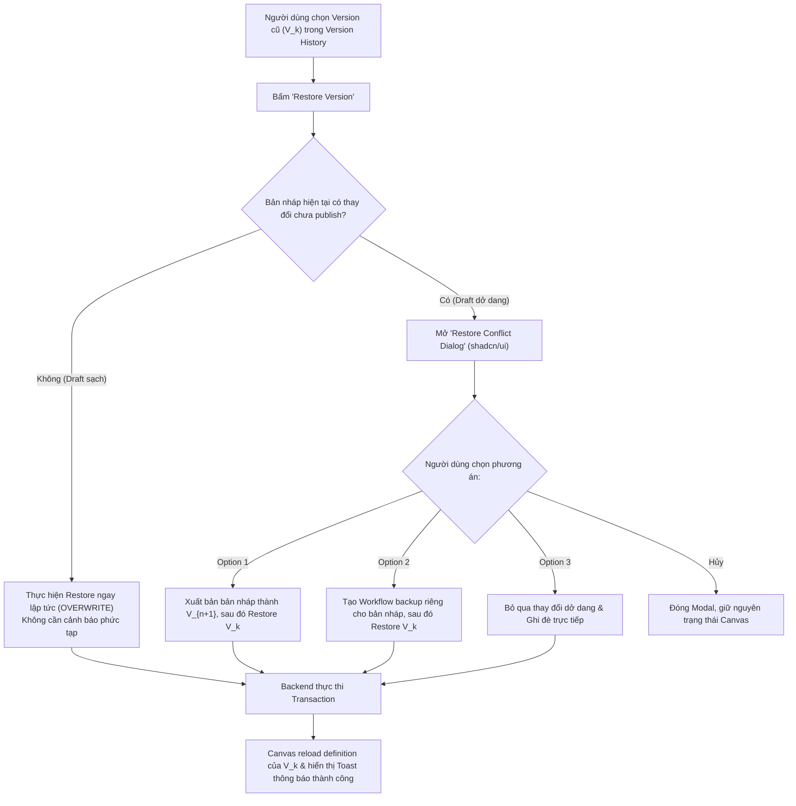

# Feature Specification: Workflow Version Restore (Khôi phục phiên bản)

## 1. Bối cảnh & Vấn đề (Context & Problem Statement)

Trong FlowPilot:
- Mỗi `Workflow` có chính xác **1 bản nháp** (`workflow_drafts`) dùng cho việc chỉnh sửa trực quan trên React Flow canvas và tự động lưu (autosave).
- Mỗi khi người dùng xuất bản (publish), một snapshot bất biến mới được tạo ra trong `workflow_versions` ($V_1, V_2, \dots, V_n$).
- **Vấn đề phát sinh:** Khi người dùng đang chỉnh sửa dở dang trên canvas (tức `workflow_draft` chứa các thay đổi chưa được publish) và muốn **"Khôi phục" (Restore)** một phiên bản cũ trong lịch sử ($V_k$):
  - Thao tác nạp definition của $V_k$ vào `workflow_draft` sẽ **ghi đè và làm mất vĩnh viễn** toàn bộ công sức chưa xuất bản nếu không có cơ chế bảo vệ.
- **Giải pháp thống nhất:** Áp dụng **Phương án A cải tiến (Zero-Data-Loss Smart Restore)** — Cung cấp giao diện cảnh báo thông minh với 3 lựa chọn linh hoạt, đảm bảo an toàn dữ liệu 100% và tôn trọng quyền tự quyết của người dùng.

---

---

## 2. Hiện trạng hệ thống & Phân tích khoảng trống (Current State & Gap Analysis)

Để triển khai tính năng khôi phục phiên bản, đối chiếu trực tiếp mã nguồn hiện tại của dự án cho thấy:

### 2.1. Cơ sở dữ liệu (Database Schema / Prisma)
- **Đã có sẵn (100%):**
  - Bảng `workflows`: Đã có `id`, `name`, `status`, `ownerId`, `currentVersionId`, quan hệ 1:1 với `workflow_drafts`, 1:N với `workflow_versions`.
  - Bảng `workflow_drafts`: Đã có `workflowId`, `definition` (JSON React Flow), `updatedAt`, `validationErrors`.
  - Bảng `workflow_versions`: Đã có `id`, `workflowId`, `versionNumber`, `definition` (bất biến), `publishedAt`, `publishedById`, ràng buộc `@@unique([workflowId, versionNumber])`.
- **Thiếu:**
  - Không thiếu gì ở tầng database. **Không cần migration cơ sở dữ liệu mới.**

### 2.2. Phía Backend (`monolith-backend/libs/designer`)
- **Đã có sẵn:**
  - Module `designer` theo chuẩn Clean Architecture & CQRS.
  - `POST /api/workflows`: Tạo workflow mới.
  - `POST /api/workflows/:id/versions`: Xuất bản draft thành phiên bản mới (`PublishWorkflowCommand`).
  - `GET /api/workflows/:id/draft`: Lấy dữ liệu bản nháp hiện tại.
  - `PUT /api/workflows/:id/draft`: Lưu bản nháp (`SaveDraftCommand`).
- **Đang thiếu (Cần làm mới):**
  - ❌ `POST /api/workflows/:id/versions/:versionId/restore`: Endpoint thực hiện khôi phục phiên bản theo chiến lược (`strategy`).
  - ❌ `RestoreVersionCommand` & `RestoreVersionHandler`: Xử lý nghiệp vụ điều phối và bảo vệ toàn vẹn dữ liệu.
  - ❌ `PrismaWorkflowRepository.restoreVersion()`: Logic transaction (`prisma.$transaction`) để nạp snapshot version vào draft và tạo version mới hoặc workflow backup nếu chọn chiến lược tương ứng.
  - ❌ `GET /api/workflows/:id/draft/status`: Endpoint kiểm tra xem bản nháp hiện tại có khác với phiên bản đã xuất bản gần nhất hay không (`hasUnpublishedChanges`).
  - ❌ `GET /api/workflows/:id/versions` & `GET /api/workflows/:id/versions/:versionId`: API danh sách và chi tiết các phiên bản (đang nằm trong đặc tả task 4.4, chưa viết mã).

### 2.3. Phía Frontend (`frontend/src`)
- **Đã có sẵn:**
  - `DesignerPage.tsx`: Màn hình thiết kế canvas (`Canvas.tsx`, `Sidebar.tsx`, `PropertiesPanel.tsx`).
  - `workflow.api.ts` & `workflow.service.ts`: Gọi API tạo workflow, lưu draft, publish.
  - `designer.store.ts` (Zustand): Quản lý state của các node, edge và catalog.
  - Thư viện UI: Đã cài đặt Tailwind CSS v4, `components.json` của shadcn/ui.
- **Đang thiếu (Cần làm mới):**
  - ❌ Thư viện `@tanstack/react-query`: Chưa được cài đặt trực tiếp trong `dependencies` của `package.json` và chưa bọc `QueryClientProvider` trong `App.tsx`.
  - ❌ Định tuyến `react-router-dom`: Hiện tại `App.tsx` chỉ dùng state cục bộ `useState(workflowId)` để chuyển trang, chưa có route `/workflows/:id/versions`.
  - ❌ Các component `shadcn/ui` cần thiết: Thư mục `frontend/src/components/ui/` hiện **mới chỉ có `button.tsx`**. Cần cài đặt bổ sung:
    - `dialog` (cho modal cảnh báo xung đột khôi phục)
    - `radio-group` (cho việc chọn 1 trong 3 chiến lược khôi phục)
    - `alert` (cho banner cảnh báo mất dữ liệu)
    - `badge` (cho hiển thị số hiệu phiên bản v1, v2)
    - `sonner` hoặc `toast` (cho thông báo phản hồi thao tác)
  - ❌ Component giao diện:
    - `RestoreConflictDialog.tsx`: Dialog cảnh báo 3 lựa chọn (Xuất bản trước / Tạo backup / Ghi đè).
    - Nút bấm **"Restore"** tích hợp vào danh sách phiên bản (trên thanh công cụ Designer hoặc trang Version History).
  - ❌ React Query Hooks & API:
    - `useRestoreVersion.ts` (mutation hook tự động cập nhật canvas và cache).
    - `useDraftStatus.ts` (query hook kiểm tra dirty state).
    - API client method `restoreVersion()` trong `workflow-version.api.ts`.

### 2.4. Mối liên hệ với Task 4.4 (Execution Run UI)
- Task 4.4 tập trung vào việc tạo trang danh sách versions và nút **"Run"** để thực thi phiên bản.
- Tính năng Restore Version này là mảnh ghép bổ sung hoàn hảo: tận dụng chung API `GET /api/workflows/:id/versions` của 4.4 và gắn thêm nút **"Restore"** bên cạnh nút **"Run"** trên giao diện quản lý phiên bản.

---

## 3. Phạm vi (Scope)

### Trong phạm vi (In-Scope)
- **API Khôi phục phiên bản:** `POST /api/workflows/:id/versions/:versionId/restore` hỗ trợ 3 chiến lược giải quyết xung đột bản nháp:
  1. `PUBLISH_THEN_RESTORE`: Xuất bản bản nháp hiện tại thành phiên bản mới ($V_{n+1}$) trước, sau đó mới nạp $V_k$ vào bản nháp.
  2. `BACKUP_THEN_RESTORE`: Tạo một workflow mới để lưu giữ bản nháp hiện tại, sau đó nạp $V_k$ vào bản nháp của workflow gốc.
  3. `OVERWRITE`: Hủy bỏ các thay đổi chưa xuất bản và ghi đè trực tiếp $V_k$ vào bản nháp.
- **API Kiểm tra trạng thái bản nháp:** Phục vụ frontend xác định xem bản nháp hiện tại có khác với phiên bản đã publish gần nhất hay không.
- **Giao diện Modal cảnh báo (UI/UX):** Xây dựng bằng `shadcn/ui` (`Dialog`, `Button`, `RadioGroup`, `Alert`, `Badge`) để người dùng lựa chọn chiến lược phù hợp.
- **Cập nhật Canvas liền mạch:** Tự động reload nodes/edges trên React Flow canvas sau khi khôi phục thành công.

### Ngoài phạm vi (Out-of-Scope)
- So sánh trực quan (Visual Diff) giữa 2 phiên bản (thuộc tính năng Version Compare riêng biệt).
- Hợp nhất (Merge/Three-way merge) giữa bản nháp và phiên bản cũ.

---

## 3. Luồng trải nghiệm người dùng (UI/UX Flow)



### Chi tiết Restore Conflict Dialog (shadcn/ui)
- **Tiêu đề:** `Khôi phục phiên bản [Version Name/Number]`
- **Cảnh báo (Alert Warning):** "Bản nháp hiện tại có những thay đổi chưa được xuất bản. Vui lòng chọn cách xử lý để tránh mất dữ liệu."
- **3 Lựa chọn (Radio Card / Action Items):**
  1. **Xuất bản bản nháp trước khi khôi phục (Khuyến nghị - An toàn nhất):**
     - Lưu bản nháp dở dang thành **Phiên bản mới (v[N+1])**, sau đó nạp phiên bản [k] vào bản nháp để tiếp tục chỉnh sửa. Bạn có thể quay lại bản nháp bất cứ lúc nào qua lịch sử.
  2. **Tách bản nháp thành Workflow mới (Backup):**
     - Tạo một workflow độc lập mang tên `[Backup] Tên Workflow - Ngày/Giờ` để giữ lại ý tưởng đang làm dở, sau đó khôi phục phiên bản [k] tại workflow này.
  3. **Hủy bỏ thay đổi & Ghi đè (Discard & Overwrite):**
     - Xóa toàn bộ các thay đổi chưa xuất bản và nạp phiên bản [k]. *Lưu ý: Hành động này không thể hoàn tác.*
- **Nút bấm:**
  - `Hủy bỏ (Cancel)`: Đóng dialog, không thay đổi gì.
  - `Xác nhận khôi phục (Confirm Restore)`: Kích hoạt gọi API kèm strategy đã chọn.

---

## 4. Đặc tả API (API Specification)

### 4.1. Khôi phục phiên bản cũ
- **Endpoint:** `POST /api/workflows/:id/versions/:versionId/restore`
- **Mô tả:** Khôi phục định nghĩa của `versionId` vào bản nháp `workflow_drafts` của workflow `:id` theo chiến lược chỉ định.
- **Xác thực:** Bearer JWT Token.

#### Request
**Path Parameters:**
- `id` (UUID): ID của workflow.
- `versionId` (UUID): ID của phiên bản cần khôi phục.

**Headers:**
- `Content-Type: application/json`

**Body (JSON):**
```json
{
  "strategy": "PUBLISH_THEN_RESTORE",
  "backupWorkflowName": "string (tùy chọn, áp dụng khi BACKUP_THEN_RESTORE)",
  "publishComment": "string (tùy chọn, ghi chú khi xuất bản bản nháp)"
}
```

*Trong đó `strategy` là Enum:*
- `"PUBLISH_THEN_RESTORE"`
- `"BACKUP_THEN_RESTORE"`
- `"OVERWRITE"`

#### Response
**Status:** `200 OK`
```json
{
  "success": true,
  "data": {
    "workflowId": "6ba7b810-9dad-11d1-80b4-00c04fd430c8",
    "restoredFromVersionId": "7c9e6679-7425-40de-944b-e07fc1f90ae7",
    "restoredVersionNumber": 1,
    "strategyUsed": "PUBLISH_THEN_RESTORE",
    "newPublishedVersionNumber": 3,
    "backupWorkflowId": null,
    "draftUpdatedAt": "2026-10-04T02:00:00.000Z",
    "definition": {
      "nodes": [],
      "edges": [],
      "viewport": { "x": 0, "y": 0, "zoom": 1 }
    }
  },
  "message": "Phiên bản 1 đã được khôi phục thành công vào bản nháp."
}
```

#### Error Codes:
- `400 Bad Request`: `strategy` không hợp lệ hoặc thiếu dữ liệu bắt buộc.
- `401 Unauthorized`: Chưa đăng nhập.
- `403 Forbidden`: Người dùng không có quyền chỉnh sửa workflow này.
- `404 Not Found`: Không tìm thấy `Workflow` hoặc `WorkflowVersion` tương ứng.
- `409 Conflict`: Phiên bản yêu cầu khôi phục không thuộc về workflow này (`version.workflowId !== workflow.id`).

---

### 4.2. Kiểm tra trạng thái bản nháp (Draft Status)
- **Endpoint:** `GET /api/workflows/:id/draft/status`
- **Mô tả:** Giúp frontend biết bản nháp hiện tại có khác biệt so với phiên bản đang publish hay không (`hasUnpublishedChanges`).

#### Response
**Status:** `200 OK`
```json
{
  "success": true,
  "data": {
    "workflowId": "6ba7b810-9dad-11d1-80b4-00c04fd430c8",
    "hasDraft": true,
    "hasUnpublishedChanges": true,
    "currentPublishedVersion": {
      "id": "7c9e6679-7425-40de-944b-e07fc1f90ae7",
      "versionNumber": 2,
      "publishedAt": "2026-10-03T15:30:00.000Z"
    },
    "draftUpdatedAt": "2026-10-04T01:45:00.000Z"
  }
}
```

---

## 5. Quy tắc nghiệp vụ (Business Rules)

1. **Bảo vệ toàn vẹn lịch sử (Immutable History):**
   - Không bao giờ sửa đổi hoặc ghi đè các bản ghi trong `workflow_versions`.
   - Lịch sử phiên bản chỉ tăng dần (`version_number` đơn điệu tăng: 1, 2, 3...).
2. **Quy tắc khôi phục (Restore Semantics):**
   - Khôi phục là thao tác đưa dữ liệu phiên bản cũ vào **Bản nháp (Draft)** để người dùng xem và tiếp tục chỉnh sửa, **KHÔNG** làm thay đổi ngay lập tức phiên bản đang thực thi (Production Version - `currentVersionId`), trừ khi người dùng chủ động chọn `PUBLISH_THEN_RESTORE` (chỉ tạo version mới cho bản nháp cũ, còn version đang chạy thực tế vẫn giữ nguyên hoặc theo quy định publish).
3. **Tính toán Version Number kế tiếp:**
   - Khi thực hiện `PUBLISH_THEN_RESTORE`, version mới sẽ mang số `versionNumber = MAX(existing_versions) + 1`.
4. **Tính nhất quán dữ liệu (ACID Transaction):**
   - Mọi thao tác khôi phục (tạo backup, tạo version mới, cập nhật draft) phải được thực thi trong một Database Transaction duy nhất. Nếu bất kỳ bước nào thất bại, toàn bộ thao tác được rollback về trạng thái ban đầu.
5. **Nguồn dữ liệu:**
   - Frontend không được gửi snapshot definition trong request restore. Backend phải tự truy vấn trực tiếp từ bảng `workflow_versions` thông qua `versionId` để đảm bảo dữ liệu không bị can thiệp trái phép.
