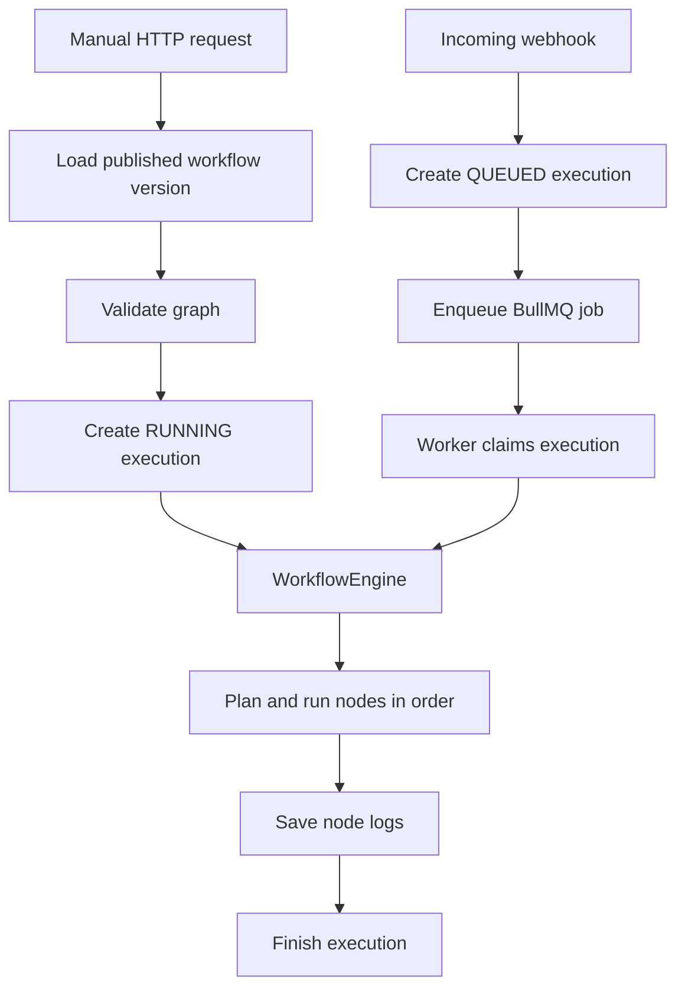

# Workflow Execution

This note describes the execution behavior implemented in `monolith-backend/libs/execution`. It covers manually started runs and webhook-triggered runs, from accepting the request through running nodes and storing the result.

## Overview

The execution subsystem has two entry paths and one shared workflow engine:

Manual runs execute in the request and return the stored result. Webhook runs return an execution ID after enqueueing; the worker runs them in the background. Both paths use `WorkflowEngine` and `NodeRunner`.

## Starting an Execution

### Manual run

`POST /api/executions` is protected by the JWT guard. The request names a workflow version, and the authenticated user becomes the actor. `StartExecutionHandler`:

1. Loads the workflow version and verifies that the actor owns its workflow.
2. Plans the graph before creating an execution. Invalid definitions are returned as a bad request, and no execution row is created.
3. Creates an execution with status `RUNNING`, trigger type `MANUAL`, and the actor ID.
4. Calls the engine with no trigger items, waits for it to finish, then returns the execution result and node logs.

The manual trigger executor, when present as the first node, emits one empty JSON item to start the flow.

### Webhook run

The webhook receiver passes each accepted event to `EnqueueExecutionHandler` as one item. The handler:

1. Loads the referenced workflow version.
2. Creates an execution with status `QUEUED`, trigger type `WEBHOOK`, no actor ID, and the trigger items in its context.
3. Enqueues a BullMQ job containing the execution ID, workflow version ID, trigger items, and queue timestamp.

If enqueueing fails, the handler marks the execution failed before rethrowing. Graph planning happens when the worker calls the engine, rather than before the queued execution row is created.

The worker atomically changes a row from `QUEUED` to `RUNNING`. If it cannot claim the row, it does not run the workflow. It then loads the workflow version and passes the job's trigger items to the same engine used by manual runs.

## Graph Planning and Scheduling

`buildGraphPlan` validates the definition and builds a parent-before-child order from its edges. Edge storage order does not have to be topological. A runnable graph must have nodes and a non-empty edge list, every edge must reference existing nodes, there must be exactly one start node among nodes connected by edges, and the connected graph must not contain a cycle. Nodes that are not involved in an edge are not included in the plan.

The engine walks the resulting order sequentially. Branches and joins are supported, but nodes are not executed concurrently. At a join, inputs are concatenated in incoming-edge storage order, with each edge's items kept in their produced order.

An edge selects an output by its `sourceHandle` when that handle begins with `out:`; otherwise it selects the main output. A target node runs if at least one incoming edge is activated:

- An output is activated when its source ran and produced that output.
- The main output activates its edge even when it contains zero items. This lets a downstream node run after a filter drops all items.
- A named output with zero items does not activate its edge. For example, an `IF` branch with no matching items is skipped.
- A node with incoming edges is logged as `SKIPPED` when none of those edges is activated.

Each processed item is represented as `{ json: ... }`. Per-item executors can route items to named outputs. The engine also tracks item pairing so expressions can refer to the corresponding item from an earlier node, including across branches and joins.

## Running a Node

The engine loads the configuration schemas for node types in the workflow, then calls `NodeRunner` for each active node. The runner:

1. Looks up the executor registered for the node's `data.key`. An unknown key fails that node.
2. Applies schema defaults to missing or null configuration values.
3. Resolves credentials for the workflow owner, if `credential_id` is set.
4. Resolves permitted expressions, parses the resulting configuration, and invokes the executor.
5. Normalizes the executor result into items and output groups, then returns a node log.

Executors declare one of two run modes:

- `once`: receives the complete input item list once and returns a list of items.
- `per_item`: is called sequentially for each input item. An object yields one item, an array yields multiple items, and `null` or an empty array drops that item. A `RoutedItem` sends the result to a named output; ordinary results go to the main output. Per-item results retain a `pairedItem` index for expression pairing.

Per-item executors may enforce a maximum item count. If the limit is exceeded, the node fails before processing items. A per-item failure stops the node at that item and records a summary containing the total item count, processed count, and failed index. A failure in any node stops the workflow; later nodes are not run.

### Expressions

Expressions use the `{{...}}` template form. Only string config fields whose node config schema sets `x-allowExpression: true` are evaluated. Supported forms include:

- `{{$json.field}}` for the current item's data.
- `{{$node["Node name"].json.field}}` for the earlier node's paired item.
- `{{$node["Node name"].all}}` for all output items from an earlier node, optionally followed by a path.
- `{{field}}` as shorthand for `{{$json.field}}`.

This is a data-access expression language, not JavaScript. An expression occupying the entire config string preserves its value type; mixed text and expressions produce a string. Node references must resolve to one uniquely named node that has already run.

### Credentials

`credential_id` is read from the raw configuration and is not expression-enabled. The repository verifies that the credential exists and belongs to the workflow owner, decrypts its secret using `ENCRYPTION_KEY`, and returns the connector key with the secret. The runner checks the connector key when the executor declares an expected connector. Credentials are passed to executor code and are not intended to be part of workflow config.

## Stored Results and Logs

Execution records store workflow and version IDs, trigger type, actor (null for webhook runs), status, timestamps, duration, and optional trigger context. Each executed or skipped node gets an `execution_node_logs` record with node identity, status, input, output, timestamps, and duration. Failed node logs also include an error message. Per-item failures store the progress summary in the log output field.

The error message is sanitized before it is saved to a failed node log. The input and output fields are persisted as supplied by the runner; they are not generally redacted by this subsystem. Avoid treating node logs as a secret-safe view of arbitrary workflow data.

When the engine finishes, it stores the final execution status and duration. A node-level failure results in `FAILED` and a returned result for a manual run. Unexpected errors, such as a persistence failure, leave the engine's default final status as `FAILED`; the error is then rethrown. The queue processor catches engine errors and logs them.

## Queue and Failure Behavior

Whole executions are not automatically replayed. BullMQ jobs use one attempt, have an execution ID as their job ID, and the worker is configured with `maxStalledCount: 0`. This is intentional because a node may already have performed an external side effect before a worker stops. A failed or stalled job marks any still-queued or running execution as `FAILED`.

This policy is separate from retries implemented inside individual node executors. For example, some package actions or LLM calls can retry their own operation. Those retries do not replay the entire workflow.

On worker startup, executions left `RUNNING` by a dead process are marked failed only for manual runs, using `EXECUTION_STALE_MINUTES` (default 15). Worker concurrency is configured by `EXECUTION_CONCURRENCY` (default 5). Invalid or non-positive values use the defaults.

## Main Implementation Files

- [Execution controller](../../monolith-backend/libs/execution/src/presentation/http/execution.controller.ts) and [manual command handler](../../monolith-backend/libs/execution/src/application/commands/start-execution/start-execution.command.ts): authenticated manual runs.
- [Webhook enqueue handler](../../monolith-backend/libs/execution/src/application/commands/enqueue-execution/enqueue-execution.command.ts) and [queue processor](../../monolith-backend/libs/execution/src/infrastructure/queue/execution.processor.ts): background runs.
- [Workflow engine](../../monolith-backend/libs/execution/src/application/services/workflow-engine.ts): graph traversal, item flow, logs, and final status.
- [Node runner](../../monolith-backend/libs/execution/src/application/services/node-runner.ts) and [executor contract](../../monolith-backend/libs/execution/src/domain/entities/node-executor.ts): configuration, credentials, expressions, and executor invocation.
- [Graph planner](../../monolith-backend/libs/execution/src/domain/entities/workflow-execution.entity.ts), [run state](../../monolith-backend/libs/execution/src/domain/entities/run-state.ts), and [item model](../../monolith-backend/libs/execution/src/domain/models/item.ts): graph rules, expression context, and item pairing.
- [Execution repository](../../monolith-backend/libs/execution/src/domain/repositories/execution.repository.ts) and [Prisma implementation](../../monolith-backend/libs/execution/src/infrastructure/persistence/prisma-execution.repository.ts): persistence and state transitions.
- [Execution module](../../monolith-backend/libs/execution/src/execution.module.ts): executor registration and dependency wiring.
