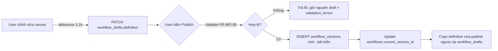

# Technical Notes — Lưu trữ Workflow trong quá trình Tạo / Chỉnh sửa / Publish

**Liên quan:** `flowpilot-database-schema.md`, bảng `workflow_versions`

---

## 1. Vấn đề cốt lõi

M��t workflow có 2 loại trạng thái bản chất khác nhau, cần được lưu trữ khác nhau:

- **"Canvas đang hiển thị gì ngay bây giờ?"** — thay đổi liên tục, có thể invalid, không cần giữ lịch sử từng lần gõ.
- **"Workflow này đã/đang chạy với logic nào tại một thời điểm cụ thể?"** — bất biến, cần giữ lại vĩnh viễn để execution, audit, rollback tra cứu đúng bản đã publish.

Gộp 2 loại này vào 1 bảng (ví dụ dùng cờ `is_draft` trên cùng 1 bảng version) sẽ gây nhập nhằng: mỗi lần autosave phải quyết định có tạo version mới không, và "version" mất ý nghĩa "một mốc đã publish" nếu nó cũng đại diện luôn cho trạng thái đang gõ dở. Giải pháp: **tách thành 2 bảng riêng ngay từ đầu.**

| | Scratch space (đang edit) | History (đã publish) |
| --- | --- | --- |
| Bảng | `workflow_drafts` | `workflow_versions` |
| Số row / workflow | 1 (luôn update) | N (append-only) |
| Có thể invalid không | Có | Không (chỉ insert khi validate pass) |
| Mục đích | Continuous editing, autosave | Audit trail, rollback, compare, execution reference |

---

## 2. Thiết kế bảng

### `workflow_drafts`

| Cột | Kiểu | Mô tả |
| --- | --- | --- |
| workflow_id | UUID | PK, FK → workflows.id (1:1 — mỗi workflow có đúng 1 draft) |
| definition | JSONB | graph hiện tại, được phép invalid/thiếu config |
| validation_errors | JSONB | kết quả validate lần gần nhất, hiển thị lại marker lỗi khi mở lại editor |
| locked_by_id | UUID | FK → users.id, NULL — advisory lock, không enforce ở DB |
| locked_at | TIMESTAMPTZ | NULL — dùng để tự hết hạn lock sau X phút không hoạt động |
| updated_at | TIMESTAMPTZ | dùng làm optimistic-concurrency token |

### `workflow_versions`

M��i row trong bảng này **luôn là bản đã publish** — không có cờ `is_draft`, không có trạng thái trung gian.

| Cột | Kiểu | Mô tả |
| --- | --- | --- |
| id | UUID | PK |
| workflow_id | UUID | FK → workflows.id |
| version_number | INTEGER | tăng dần, UNIQUE với workflow_id |
| definition | JSONB | graph tại thời điểm publish — bất biến, không bao giờ update sau khi insert |
| published_at | TIMESTAMPTZ | luôn có giá trị (không NULL) — vì row chỉ tồn tại khi đã publish |
| published_by_id | UUID | FK → users.id |
| created_at | TIMESTAMPTZ | |

---

## 3. Luồng dữ liệu

Điểm mấu chốt ở bước cuối (H): sau khi publish, `workflow_drafts` **không bị xoá** — nó được reset về đúng nội dung vừa publish, để người dùng tiếp tục chỉnh sửa từ đó mà không có khoảng trống giữa "vừa publish" và "bắt đầu sửa tiếp".

---

## 4. Autosave

- **Không** event-source từng thao tác (add node, move node, connect edge...) — không cần undo lịch sử ở server cho quy mô hệ thống này.
- Client debounce (1–2s sau khi ngừng thao tác, hoặc khi blur/click ra ngoài canvas) rồi `PATCH` **toàn bộ** `definition` JSONB lên `workflow_drafts` — rẻ vì chỉ có 1 row/workflow, không tăng version_number.
- Undo/redo trong phiên làm việc: giữ **client-side only** (command stack trong React Flow state), không cần persist từng bước xuống DB.

---

## 5. Concurrency khi chỉnh sửa

SRS đã loại real-time multi-user collaboration khỏi phạm vi → không cần OT/CRDT. Chỉ cần chống ghi đè âm thầm:

- **Optimistic concurrency:** client gửi kèm `updated_at` đã load; server so sánh, từ chối (409) nếu khác — nghĩa là có người/tab khác đã lưu sau đó.
- **Soft lock (UX, không bắt buộc):** set `locked_by_id`/`locked_at` khi mở editor, hiển thị banner "X đang chỉnh sửa workflow này" cho người khác mở cùng lúc; tự hết hạn sau N phút không hoạt động. Đây là gợi ý cho UI, không phải ràng buộc cứng ở DB.

---

## 6. Validation state

- `validation_errors` lưu trên **draft**, không chỉ tính tại thời điểm publish — nhờ vậy đóng tab giữa chừng rồi mở lại vẫn thấy marker lỗi cũ ngay, không cần chạy lại validate.
- Ràng buộc "phải hợp lệ mới được đi tiếp" (FR-WD-06/07) chỉ áp dụng ở **bước chuyển draft → version**; bản thân draft luôn được phép invalid tại bất kỳ thời điểm nào (JSONB vốn không ép schema).
- `workflow_versions` không cần cột `validation_errors` — vì mọi row trong đó, theo định nghĩa, đã pass validate lúc publish.

---

## 7. Compare & Rollback

- **Compare (FR-VM-02):** diff `definition` giữa 2 row `workflow_versions` ở service layer.
- **Rollback (FR-VM-03):** copy `definition` của version cũ → INSERT thành version **mới** → publish → đồng thời reset `workflow_drafts` theo bước 2(H) ở mục 3, để tránh tình trạng rollback xong nhưng draft vẫn giữ nội dung cũ chưa rollback.

---

## 8. Vì sao cần `workflow_versions` (không chỉ `workflows` hoặc chỉ `workflow_drafts`)

Câu hỏi gốc: mọi thứ liên quan đến workflow gắn với **một thời điểm cụ thể trong quá khứ**, không phải "hiện tại". Nếu chỉ có 1 bản ghi đại diện cho "workflow này trông như thế nào" (dù đặt ở `workflows` hay `workflow_drafts`), nó chỉ trả lời được "bây giờ ra sao" — không trả lời được "lúc execution #123 chạy, logic là gì", vì bản ghi duy nhất đó đã bị ghi đè bởi lần sửa mới nhất.

Hệ quả cụ thể nếu thiếu `workflow_versions`:

| Không có version | Có version |
| --- | --- |
| Publish = ghi đè, mất bản cũ vĩnh viễn | Publish = insert row mới, giữ mọi bản cũ |
| Execution có thể "chạy nhầm" bản mới hơn dự kiến nếu ai đó sửa workflow trước giờ trigger | Execution luôn trỏ đúng bản đã publish tại thời điểm chạy (`workflow_version_id` bất biến) |
| Không compare/rollback được (không có gì để so sánh/quay lại) | Compare/rollback = đọc lại row cũ, không cần schema riêng |

---

## 9. Trade-off: quá nhiều version có lãng phí không?

**Lo ngại:** nếu 1 workflow được publish nhiều lần, số row `workflow_versions` tăng dần trong khi hầu hết truy vấn chỉ cần đúng 1 bản (current).

**Phản biện:**

1. **Dung lượng nhỏ không đáng kể.** `definition` JSON của 1 workflow trung bình chỉ vài–vài chục KB. Kể cả 1 workflow được publish 200 lần trong vòng đời — hiếm khi xảy ra vì publish là hành động có chủ ý, tần suất thấp — tổng cộng cũng chỉ vài MB. Không đáng lo trên PostgreSQL.
2. **Tách draft ra riêng đã giải quyết phần lớn vấn đề.** Version chỉ tăng khi user bấm Publish, không tăng theo từng autosave — nên tốc độ tăng version chậm hơn nhiều so với lo ngại ban đầu.
3. **Version cũ có pattern truy cập "cold" — đó là điều tốt.** Chúng không nằm trong hot path (execution/monitor chỉ query `current_version_id`), không tốn index nặng, không ảnh hưởng hiệu năng hàng ngày. Chi phí duy nhất là byte nằm im trên đĩa — loại chi phí rẻ nhất để đổi lấy khả năng rollback/audit.
4. **Cái giá của việc không có nó lớn hơn nhiều:** mất khả năng debug production incident theo đúng logic đã chạy, mất audit trail — với client fintech, audit trail gần như là yêu cầu ngầm định chứ không phải "nice to have".

**Nếu sau này thực sự cần tối ưu (không làm ngay ở giai đoạn hiện tại):**
- **Retention policy:** cronjob archive/xoá version cũ hơn N tháng, trừ version đang được `current_version_id` trỏ tới hoặc được user "ghim" lại.
- **Cold storage offload:** move `definition` của version cũ sang S3/Blob, giữ pointer trong Postgres — chỉ hợp lý khi số lượng version lên tới hàng triệu.
- Cả hai đều là thay đổi **có thể thêm sau mà không cần đổi schema hiện tại** — không phải lý do để thiết kế khác đi từ bây giờ.

---