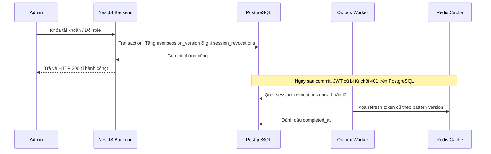

# Thiết kế: Nền tảng Quản trị, Phân quyền và Quản lý Phiên (Admin Foundation)

Status: completed (PR #39)

## 1. Ranh giới Module và Phân tầng Kiến trúc

- **Presentation**: `monolith-backend/libs/admin/src/presentation`:
  - `AdminController` được bảo vệ bởi `@UseGuards(JwtAuthGuard, RolesGuard, AdminMutationFieldsGuard)` và `@Roles(ADMIN_ROLE)`.
  - `AdminMutationFieldsGuard`: Kiểm tra field của raw request body trước khi qua Global ValidationPipe, chống việc client cố tình gửi các trường không được phép (như `actorId`).
- **Domain & Application**:
  - `libs/auth`: Chịu trách nhiệm về entity `User`, xác thực mật khẩu, phát hành JWT token mang claim `sessionVersion`, và kiểm soát logic bootstrap Admin đầu tiên.
  - `AccountAdministrationPort` và `SessionAccessPort`: Cung cấp cổng giao tiếp nội bộ cho module Admin.
- **Infrastructure & Persistence**:
  - `monolith-backend/prisma/schema.prisma`:
    - Enum `UserRole`: Chỉ gồm `CLIENT` và `ADMIN`.
    - Cột `users.session_version`: `Int @default(0) @map("session_version")`.
    - Cột `users.revision`: `Int @default(0)`.
    - Bảng `session_revocations`: Outbox pattern dọn dẹp Redis session.
    - Bảng `admin_audit_events`: Lưu vết kiểm toán.

## 2. Hợp đồng API và DTO Whitelist

### 2.1. Đăng ký Công khai (Public Register)
- `POST /api/auth/register`
- DTO: `RegisterDto` (email, password, name, verificationToken). Tuyệt đối không có trường `role`.
- Global ValidationPipe cấu hình `whitelist: true, forbidNonWhitelisted: true` sẽ lập tức ném lỗi 400 nếu có field `role`.

### 2.2. Guard & Strategy
- `JwtStrategy`: Giải mã token, trích xuất `sub` (userId) và `sessionVersion`. Truy vấn user từ DB; nếu `user.sessionVersion !== token.sessionVersion` hoặc `!user.isActive`, từ chối ngay lập tức với `401 Unauthorized`.
- `RolesGuard`: Đọc metadata `@Roles(ADMIN_ROLE)`, đối chiếu `user.role === 'ADMIN'`. Nếu sai, ném `403 Forbidden`.

## 3. Quản lý Phiên & Transaction Lock

### 3.1. Quy trình Thu hồi Token qua Outbox

### 3.2. CLI Bootstrap Admin
- File: `monolith-backend/src/scripts/admin-bootstrap.ts`.
- Thực hiện trong transaction có advisory lock:
  1. Kiểm tra xem đã có user nào mang `role = 'ADMIN'` và `isActive = true` chưa. Nếu có, hủy bỏ.
  2. Tìm user theo email. Kiểm tra `isActive = true`.
  3. Cập nhật `role = 'ADMIN'`, tăng `session_version` và `revision`.
  4. Ghi `admin_audit_events` với `actorType = 'SYSTEM'`, `action = 'ADMIN_BOOTSTRAPPED'`.

## 4. Thiết kế Giao diện Frontend

- `AdminLayout.tsx`: Header hiển thị logo FlowPilot, badge "Admin", nút "Back to workspace", avatar dropdown. Navigation tabs gồm Overview và Users.
- `AdminGuard.tsx`: Bọc các route `/admin/*`, kiểm tra `useAuthStore`:
  - Chưa đăng nhập -> Điều hướng sang `/login`.
  - Role !== 'ADMIN' -> Hiển thị màn hình 403 Access Denied.
- Xóa cache Admin: Khi người dùng logout hoặc phiên bị thu hồi, toàn bộ cache TanStack Query của module Admin bị hủy lập tức (`queryClient.clear()`).
