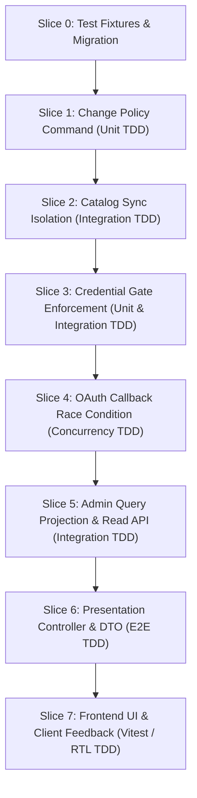

# Kế hoạch Triển khai theo TDD: Quản lý Connector và Chính sách Credential

Status: ready-for-agent (P1)

## 1. Nguyên tắc Chỉ đạo TDD & BDD

Kế hoạch này triển khai tính năng **Quản lý Connector và Chính sách Credential** theo quy trình **Test-Driven Development (TDD)** nghiêm ngặt:
1. **Vertical Slicing (Lát cắt Dọc)**: Chia nhỏ tính năng thành các lát cắt chức năng hoàn chỉnh từ domain/command đến endpoint hoặc UI, thay vì viết toàn bộ database rồi mới viết API hay UI.
2. **Red → Green → Refactor**:
   - **RED**: Luôn viết test thất bại trước. Test mô tả hành vi người dùng mong đợi qua các BDD scenarios.
   - **GREEN**: Chỉ viết lượng code tối thiểu để test chuyển sang màu xanh (PASS).
   - **REFACTOR**: Tối ưu hóa code sau khi test đã pass, đảm bảo không phá vỡ bất kỳ test nào.
3. **Kiểm thử tại Seams**: Kiểm thử thông qua public interface (Command Handlers, REST API, UI components qua Accessibility Roles), không mock internals hoặc kiểm tra private state.
4. **Vị trí Test**:
   - Backend: Tuyệt đối không để test code trong `src/`. Tất cả test nằm trong `monolith-backend/test/unit/`, `test/integration/`, `test/e2e/`, `test/support/`.
   - Frontend: Collocation trong `frontend/src/features/admin/.../*.test.tsx`.

---

## 2. Các Lát cắt Phát triển (TDD Vertical Slices)

---

### Slice 0: Hạ tầng Kiểm thử & Database Migration
- **Mục tiêu**: Chuẩn bị schema database và in-memory test doubles phục vụ các chu trình TDD tiếp theo.
- **RED**: Viết integration test kiểm tra bảng `connector_policies` tồn tại và foreign key cascade xóa khi connector bị xóa.
- **GREEN**:
  - Cập nhật `monolith-backend/prisma/schema.prisma` thêm model `ConnectorPolicy`.
  - Tạo migration `20261116000000_admin_connector_policy`. Chạy `prisma generate`.
  - Tạo `InMemoryConnectorPolicyRepository` trong `monolith-backend/test/support/connector/in-memory-connector-policy.repository.ts`.
- **REFACTOR**: Đảm bảo migration chạy idempotent và in-memory repository tuân thủ interface `IConnectorPolicyPort`.

---

### Slice 1: Lệnh Thay đổi Chính sách (`ChangeConnectorPolicyCommand`)
- **BDD Scenarios bao phủ**: BDD-CM-02, BDD-CM-03, BDD-CM-04.
- **Seam**: Application Command Seam (`ChangeConnectorPolicyHandler`).
- **RED (Test First)**:
  - Viết unit test tại `monolith-backend/test/unit/connector/commands/change-connector-policy.handler.spec.ts`:
    - `should update policy, bump revision, and emit audit event when revision matches` (BDD-CM-02).
    - `should throw ConflictException STALE_REVISION when expectedRevision does not match` (BDD-CM-03).
    - `should return current state without bumping revision or emitting audit event when no-op` (BDD-CM-04).
    - `should default allowNewCredentials to true if policy record does not exist yet`.
- **GREEN (Implementation)**:
  - Định nghĩa `ChangeConnectorPolicyCommand` trong `libs/connector/src/application/commands/`.
  - Cài đặt `ChangeConnectorPolicyHandler` với logic kiểm tra revision, no-op, tăng revision và gọi audit event port.
- **REFACTOR**: Tách logic nghiệp vụ kiểm tra trạng thái vào domain helper nếu cần.

---

### Slice 2: Cô lập Đồng bộ Catalog (`PackageCatalogSync`)
- **BDD Scenarios bao phủ**: BDD-CM-09.
- **Seam**: Infrastructure & Lifecycle Seam (`PackageCatalogSync`).
- **RED (Test First)**:
  - Viết integration test tại `monolith-backend/test/integration/node-library/package-catalog-sync.integration-spec.ts`:
    - `should retain connector_policies table state untouched when sync() runs after admin modifications`.
- **GREEN (Implementation)**:
  - Kiểm tra `PackageCatalogSync.sync()` trong `libs/node-library/src/infrastructure/package-catalog.sync.ts`.
  - Đảm bảo câu lệnh Prisma upsert chỉ tác động bảng `connectors`, tuyệt đối không ghi đè hay reset bảng `connector_policies`.
- **REFACTOR**: Tối ưu hóa truy vấn catalog sync.

---

### Slice 3: Chặn Tạo Credential khi Chính sách Bị Tắt (Credential Gates)
- **BDD Scenarios bao phủ**: BDD-CM-05, BDD-CM-06, BDD-CM-07.
- **Seam**: Application Credential Handlers (`CreateApiKeyCredentialHandler`, `GetGoogleAuthUrlHandler`, `OAuth2Service`).
- **RED (Test First)**:
  - Viết unit test tại `monolith-backend/test/unit/connector/commands/create-api-key-credential.handler.spec.ts`:
    - `should reject with ConflictException CONNECTOR_NEW_CREDENTIALS_DISABLED when policy is false` (BDD-CM-05).
    - `should allow credential creation when policy is true`.
  - Viết unit test tại `monolith-backend/test/unit/connector/queries/get-google-auth-url.handler.spec.ts`:
    - `should reject with ConflictException CONNECTOR_NEW_CREDENTIALS_DISABLED when Google connector policy is false` (BDD-CM-06).
  - Viết integration test tại `monolith-backend/test/integration/connector/existing-credential-execution.integration-spec.ts`:
    - `should successfully read, decrypt, and execute workflow using existing credential when allowNewCredentials is false` (BDD-CM-07).
    - `should successfully refresh expired token for existing credential even if allowNewCredentials is false` (BDD-CM-07).
- **GREEN (Implementation)**:
  - Gắn `IConnectorPolicyPort.assertCanCreateCredential(connectorId)` vào:
    - `CreateApiKeyCredentialHandler`.
    - `GetGoogleAuthUrlQueryHandler`.
    - `OAuth2Controller.auth`.
- **REFACTOR**: Sử dụng reusable guard/check helper để tránh trùng lặp mã kiểm tra.

---

### Slice 4: Chống Race Condition tại Callback Hoàn tất OAuth
- **BDD Scenarios bao phủ**: BDD-CM-08.
- **Seam**: Concurrency & Database Transaction Seam (`HandleGoogleCallbackCommand`, `OAuth2Service.complete`).
- **RED (Test First)**:
  - Viết integration concurrency test tại `monolith-backend/test/integration/connector/oauth-callback-race-condition.integration-spec.ts`:
    - Giả lập 2 tác vụ chạy song song với `Promise.all`:
      1. Tác vụ 1: Admin đổi policy của connector thành `allowNewCredentials = false`.
      2. Tác vụ 2: User gọi callback hoàn tất lưu OAuth credential.
    - Assert: Transaction lưu credential phải nhận thấy thay đổi (nhờ transaction lock), rollback toàn bộ và ném `CONNECTOR_NEW_CREDENTIALS_DISABLED`. Không có bản ghi credential nào được tạo.
- **GREEN (Implementation)**:
  - Bọc logic hoàn tất lưu credential trong `tx.$transaction(...)` với câu lệnh đọc policy có lock.
  - Kiểm tra `isAllowed`; nếu `false` thì throw `ConflictException` để trigger rollback.
- **REFACTOR**: Rà soát lại việc giải phóng lock và transaction timeout.

---

### Slice 5: Projection Danh mục Connector và Thống kê Sử dụng
- **BDD Scenarios bao phủ**: BDD-CM-01.
- **Seam**: Read Port Seam (`AdminReadPort`).
- **RED (Test First)**:
  - Viết integration test tại `monolith-backend/test/integration/admin/prisma-admin-read-connectors.integration-spec.ts`:
    - `should return list of connectors with calculated credentialCount and distinct published workflowCount` (BDD-CM-01).
    - `should correctly filter by authType, isActive, allowNewCredentials, and search query q`.
    - `should paginate results and sort by createdAt descending`.
- **GREEN (Implementation)**:
  - Mở rộng `AdminReadPort` với phương thức `connectors(query)` và `connector(id)`.
  - Cài đặt trong `PrismaAdminRead`:
    - Query kết hợp `connectors` và `connector_policies`.
    - Tính `credentialCount` qua `tx.connectorCredential.count({ where: { connectorId } })`.
    - Tính `workflowCount` trên các workflow có `status = 'PUBLISHED'` đang tham chiếu connector.
- **REFACTOR**: Tối ưu hóa query (sử dụng Prisma `_count` hoặc aggregation nếu có thể).

---

### Slice 6: Presentation Controller & DTO Validation
- **BDD Scenarios bao phủ**: BDD-CM-01, BDD-CM-02, BDD-CM-03, BDD-CM-04.
- **Seam**: HTTP Presentation Seam (`AdminController`).
- **RED (Test First)**:
  - Viết E2E test tại `monolith-backend/test/e2e/admin/admin-connectors.e2e-spec.ts`:
    - `GET /api/admin/connectors` -> returns 200 with sanitized data (no secrets).
    - `PATCH /api/admin/connectors/:id/credential-policy` -> validates body with class-validator (reason 5-500 chars).
    - `PATCH /api/admin/connectors/:id/credential-policy` -> returns 409 when expectedRevision is stale.
    - `PATCH /api/admin/connectors/:id/credential-policy` -> returns 403 when caller is not Admin.
- **GREEN (Implementation)**:
  - Tạo `ChangeConnectorPolicyDto` với validation annotations.
  - Thêm endpoints `GET /api/admin/connectors`, `GET /api/admin/connectors/:id`, `PATCH /api/admin/connectors/:id/credential-policy` vào `AdminController`.
- **REFACTOR**: Áp dụng chuẩn DTO serialization và exception filter.

---

### Slice 7: Frontend UI & Client Feedback
- **BDD Scenarios bao phủ**: BDD-CM-01, BDD-CM-02, BDD-CM-10.
- **Seam**: Frontend Component & Hook Seam.
- **RED (Test First)**:
  - Viết test tại `frontend/src/features/admin/hooks/useAdminConnectors.test.tsx`:
    - `should fetch connector list and handle query state transitions`.
    - `should invalidate query cache upon successful policy mutation`.
  - Viết test tại `frontend/src/features/admin/components/ConnectorPolicyDialog.test.tsx`:
    - `should render dialog with current policy state and submit updated reason`.
    - `should enforce reason length between 5 and 500 characters`.
    - `should display 409 conflict error when revision conflict occurs`.
  - Viết test tại `frontend/src/features/workflow/components/ConnectorDisabledBanner.test.tsx`:
    - `should render warning banner when selected connector has allowNewCredentials = false` (BDD-CM-10).
- **GREEN (Implementation)**:
  - Tạo `admin.service.ts` connector methods & types.
  - Cài đặt hook `useAdminConnectors.ts`.
  - Xây dựng `ConnectorTable.tsx`, `ConnectorPolicyDialog.tsx`, `ConnectorsPage.tsx` bằng `shadcn/ui`.
  - Thêm `ConnectorDisabledBanner.tsx` vào cấu hình node của Workflow Designer.
- **REFACTOR**: Đảm bảo tuân thủ Tailwind CSS v4 và tiêu chuẩn khả năng tiếp cận (Accessibility - a11y).

---

## 3. Tiêu chí Chất lượng và Cổng Kiểm định (Quality Gates)

Mỗi lát cắt chỉ được đánh dấu hoàn thành khi đáp ứng các điều kiện:
1. **Failing Test First**: Phải có commit hoặc chứng cứ test thất bại (RED) trước khi implement code.
2. **100% Test Pass**: Tất cả unit, integration, và e2e tests đều chuyển sang GREEN (`npm test` backend & frontend).
3. **No Regressions**: Toàn bộ test suite hiện có của hệ thống vẫn vượt qua 100%.
4. **Zero Test Code in Backend `src/`**: Tuân thủ triệt để nguyên tắc Clean Architecture.
5. **No `any` trong TypeScript**: Strict typing trên toàn bộ DTOs, interfaces và tests.
