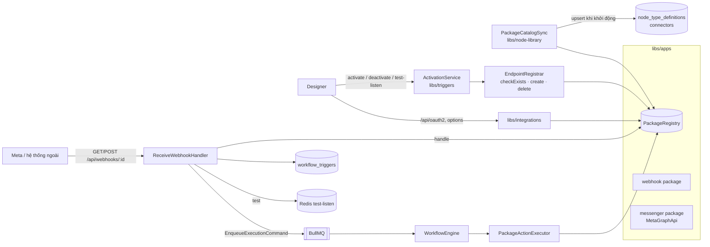

# Technical Design: Integration Packages & App Triggers

## 1. Kiến trúc



| Module | Trách nhiệm |
|---|---|
| `libs/apps` | Hợp đồng package, `PackageRegistry`, sinh JSON Schema cho node / credential, package `webhook` và `messenger`. Không phụ thuộc module khác. |
| `libs/node-library` | `PackageCatalogSync` (OnApplicationBootstrap): upsert node type + credential type của package. |
| `libs/connector` | `CredentialVault` (đọc / ghi secret đã giải mã, kiểm chủ sở hữu); cho phép lưu form của credential type OAuth2 của package; `oauth2.redirectUrl` trong danh sách connector. |
| `libs/integrations` | OAuth2 chung (`/api/oauth2/auth`, `/callback`), `loadOptions` (`/api/node-types/:key/options/:property`). Google OAuth cũ giữ nguyên. |
| `libs/triggers` | Endpoint, listener, activate / deactivate, chuyển version khi publish, ingress, test event, kiểm credential khi publish. Không có code riêng của app nào. |
| `libs/execution` | Executor sinh từ package: trigger → pass-through, action → `PackageActionExecutor` (retry lỗi tạm thời). |
| `libs/designer` | Publish / restore gọi `SwitchActiveVersionCommand` (hợp đồng nằm ở designer, handler ở triggers). |

**Quy tắc mở rộng:** ngoài `libs/apps/src/<app>` không có `if (app === '…')`. Mọi thứ hỏi `PackageRegistry`.

## 2. Hợp đồng package (`libs/apps/src/core/package.ts`)

```ts
interface IntegrationPackage {
  key: string; displayName: string;
  credentials: CredentialType[];
  nodes: Array<TriggerNode | ActionNode>;
}

interface CredentialType {
  key: string;                 // = connectors.key, vd. 'facebookMessengerOAuth2'
  displayName: string;
  fields: CredentialField[];   // người dùng nhập: { name, displayName, required?, secret?, description? }
  oauth2?: {
    authorizationUrl: string; scopes: string[]; scopeSeparator?: string;
    // code → giá trị lưu thêm vào credential (token, danh sách Page…)
    exchangeCode(input: { code; redirectUri; values }): Promise<Record<string, unknown>>;
  };
}

interface NodeBase {
  key; displayName; description; icon; color;
  credentialType?: string;     // thêm field credential_id
  properties: NodeProperty[];  // { name, displayName, type: string|number|boolean|options,
                               //   required?, default?, description?, placeholder?,
                               //   expression?, multiline?, options?, loadOptions?(ctx) }
}

interface TriggerNode extends NodeBase {
  kind: 'trigger';
  webhook: {
    scope: 'node' | 'credential';
    initialData?(): Record<string, unknown>;          // lúc tạo endpoint (vd. verify token)
    checkExists?(ctx: WebhookLifecycleContext): Promise<boolean>;
    create?(ctx): Promise<void>;
    delete?(ctx): Promise<void>;
    handle(ctx: { request; credential; data }): Promise<WebhookResult> | WebhookResult;
    accepts?(event: TriggerEvent, parameters: Record<string, unknown>): boolean; // mặc định true
  };
}
interface WebhookLifecycleContext {
  url: string;                              // {PUBLIC_BASE_URL}/api/webhooks/<id>
  credential: Record<string, unknown> | null;
  data: Record<string, unknown>;            // dữ liệu endpoint, được lưu lại sau khi gọi
  listeners: Array<Record<string, unknown>>; // parameters của mọi listener trên endpoint
}
interface WebhookResult { status: number; body?: unknown; contentType?: string; events: TriggerEvent[] }
interface TriggerEvent { id?: string; json: Record<string, unknown> }

interface ActionNode extends NodeBase {
  kind: 'action';
  execute(ctx: { parameters; credential; item }): Promise<ItemJson | ItemJson[] | null>;
}
```

- Danh sách package: `libs/apps/src/packages.ts` (`createPackages({ metaGraph })`). `AppsModule` cung cấp `PackageRegistry` và `META_GRAPH_API` (thay được trong test).
- Lỗi API của app: `AppApiError(message, retryable)`.

### Sinh JSON Schema (`core/schema.ts`)
Node → `config_schema` dùng bộ `x-*` sẵn có, thêm:
- `credential_id`: `x-refType: credential`, `x-connectorKey: <credentialType>`, `x-credentialInput: form`.
- `expression` → `x-allowExpression`; `multiline` → `x-multiline`; `placeholder` → `x-placeholder`; `options` → `enum` + `x-enumLabels`; `loadOptions` → `x-loadOptions: true` (UI gọi API với `credential_id` hiện tại).
- Trigger: gốc schema có `x-webhook: { scope }` (UI hiện Webhook URL với scope `node`, nút test event với mọi trigger).
- `x-propertyOrder` theo thứ tự khai báo; `required` = credential + property `required`.

Credential type → `connectors`: `auth_type` = `OAUTH2` nếu có `oauth2`, ngược lại `API_KEY`; `config_schema` từ `fields` (`x-secret`), thêm `x-oauth2: true`. Token không nằm trong schema: callback ghi thẳng vào secret.

## 3. Package v1

### Webhook (`webhook`)
- Node `webhook.trigger`, `scope: node`, không credential, không field.
- `handle`: chỉ `POST` (khác → `405`); một sự kiện `{ body, query, headers (bỏ authorization, cookie, x-api-key…), received_at }`, `id` = `Idempotency-Key`; `202`.

### Facebook Messenger (`messenger`)
- Credential `facebookMessengerOAuth2`: field `client_id` (App ID), `client_secret` (App Secret, ẩn). OAuth2: dialog `https://www.facebook.com/{v}/dialog/oauth`, scope `pages_show_list, pages_messaging, pages_manage_metadata`. `exchangeCode`: code → user token → token dài hạn → `GET me/accounts`; lưu `access_token`, `token_expires_at`, `pages: [{ id, name, access_token }]` (Page token lấy từ token dài hạn không hết hạn). Không có Page nào → lỗi.
- `messenger.trigger` (`scope: credential`), property `page_id` (options từ `pages` của credential), `keywords` (tuỳ chọn).
  - `initialData`: `{ verify_token: <32 byte ngẫu nhiên> }`.
  - `checkExists`: `GET /{app-id}/subscriptions` có object `page` với `callback_url` = URL và `active`, và mỗi Page của listener có app trong `GET /{page-id}/subscribed_apps`.
  - `create`: `POST /{app-id}/subscriptions` (`object=page, callback_url, verify_token, fields=messages`, app token `{app-id}|{app-secret}`); mỗi Page: `POST /{page-id}/subscribed_apps?subscribed_fields=messages`. Ghi `data.pages`.
  - `delete`: `DELETE /{app-id}/subscriptions?object=page`, `DELETE /{page-id}/subscribed_apps` cho Page trong `data.pages`.
  - `handle`: `GET` → so `hub.verify_token` với `data.verify_token` → challenge (`text/plain`) hoặc `403`. `POST` → HMAC `X-Hub-Signature-256` bằng `client_secret` trên body gốc (`401` nếu sai) → sự kiện cho mỗi tin của khách (bỏ echo, delivery, read): `{ message_id, sender_id, page_id, text, attachments, timestamp, raw }`, `id` = `mid`; `200`.
  - `accepts`: `page_id` khớp và (không có từ khoá hoặc nội dung chứa một từ khoá, so khớp đã chuẩn hoá).
- `messenger.sendMessage`: `page_id`, `recipient_id` (biểu thức, mặc định `{{$node["Messenger Trigger"].json.sender_id}}`), `text` (biểu thức, ≤ 2000 ký tự). Gửi `me/messages` (`messaging_type: RESPONSE`) bằng Page token trong credential. Output `{ page_id, recipient_id, message_id, status: 'sent' }`.

## 4. Dữ liệu

Viết lại migration chưa merge `20261029000000_add_workflow_triggers`:

```prisma
model Workflow { … active Boolean @default(false) }

model WebhookEndpoint {
  id           String   @id @default(uuid()) @db.Uuid   // = đoạn cuối URL
  scopeKey     String   @unique @map("scope_key")         // "node:<workflowId>:<nodeId>" | "credential:<credentialId>"
  nodeKey      String   @map("node_key")
  workflowId   String?  @map("workflow_id") @db.Uuid      // scope node (xoá theo workflow)
  credentialId String?  @map("credential_id") @db.Uuid    // scope credential (xoá theo credential)
  ownerId      String   @map("owner_id") @db.Uuid
  data         Json     @default("{}")                    // verify token, Page đã đăng ký…
  registered   Boolean  @default(false)                   // đã create với app bên ngoài
  createdAt / updatedAt
  listeners    WorkflowTrigger[]
}

model WorkflowTrigger {             // listener của workflow đang Active
  id, workflowId, workflowVersionId, nodeId, nodeKey,
  endpointId   → WebhookEndpoint (cascade)
  credentialId String?
  parameters   Json                 // config của node (không gồm credential_id)
  createdAt
  @@unique([workflowId, nodeId]) @@index([endpointId])
}
```
Không còn `app_key`, `routing_key`, `match_mode`, `keywords`, `is_active`: listener chỉ tồn tại khi workflow Active. DB dev: drop bảng cũ, chạy SQL mới bằng `prisma db execute`.

## 5. Kích hoạt (`ActivationService`, `EndpointRegistrar`)

```
activate(workflowId, userId):
  workflow của user, có currentVersionId (không → 400 "Publish the workflow before activating it")
  listen(workflow, version):
    nodes = trigger node của package trong definition (không có → 400)
    mỗi node: credential (nếu node cần) phải của chủ workflow, đúng type
              endpoint = ensureEndpoint(scope)  → tạo row (initialData) nếu chưa có
    mỗi endpoint: params = listener của workflow khác + listener mới
              registrar.register: checkExists? → nếu không có → create → lưu data, registered = true
              lỗi: gỡ endpoint vừa đăng ký lần này (nếu không ai khác nghe), ném 400 "<Node>: <lỗi>"
    replaceListeners(workflow, version, planned)   // một transaction
    cleanup endpoint workflow không còn dùng
  workflows.active = true

deactivate: xoá listener, active = false, cleanup endpoint.
cleanup(endpoint): không còn listener và không có test đang chờ → delete (lỗi chỉ ghi log), registered = false.
switchVersion (SwitchActiveVersionCommand, sau publish / restore):
  workflow không Active → null
  listen(version mới) thành công → { active: true }
  lỗi → deactivate → { active: false, error }
```

Kiểm khi publish (`CheckPublishTriggersHandler`): mọi node của package có credential → credential phải tồn tại, của chủ workflow, đúng type (`INVALID_CREDENTIAL`).

## 6. Nhận sự kiện (`ReceiveWebhookHandler`)

```
endpoint (id phải là UUID) → không có: 404
trigger = registry.trigger(endpoint.nodeKey); credential = vault.find(endpoint.credentialId) nếu scope credential
result = trigger.webhook.handle({ request, credential, data: endpoint.data })
không có sự kiện → trả result (handshake, 401, 405…)
listeners = workflow_triggers của endpoint; tests = test đang chờ của endpoint
không ai nghe: scope node → 404; scope credential → trả result
mỗi sự kiện:
  test khớp (accepts) → lưu JSON vào test, test kết thúc
  listener khớp; không có → ignored
  dedup:{endpoint}:{event.id} (24h) đã có → ignored
  mỗi listener khớp: EnqueueExecutionCommand(listener.workflowVersionId, [{ json }])
→ result.status, body = result.body ?? { success, data: { started, ignored } }
```
Lỗi bất ngờ sau khi package đã xác thực → trả `result.status` (Meta tắt webhook nếu lỗi liên tục), ghi log.

## 7. Test event (`TestListenService`)

- `start(workflowId, nodeId, userId)`: lấy node trong **bản nháp**, kiểm credential, `ensureEndpoint`, `registrar.register` với params hiện có + params thử, lưu Redis `test-listen:{id}` `{ userId, endpointId, nodeKey, parameters, status, event?, expiresAt }` (TTL 10 phút, hết hạn sau 120 giây) và tập `test-listen:endpoint:{endpointId}`.
- Ingress đánh dấu `received` + `event`. `GET` trả `waiting | received | expired`. `DELETE` dừng.
- Hết hạn / dừng → `cleanup(endpoint)` (setTimeout trong tiến trình; mất khi server khởi động lại — endpoint sẽ được gỡ ở lần deactivate / cleanup sau).

## 8. OAuth2 chung & loadOptions (`libs/integrations`)

- `GET /api/oauth2/auth?credentialId`: credential của user, type có `oauth2`, có `client_id`. Lưu state Redis `{ userId, credentialId }` (10 phút, dùng một lần). URL = `authorizationUrl?client_id&redirect_uri={PUBLIC_BASE_URL}/api/oauth2/callback&state&response_type=code&scope`.
- `GET /api/oauth2/callback`: lấy state → `exchangeCode({ code, redirectUri, values: secret })` → ghi đè secret = secret cũ + kết quả → HTML `postMessage({ type: 'oauth2-callback', status: 'success' | 'error', credentialId, message })` rồi đóng.
- `POST /api/node-types/:key/options/:property` `{ credentialId }`: node + property có `loadOptions`; credential (nếu node cần) của user và đúng type; trả `[{ value, label }]`; lỗi → `400` kèm lý do (vd. "Connect this credential first").

## 9. Execution

- `NODE_EXECUTORS` = executor sẵn có + mỗi trigger của package → `PassThroughTriggerExecutor(key)`, mỗi action → `PackageActionExecutor(node)`.
- `PackageActionExecutor` (`per_item`): `parseConfig` kiểm property bắt buộc sau khi resolve; `expectedConnectorKey` = `credentialType`; retry `AppApiError.retryable` 1s → 2s.
- Gỡ `ReplyExecutor`, `usesConversation`, `conversationOf`, `NodeKeys.TRIGGER_APP / CHAT_REPLY`.

## 10. Frontend

- `api|services|hooks/activation.*`: activation, activate / deactivate, webhooks, test-listen.
- `ActiveToggle` (shadcn `Switch`) trong header Designer; lỗi hiện dưới dạng `Alert`.
- `PropertiesPanel`: form chung cho mọi node; `x-webhook.scope = node` → `WebhookUrlField`; `x-webhook` → `TestEventPanel`.
- `ConfigField`: `x-loadOptions` → `LoadOptionsField` (Select, tải lại khi đổi credential); `x-enumLabels`, `x-placeholder`.
- `AddCredentialDialog`: credential `x-oauth2` → hiện OAuth Redirect URL + Copy, nút **Save & connect** mở pop-up (`useOAuth2Popup`); `CredentialPicker` có **Reconnect** cho credential OAuth2 đang chọn.
- Gỡ `AppTriggerFields`, `useAppOAuth`, `AppTriggerInfo`; `VersionDetailPage` dùng `EventTriggerInfo` (trạng thái Active + URL webhook).
- Danh sách workflow: badge **Active**. Publish: hiện `activation.error` nếu workflow bị tắt.

## 11. Kiểm thử

| Mục | Loại |
|---|---|
| Sinh schema node / credential, registry | unit |
| Package webhook: handle, 405, Idempotency-Key, lọc header | unit |
| Package messenger: handshake theo verify token của endpoint, chữ ký theo App Secret của credential, parse, accepts + từ khoá, create / checkExists / delete (Graph giả), exchangeCode, sendMessage, map lỗi Graph | unit |
| ActivationService: chưa publish, không có trigger, credential sai, create lỗi → rollback, chuyển version, deactivate gỡ endpoint cuối | unit |
| ReceiveWebhook: 404, mọi listener khớp đều chạy, dedup, test event | unit |
| OAuth2 service: state một lần, lưu token vào credential | unit |
| PackageActionExecutor trong engine: retry, thiếu field | unit |
| Webhook + Messenger qua HTTP, DB, Redis, queue thật (Graph giả): OAuth2 → loadOptions → activate → handshake → 2 workflow cùng chạy → send; activate lỗi; deactivate; test event | e2e |
