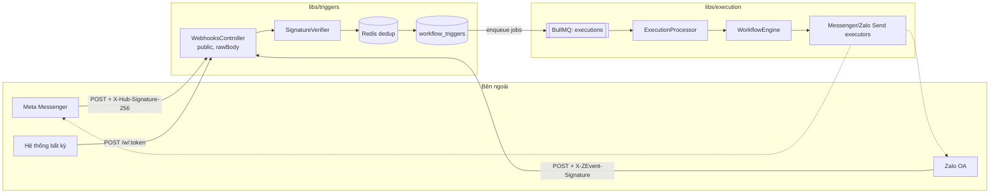
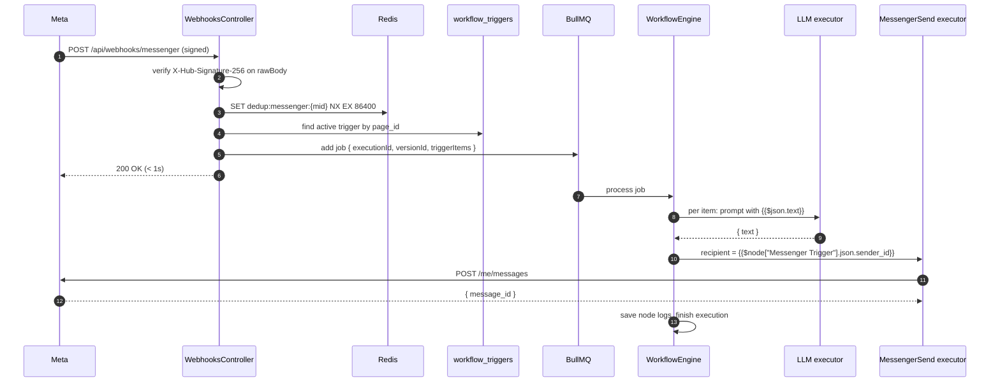

# Technical Design: Chat Trigger (Messenger & Zalo OA)

> Xây trên `execution-item-model` và `llm-node`. Chia 3 giai đoạn độc lập, mỗi giai đoạn merge được riêng:
> **P1** nền tảng webhook + hàng đợi → **P2** Messenger → **P3** Zalo OA.

## 1. Kiến trúc tổng thể (Architecture Overview)

Bounded context bị chạm tới:
- **`libs/execution`** — tách engine khỏi handler, hàng đợi BullMQ, trigger nhận item, executor gửi tin.
- **`libs/triggers`** (module mới) — bảng `workflow_triggers`, controller webhook public, xác thực chữ ký, chống trùng, đồng bộ khi publish.
- **`libs/designer`** — phát `WorkflowPublishedEvent`, thêm rule validate `CHANNEL_ALREADY_BOUND`.
- **`libs/connector`** — credential nhiều field theo `config_schema`.
- **`libs/integrations`** — client Graph API (Meta) và Zalo Open API, làm mới token Zalo.
- **`prisma`** — migration bảng mới + seed.
- **Frontend `features/workflow`** — URL webhook, dialog credential nhiều field, nguồn chạy.



---

## 2. Database (Prisma)

### 2.1. Bảng mới `workflow_triggers`
```prisma
enum TriggerChannel {
  WEBHOOK
  MESSENGER
  ZALO_OA
}

// Workflow version nào đang lắng nghe kênh nào. Chỉ row isActive = true nhận sự kiện.
model WorkflowTrigger {
  id                String         @id @default(uuid()) @db.Uuid
  workflowId        String         @map("workflow_id") @db.Uuid
  workflow          Workflow       @relation(fields: [workflowId], references: [id], onDelete: Cascade)
  workflowVersionId String         @map("workflow_version_id") @db.Uuid
  workflowVersion   WorkflowVersion @relation(fields: [workflowVersionId], references: [id])

  nodeId     String         @map("node_id") @db.VarChar(100)
  triggerKey String         @map("trigger_key") @db.VarChar(150) // trigger.webhook | trigger.messenger.message | trigger.zalo.message
  channel    TriggerChannel

  // WEBHOOK: token bí mật trong URL. MESSENGER: page_id. ZALO_OA: oa_id.
  routingKey   String  @map("routing_key") @db.VarChar(255)
  credentialId String? @map("credential_id") @db.Uuid

  isActive  Boolean  @default(true) @map("is_active")
  createdAt DateTime @default(now()) @map("created_at") @db.Timestamptz

  @@index([channel, routingKey, isActive])
  @@index([workflowId])
  @@map("workflow_triggers")
}
```
- Ràng buộc "một Page/OA chỉ một workflow đang chạy" kiểm ở tầng ứng dụng (Postgres partial unique index `WHERE is_active` viết tay trong migration để chặn race: `CREATE UNIQUE INDEX ... ON workflow_triggers(channel, routing_key) WHERE is_active`).
- **Token webhook giữ nguyên giữa các version** của cùng workflow + node (URL không đổi khi publish lại): khi đồng bộ, copy `routingKey` từ row cũ cùng `nodeId`.
- Migration viết tay như `llm-node` (DB dev tạo bằng `db push`).

### 2.2. Seed
**Connectors** (`auth_type: API_KEY`, nhập tay):
```json
// messenger
{ "type": "object", "required": ["page_id", "page_access_token"],
  "properties": {
    "page_id":           { "type": "string", "title": "Page ID" },
    "page_access_token": { "type": "string", "title": "Page Access Token", "x-secret": true }
  } }
// zalo_oa
{ "type": "object", "required": ["oa_id", "access_token", "refresh_token"],
  "properties": {
    "oa_id":         { "type": "string", "title": "OA ID" },
    "access_token":  { "type": "string", "title": "Access Token", "x-secret": true },
    "refresh_token": { "type": "string", "title": "Refresh Token", "x-secret": true }
  } }
```
**Node types:**

| Key | Category | Config | Run mode |
|---|---|---|---|
| `trigger.webhook` | TRIGGER | (không có) | `once` |
| `trigger.messenger.message` | TRIGGER | `credential_id` (`x-connectorKey: messenger`) | `once` |
| `trigger.zalo.message` | TRIGGER | `credential_id` (`x-connectorKey: zalo_oa`) | `once` |
| `integration.messenger.send` | INTEGRATION | `credential_id`, `recipient_id` (fx, default `{{$json.sender_id}}`), `text` (fx, multiline) | `per_item` |
| `integration.zalo.send` | INTEGRATION | `credential_id`, `user_id` (fx, default `{{$json.sender_id}}`), `text` (fx, multiline) | `per_item` |

Lưu ý: default `{{$json.sender_id}}` chỉ đúng khi node gửi đứng ngay sau trigger. Sau LLM, `$json` là output của LLM → người dùng đổi thành `{{$node["Messenger Trigger"].json.sender_id}}`. UI gợi ý điều này (mục 5).

---

## 3. Backend

### 3.1. P1 — Tách engine và chạy nền (`libs/execution`)

**`WorkflowEngine`** (application service mới) — chuyển vòng lặp hiện tại của `StartExecutionHandler.execute` vào đây:
```typescript
export interface RunWorkflowInput {
  version: WorkflowVersionForExecution;
  triggerType: 'MANUAL' | 'WEBHOOK';
  triggeredById: string | null;   // null với webhook
  credentialOwnerId: string;      // luôn = version.workflowOwnerId
  triggerItems: Item[];           // [] với manual; payload chuẩn hoá với webhook
  executionId?: string;           // đã tạo sẵn khi enqueue
}
run(input: RunWorkflowInput): Promise<string /* executionId */>;
```
- `StartExecutionHandler` (manual) giữ API và hành vi đồng bộ: kiểm quyền → `engine.run({ triggerItems: [], triggerType: 'MANUAL', ... })` → trả `findExecutionResult`. Test hiện có phải pass nguyên vẹn.
- `NodeRunner.run` đổi `actorId` thành `credentialOwnerId` (đổi tên, cùng giá trị với manual).
- Item đầu vào của node đầu tiên = `triggerItems`. Trigger `once` nhận `items` đó qua `execute({ items })`.
- `ExecutionRepository.createExecution` nhận thêm `triggerType` và `context` (lưu payload trigger đã chuẩn hoá — giúp debug và chạy lại sau này).

**Hàng đợi** (điền vào 2 file rỗng có sẵn):
- Thêm `bullmq` + `@nestjs/bullmq`, kết nối `REDIS_HOST/PORT/PASSWORD` có sẵn.
- Queue `executions`, job `{ executionId, workflowVersionId, triggerItems }`, `attempts: 1` (không tự chạy lại cả workflow — tránh gửi tin trùng), `removeOnComplete: 1000`.
- `ExecutionProcessor` (concurrency từ env `EXECUTION_CONCURRENCY`, mặc định 5) → `engine.run(...)`.
- **Execution được tạo ở trạng thái `RUNNING` ngay khi enqueue** để trả `executionId` cho người gọi; processor dùng lại id đó. (Enum chưa có `QUEUED`; thêm là thay đổi riêng, không cần cho v1.)
- Execution kẹt `RUNNING` do process chết: khi app khởi động, đánh dấu `FAILED` các execution `RUNNING` quá `EXECUTION_STALE_MINUTES` (mặc định 15).

**Trigger executors** (`once`, đều trả lại `items` nhận được):
```typescript
class PassThroughTriggerExecutor implements IOnceExecutor<Record<string, never>> {
  constructor(readonly key: string) {}
  readonly runMode = 'once' as const;
  parseConfig() { return {}; }
  execute({ items }) { return Promise.resolve(items.length ? items : [{ json: {} }]); }
}
```
Đăng ký 3 instance cho `trigger.webhook`, `trigger.messenger.message`, `trigger.zalo.message`. Trigger kênh chat **không** cần credential lúc chạy (credential chỉ dùng để định tuyến khi đồng bộ) → `NodeRunner` bỏ qua `resolveCredential` cho category TRIGGER.

### 3.2. P1 — Module `libs/triggers`

**Đồng bộ khi publish:**
- `PublishWorkflowHandler` (và nhánh `PUBLISH_THEN_RESTORE` của `RestoreVersionHandler`) phát `WorkflowPublishedEvent(workflowId, versionId, definition)` **sau khi commit**.
- Rule validate mới trong publish (chạy trước khi tạo version): với mỗi trigger kênh chat, đọc `page_id` / `oa_id` từ credential, kiểm có `workflow_triggers` active của **workflow khác** cùng `routingKey` → issue `CHANNEL_ALREADY_BOUND { nodeId, workflowName }`. Lấy qua query `FindActiveTriggerByRoutingQuery` của `libs/triggers` (không đọc chéo bảng).
- `SyncWorkflowTriggersHandler` (event handler): trong một transaction — `isActive = false` cho mọi row của workflow; insert row mới cho từng node trigger không phải manual; giữ `routingKey` cũ cho `trigger.webhook` cùng `nodeId`, sinh mới bằng `crypto.randomBytes(32).toString('base64url')` nếu chưa có.
- Index unique partial chặn trường hợp hai publish đua nhau; lỗi unique → log + đánh dấu workflow cần publish lại (hiếm, chấp nhận ở v1).

**`WebhooksController`** (`/api/webhooks`, không gắn `JwtAuthGuard`):

| Route | Xử lý |
|---|---|
| `POST /w/:token` | tìm trigger `WEBHOOK` active theo token → tạo execution + enqueue → `202 { executionId }` |
| `GET /messenger` | so `hub.verify_token` với `META_VERIFY_TOKEN` → trả `hub.challenge` dạng text |
| `POST /messenger` | kiểm chữ ký → với mỗi `entry[].messaging[]` là tin nhắn của khách: chuẩn hoá → dedup → tìm trigger theo `entry.id` (page_id) → enqueue. Luôn `200` |
| `POST /zalo` | kiểm chữ ký → chỉ nhận `event_name = user_send_text` (v1) → chuẩn hoá → dedup → tìm trigger theo `recipient.id` (oa_id) → enqueue. Luôn `200` |

- `main.ts`: `NestFactory.create(AppModule, { rawBody: true })`; controller đọc `req.rawBody` để kiểm HMAC.
- Giới hạn body 1 MB cho route webhook.
- Không tìm thấy trigger cho Page/OA → vẫn `200` (để Meta/Zalo không retry), log mức `debug`.

**`SignatureVerifier`** (domain service thuần, dễ test bảng):
- Meta: `sha256=` + `HMAC_SHA256(META_APP_SECRET, rawBody)` hex; so bằng `crypto.timingSafeEqual`.
- Zalo: theo tài liệu Zalo OA webhook — chuỗi băm SHA-256 ghép từ `app_id`, body, `timestamp` và **OA secret key**. ⚠️ **Phải đối chiếu đúng công thức với tài liệu hiện hành của Zalo trước khi code** (tài liệu Zalo thay đổi theo phiên bản API).
- Từ chối timestamp lệch quá 5 phút (Zalo) để chống replay.

**Chống trùng:** Redis `SET dedup:{channel}:{messageId} 1 NX EX 86400`; đã tồn tại → bỏ qua.

**Lọc sự kiện Messenger:** chỉ nhận `messaging[i].message` khi **không** có `message.is_echo`; bỏ `delivery`, `read`, `reaction`, `postback` (v1).

**Chuẩn hoá item** (`MessengerEventMapper`, `ZaloEventMapper`) → dạng thống nhất trong spec mục 4.

### 3.3. P2 — Messenger (`libs/integrations` + executor)
- `MetaGraphClient.sendText(pageAccessToken, recipientId, text)` → `POST https://graph.facebook.com/{META_GRAPH_VERSION}/me/messages` body `{ recipient: { id }, messaging_type: 'RESPONSE', message: { text } }`. Timeout 15s.
- `MessengerSendExecutor` (`per_item`): `parseCredential` `{ page_id, page_access_token }`; `expectedConnectorKey → 'messenger'`; `text` cắt kiểm ≤ 2000 ký tự (vượt → lỗi rõ ràng, không cắt ngầm); output `{ recipient_id, message_id, status: 'sent' }`.
- Map lỗi Graph API: lỗi ngoài cửa sổ 24h / người dùng chặn → không retry, thông báo dễ hiểu; `429` / `5xx` → retry tối đa 2 lần (1s → 2s), giống LLM.
- `sanitizeErrorText` thêm pattern `EAA[A-Za-z0-9]{20,}`.

### 3.4. P3 — Zalo OA
- `ZaloOaClient.sendText(accessToken, userId, text)` → API gửi tin tư vấn của Zalo OA (Open API v3). Timeout 15s.
- **Làm mới token:** access token Zalo hết hạn sau khoảng một ngày, refresh token **dùng một lần** và có hạn vài tháng. `ZaloTokenService`:
  - Trước khi gửi: nếu token sắp hết hạn (lưu `expires_at` cùng secret) → refresh.
  - Refresh xong → **ghi đè cả access token lẫn refresh token mới** vào `encrypted_secret` (nếu không, lần refresh sau sẽ hỏng).
  - Khoá phân tán Redis `lock:zalo-refresh:{credentialId}` để hai execution song song không cùng refresh (refresh token dùng một lần → một trong hai sẽ làm hỏng credential).
  - Refresh thất bại → node lỗi "Kết nối Zalo OA đã hết hạn, vui lòng nhập lại token".
- Cần thêm `ConnectorCredentialRepository.updateSecret(id, encrypted)` và để execution module gọi qua port (`CredentialRefreshPort`), không ghi thẳng bảng.
- ⚠️ Endpoint, header, thời hạn token, giới hạn cửa sổ gửi tin tư vấn: **đối chiếu tài liệu Zalo for Developers hiện hành** trước khi code; ghi kết quả vào mục "Ghi chú xác minh" của `task.md`.

### 3.5. Credential nhiều field (`libs/connector`)
- `CreateCredentialCommand(connectorKey, ownerId, name, secret: Record<string, string>)` thay cho bản chỉ có `apiKey`; validate `secret` theo `connector.configSchema` (required + string); body cũ `{ name, api_key }` map sang `secret = { api_key }`.
- Response DTO thêm `displayHint` an toàn (vd. `page_id`, `oa_id` — field **không** có `x-secret`), để UI phân biệt nhiều Page.

### 3.6. Biến môi trường mới (`.env.example`)
```
PUBLIC_BASE_URL=https://<tên-miền-public>   # để dựng URL webhook hiển thị cho người dùng
META_APP_SECRET=
META_VERIFY_TOKEN=                          # chuỗi tự đặt, dán giống hệt vào Meta dashboard
META_GRAPH_VERSION=v23.0                    # kiểm tra version hiện hành khi setup
ZALO_APP_ID=
ZALO_APP_SECRET=
ZALO_OA_SECRET_KEY=                         # dùng kiểm chữ ký webhook
EXECUTION_CONCURRENCY=5
EXECUTION_STALE_MINUTES=15
```

---

## 4. Sequence chính (Messenger → LLM → trả lời)



---

## 5. Frontend

### 5.1. Cấu trúc
```text
frontend/src/features/workflow/
├── api/trigger.api.ts                 # GET /api/workflows/:id/triggers
├── hooks/useWorkflowTriggers.ts
├── components/
│   ├── config-fields/
│   │   └── WebhookUrlField.tsx        # Input readonly + Button copy (shadcn)
│   ├── AddCredentialDialog.tsx        # thay AddApiKeyDialog: form sinh từ connector.configSchema
│   └── TriggerSourceBadge.tsx         # Manual / Webhook / Messenger / Zalo
```

### 5.2. Hành vi
- Node trigger kênh chat / webhook có hint schema mới `x-display: "webhookUrl"` → `WebhookUrlField`; chưa publish → text "Publish để lấy URL".
- `AddCredentialDialog` đọc `configSchema` của connector: field `x-secret` → `Input type=password`; giữ `AddApiKeyDialog` như một trường hợp của dialog mới (LLM không đổi hành vi).
- Picker credential hiển thị `name — displayHint` (vd. "Shop ABC — 112233445566").
- Node gửi tin đặt sau node khác trigger: cảnh báo nhẹ dưới field `recipient_id` / `user_id` nếu giá trị vẫn là `{{$json.sender_id}}`: "Sau node LLM, dùng `{{$node["Tên trigger"].json.sender_id}}`".
- `VersionDetailPage`: nút **Run** chỉ hiện khi trigger là `trigger.manual`; danh sách execution thêm cột nguồn chạy (`TriggerSourceBadge`) và tự làm mới mỗi 5 giây khi có execution `RUNNING`.
- shadcn có thể cần thêm: `tooltip` (`npx shadcn@latest add tooltip`).

---

## 6. Kiểm thử (Testing)

Nguyên tắc như các spec trước: test qua interface công khai, **không gọi Meta/Zalo thật trong test tự động**.

| Mục | Loại | Nội dung |
|---|---|---|
| `SignatureVerifier` | unit (bảng) | chữ ký đúng / sai / thiếu header / body bị sửa 1 byte; Zalo timestamp quá hạn |
| Event mappers | unit | payload Messenger mẫu (text, attachment, echo, delivery, nhiều entry); Zalo `user_send_text` |
| `WorkflowEngine` | unit | `triggerItems` đi vào node đầu; credential theo chủ workflow; manual không đổi hành vi |
| Sync triggers | unit | publish lần 1 / lần 2 giữ token webhook; tắt version cũ; `CHANNEL_ALREADY_BOUND` |
| Send executors | unit | client giả: thành công, lỗi 24h không retry, 429 retry, text quá dài |
| Zalo token | unit | refresh khi sắp hết hạn, ghi đè cả 2 token, khoá chống refresh song song, refresh thất bại |
| Webhook API | e2e | `POST /w/:token` → 202 → execution xong (đợi queue); sai chữ ký → 401; gửi trùng → 1 execution; echo bị bỏ |
| Hồi quy | e2e | `execution-run-ui.e2e-spec.ts`, `llm-node.e2e-spec.ts` pass nguyên vẹn |
| Thật | thủ công | Page thử nghiệm và OA thử nghiệm qua tunnel public (xem `task.md` phần việc của người dùng) |
