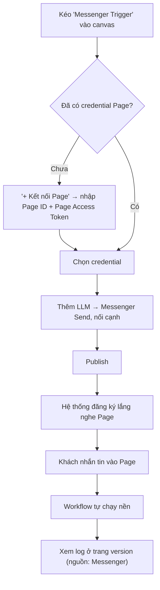

# Feature Specification: Chat Trigger (Messenger & Zalo OA)

> **Phụ thuộc:** spec `execution-item-model` (item, biểu thức, paired item) và `llm-node` (đã hoàn tất). Spec này mở rộng engine từ "chỉ chạy tay" sang "chạy khi có sự kiện từ bên ngoài".

## 1. Bối cảnh & Vấn đề (Context & Problem Statement)

Hiện tại mọi workflow chỉ bắt đầu bằng `trigger.manual`: người dùng bấm **Run** trên trang version, request HTTP chạy đồng bộ đến khi xong. Không có cách nào để workflow **tự chạy khi khách hàng nhắn tin** vào Facebook Page hoặc Zalo Official Account (OA) — trong khi đây là kênh chăm sóc khách hàng chính của doanh nghiệp nhỏ ở Việt Nam.

**Giải pháp thống nhất:** thêm **trigger nhận sự kiện từ bên ngoài** và **node gửi tin nhắn** cho hai kênh chat, xây trên một nền chung là **webhook + chạy execution nền**.

- Trigger không biết workflow sẽ làm gì với tin nhắn — nó chỉ biến một tin nhắn đến thành **một item**.
- Trả lời, phân loại, lưu vào Sheet, gọi LLM... đều do các node sau quyết định.

### Ví dụ sử dụng

**(a) Chatbot trả lời bằng AI**
```
Messenger Trigger → LLM → Messenger Send
```
- LLM `prompt`: `Bạn là nhân viên CSKH shop ABC. Trả lời ngắn gọn: {{$json.text}}`
- Messenger Send `recipient_id`: `{{$node["Messenger Trigger"].json.sender_id}}`, `text`: `{{$json.text}}`

**(b) Lọc tin khẩn rồi báo qua email**
```
Zalo Trigger → LLM (json) → Filter → Gmail
```
- LLM phân loại `{"label": "urgent" | "normal"}`, Filter `data.label = urgent`, Gmail gửi cho quản lý.

**(c) Tự động trả lời cố định**
```
Zalo Trigger → Zalo Send
```
- Zalo Send `text`: `Cảm ơn bạn đã nhắn tin, shop sẽ phản hồi trong 30 phút.`

**(d) Webhook chung (nền tảng cho mọi tích hợp sau này)**
```
Webhook Trigger → Google Sheet Append → ...
```
- Hệ thống bất kỳ POST JSON vào URL riêng của workflow.

---

## 2. Hiện trạng hệ thống & Phân tích khoảng trống (Current State & Gap Analysis)

### 2.1. Cơ sở dữ liệu (Prisma)
- **Đã có:**
  - Enum `TriggerType { SCHEDULE, WEBHOOK, MANUAL }`, cột `executions.trigger_type`.
  - `executions.triggered_by_id` nullable (chú thích: "null với schedule/webhook").
  - `executions.context Json?` — chưa dùng.
  - `connectors` + `connector_credentials.encrypted_secret` (AES-256-GCM).
- **Thiếu:**
  - ❌ Bảng ánh xạ **"kênh bên ngoài → workflow đang lắng nghe"** (Page ID / OA ID / token webhook → workflow version).
  - ❌ Seed connector `messenger`, `zalo_oa` và các node trigger / send.

### 2.2. Backend
- **Đã có:** `StartExecutionHandler` chạy cả workflow trong một request; `PrismaExecutionRepository.createExecution` luôn ghi `triggerType: 'MANUAL'`; Redis (`ioredis`) đã cấu hình cho module auth; file rỗng `infrastructure/queue/execution-queue.module.ts`, `execution.processor.ts` (chỗ dành sẵn cho hàng đợi).
- **Thiếu:**
  - ❌ **Chạy execution nền**: webhook của Meta/Zalo phải được trả `200` trong vài giây, nhưng workflow có LLM có thể chạy tới hàng chục giây.
  - ❌ Execution không có người bấm (`actorId`) — credential phải lấy theo **chủ workflow**.
  - ❌ Trigger nhận **dữ liệu đầu vào** (hiện `ManualTriggerExecutor` luôn trả `[{ json: {} }]`).
  - ❌ Endpoint public nhận webhook, xác thực chữ ký, chống xử lý trùng.
  - ❌ Đăng ký / huỷ lắng nghe khi publish version mới.
  - ❌ Client gọi API Messenger (Graph API) và Zalo OA (Open API), làm mới access token Zalo.
  - ❌ `NestFactory` chưa bật `rawBody` (cần để kiểm chữ ký HMAC trên body gốc).

### 2.3. Frontend (`frontend/src/features/workflow`)
- **Đã có:** palette theo category, `PropertiesPanel` render từ `configSchema`, `CredentialPicker` theo `x-connectorKeyFrom`, `AddApiKeyDialog` (chỉ 1 field `api_key`).
- **Thiếu:**
  - ❌ Hiển thị **URL webhook** (chỉ đọc, nút copy) trên node trigger sau khi publish.
  - ❌ Dialog tạo credential **nhiều field** (Page ID + Page Access Token; OA ID + access token + refresh token) — sinh form từ `connectors.config_schema`.
  - ❌ Trang version / execution hiện cột **nguồn chạy** (Manual / Webhook / Messenger / Zalo).
  - ❌ Nút **Run** phải ẩn hoặc đổi nghĩa khi trigger không phải manual.

---

## 3. Phạm vi (Scope)

### Trong phạm vi (In-Scope)
- **Nền tảng:** hàng đợi execution (BullMQ trên Redis sẵn có); execution `triggerType = WEBHOOK`; trigger nhận item đầu vào; bảng `workflow_triggers`; đồng bộ khi publish.
- **Webhook chung:** node `trigger.webhook` — URL bí mật riêng cho từng workflow, nhận `POST` JSON.
- **Messenger:** node `trigger.messenger.message` (tin nhắn văn bản và tệp đính kèm dạng URL), node `integration.messenger.send` (gửi văn bản).
- **Zalo OA:** node `trigger.zalo.message` (sự kiện người dùng gửi tin văn bản), node `integration.zalo.send` (tin tư vấn dạng văn bản), tự làm mới access token.
- Xác thực chữ ký webhook của cả hai nền tảng; chống trùng sự kiện.
- Credential dạng nhiều field, nhập tay (người dùng dán token lấy từ trang quản trị của Meta / Zalo).

### Ngoài phạm vi (Out-of-Scope)
- **Kết nối Page/OA bằng nút "Đăng nhập Facebook / Zalo" (OAuth đầy đủ)** — v1 dán token tay; OAuth là bước sau.
- Tin nhắn có nút bấm, quick reply, template, carousel, gửi ảnh / file.
- Gửi tin chủ động ngoài cửa sổ hội thoại (Messenger message tags, Zalo tin truyền thông / ZNS).
- Hội thoại nhiều lượt có trí nhớ (lưu lịch sử chat theo người dùng).
- Instagram, WhatsApp, Telegram, Zalo cá nhân (Zalo cá nhân **không có API chính thức**).
- Trigger theo lịch (`SCHEDULE`) — dùng chung hàng đợi nhưng là spec riêng.
- Màn hình theo dõi hàng đợi, retry tay execution thất bại.

---

## 4. Luồng trải nghiệm người dùng (UI/UX Flow)



### Form cấu hình node

| Node | Field | Control | Ghi chú |
|---|---|---|---|
| Webhook Trigger | Webhook URL | Chỉ đọc + Copy | Có sau lần publish đầu; trước đó hiện "Publish để lấy URL" |
| Messenger Trigger | Page | Credential picker (`messenger`) | Bắt buộc |
| Messenger Send | Page | Credential picker (`messenger`) | Bắt buộc |
| | Recipient ID | Text `fx` | Mặc định `{{$json.sender_id}}` |
| | Text | Textarea `fx` | Bắt buộc, tối đa 2000 ký tự |
| Zalo Trigger | Official Account | Credential picker (`zalo_oa`) | Bắt buộc |
| Zalo Send | Official Account | Credential picker (`zalo_oa`) | Bắt buộc |
| | User ID | Text `fx` | Mặc định `{{$json.sender_id}}` |
| | Text | Textarea `fx` | Bắt buộc |

### Item do trigger sinh ra (thống nhất giữa các kênh)
```json
{
  "channel": "messenger",
  "message_id": "m_abc...",
  "sender_id": "6543210987654321",
  "recipient_id": "112233445566",
  "text": "Shop ơi còn size M không?",
  "attachments": [],
  "timestamp": "2026-10-29T08:15:00.000Z",
  "raw": { }
}
```
`raw` giữ nguyên payload gốc để người dùng dùng các field chưa được chuẩn hoá.

---

## 5. Đặc tả API (API Specification)

### 5.1. Webhook chung
- `POST /api/webhooks/w/:token` — public, không JWT. `token` là chuỗi ngẫu nhiên 32 byte gắn với trigger.
- Body JSON bất kỳ (tối đa 1 MB) → 1 item `{ body, headers (đã lọc), query, received_at }`.
- Response `202 Accepted` `{ "executionId": "..." }`; `404` token không tồn tại hoặc workflow không còn lắng nghe.

### 5.2. Messenger
- `GET /api/webhooks/messenger` — Meta xác minh: kiểm `hub.mode = subscribe` và `hub.verify_token = META_VERIFY_TOKEN`, trả nguyên `hub.challenge`; sai → `403`.
- `POST /api/webhooks/messenger` — kiểm `X-Hub-Signature-256` (HMAC-SHA256 của body gốc với `META_APP_SECRET`); sai → `401`. Hợp lệ → luôn `200` ngay, xử lý nền.

### 5.3. Zalo OA
- `POST /api/webhooks/zalo` — kiểm chữ ký header `X-ZEvent-Signature` theo tài liệu Zalo (khoá bí mật OA); sai → `401`. Hợp lệ → `200` ngay, xử lý nền.

### 5.4. Credential nhiều field
- `POST /api/connectors/:connectorKey/credentials` mở rộng: body `{ name, secret: { ... } }` validate theo `connectors.config_schema`; giữ tương thích body cũ `{ name, api_key }`.
- Không trả secret ra ngoài (giữ nguyên quy tắc hiện có).

### 5.5. Trạng thái trigger
- `GET /api/workflows/:id/triggers` → `{ triggerKey, nodeId, webhookUrl?, externalId?, isActive }[]` cho version đang chạy.

---

## 6. Quy tắc nghiệp vụ (Business Rules)

1. **Chỉ version hiện hành nhận sự kiện.** Khi publish version mới, trigger của version cũ bị tắt và trigger của version mới được bật trong cùng transaction với việc đổi `currentVersionId`.
2. **Một Page / OA chỉ thuộc về một workflow đang chạy.** Publish workflow thứ hai dùng cùng Page/OA → lỗi validate `CHANNEL_ALREADY_BOUND` kèm tên workflow đang giữ.
3. **Một tin nhắn = một execution.** Meta có thể gửi nhiều tin trong một request → tách thành nhiều execution.
4. **Chống trùng:** cùng `channel + message_id` chỉ tạo execution một lần trong 24 giờ.
5. **Bỏ qua sự kiện không phải tin nhắn của khách:** echo (tin do chính Page gửi), delivery, read, reaction, sự kiện follow. Tránh vòng lặp bot tự trả lời chính nó.
6. **Credential lấy theo chủ workflow** (execution không có người bấm, `triggered_by_id = null`).
7. **Không bao giờ ghi token / app secret vào log**; mở rộng `sanitizeErrorText` cho token Meta (`EAA...`) và token Zalo.
8. **Trả lời webhook trước, chạy sau.** Không có thao tác nào gọi ra ngoài trong request webhook.
9. Messenger chỉ cho gửi tin trong **24 giờ** kể từ tin nhắn cuối của khách; Zalo có giới hạn tương tự cho tin tư vấn. Gửi ngoài cửa sổ → node lỗi với thông báo rõ ràng, không retry.

---

## 7. Tiêu chí chấp nhận (Acceptance Criteria)

- Workflow `Webhook Trigger → Gmail` chạy khi `curl -X POST` vào URL webhook; execution có `trigger_type = WEBHOOK`, `triggered_by_id = null`.
- Request webhook trả về dưới 1 giây kể cả khi workflow có node LLM.
- Request Messenger / Zalo sai chữ ký bị từ chối, không tạo execution.
- Gửi lại cùng một payload hai lần chỉ tạo một execution.
- Tin echo của Page không kích hoạt workflow.
- Publish version mới → sự kiện tiếp theo chạy version mới; version cũ không còn nhận.
- Publish workflow thứ hai cùng Page → lỗi `CHANNEL_ALREADY_BOUND`.
- Ví dụ (a) chạy thật với một Facebook Page thử nghiệm: nhắn tin → nhận câu trả lời từ LLM.
- Ví dụ (c) chạy thật với một Zalo OA thử nghiệm.
- Workflow `trigger.manual` cũ vẫn chạy đồng bộ như trước (hồi quy).
