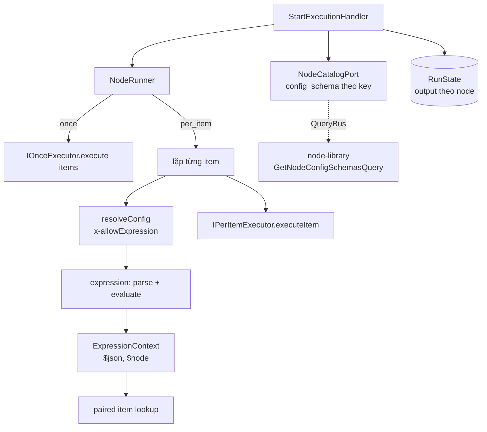

# Technical Design: Execution Item Model & Expression Resolver

## 1. Kiến trúc tổng thể (Architecture Overview)

Bounded context bị chạm tới:
- **`libs/execution`** — kiểu `Item`, hợp đồng executor mới, bộ resolve biểu thức, paired item, vòng lặp engine, 4 executor + Aggregate.
- **`libs/node-library`** — query mới trả `config_schema` theo key (để engine biết field nào là biểu thức).
- **`prisma`** — seed (không migration).
- **Frontend** — placeholder biểu thức.



---

## 2. Domain layer (`libs/execution`) — TS thuần

### 2.1. Item
```typescript
export type ItemJson = Record<string, unknown>;

export interface Item {
  json: ItemJson;
  pairedItem?: number; // index trong mảng item input của node đã sinh ra item này
}
```

### 2.2. Hợp đồng executor
Thay `INodeExecutor` hiện tại bằng hai biến thể, phân biệt bằng `runMode`:

```typescript
interface NodeExecutorBase<TConfig> {
  readonly key: string;
  parseConfig(raw: unknown): TConfig;          // nhận config ĐÃ resolve biểu thức
  parseCredential?(raw: unknown): unknown;
  // Nhận config THÔ (chưa resolve). Field dùng để suy ra connector không được là biểu thức.
  expectedConnectorKey?(rawConfig: Record<string, unknown>): string | null;
}

export interface IPerItemExecutor<TConfig = unknown> extends NodeExecutorBase<TConfig> {
  readonly runMode: 'per_item';
  // trả object → 1 item; mảng → nhiều item; null / [] → bỏ item
  executeItem(params: {
    config: TConfig;
    item: Item;
    credential: unknown;
  }): Promise<ItemJson | ItemJson[] | null>;
}

export interface IOnceExecutor<TConfig = unknown> extends NodeExecutorBase<TConfig> {
  readonly runMode: 'once';
  execute(params: {
    config: TConfig;
    items: Item[];
    credential: unknown;
  }): Promise<Item[]>;
}

export type INodeExecutor<TConfig = unknown> =
  | IPerItemExecutor<TConfig>
  | IOnceExecutor<TConfig>;
```
- `parseInput` bị bỏ — input luôn là `Item[]`, engine đảm bảo.
- Executor `per_item` **không** gán `pairedItem` — engine gán.
- Executor `once` tự gán `pairedItem` nếu có ý nghĩa (Sheet / Trigger / Aggregate: không gán).

### 2.3. Bộ biểu thức (`domain/expression/`)

**AST** — chỉ là đường dẫn:
```typescript
type PathSegment = { kind: 'key'; name: string } | { kind: 'index'; index: number };

type ExpressionAst =
  | { root: 'json'; path: PathSegment[] }                                    // $json...
  | { root: 'node'; nodeName: string; access: 'json'; path: PathSegment[] }  // $node["X"].json...
  | { root: 'node'; nodeName: string; access: 'all'; path: PathSegment[] };  // $node["X"].all...
```

**Parser** — viết tay, không dùng `eval` / `new Function`:
- Grammar:
  ```
  expr     := '$json' path
            | '$node' '[' string ']' ('.json' | '.all') path
            | ident path                       -- tương thích ngược: name → $json.name
  path     := ( '.' ident | '[' (int | string) ']' )*
  string   := '"' ... '"' | "'" ... "'"
  ident    := [A-Za-z_][A-Za-z0-9_]*
  ```
- Bỏ khoảng trắng hai đầu trong `{{ }}` (`{{ name }}` của Gmail cũ vẫn chạy).
- Lỗi cú pháp → `ExpressionSyntaxError(expression, position)`.

**Template:**
```typescript
// Tách chuỗi thành các đoạn literal và {{...}}
export function parseTemplate(value: string): TemplatePart[];

// Đúng một biểu thức, không literal → giữ kiểu; ngược lại → nối chuỗi
export function evaluateTemplate(parts: TemplatePart[], ctx: ExpressionContext): unknown;
```

**Context:**
```typescript
export interface ExpressionContext {
  currentItem: Item;
  getNodeAll(nodeName: string): ItemJson[];               // $node["X"].all
  getPairedJson(nodeName: string): ItemJson;              // $node["X"].json
}
```

**Resolve config:**
```typescript
// Chỉ đi qua các key top-level có x-allowExpression: true trong configSchema.properties.
// Giá trị string → evaluateTemplate; giá trị khác giữ nguyên.
export function resolveConfig(
  rawConfig: Record<string, unknown>,
  configSchema: unknown,
  ctx: ExpressionContext,
): Record<string, unknown>;
```
Lỗi evaluate bọc thành `ExpressionError(field, expression, reason)` → thông báo node log: `Config "to": cannot resolve {{$node["Sheet"].json.email}} — node "Sheet" not found`.

### 2.4. Paired item

`RunState` (in-memory, một execution):
```typescript
interface NodeRun {
  nodeId: string;
  nodeName: string;
  input: Item[];
  output: Item[];
}
// thứ tự theo order đã chạy
type RunState = NodeRun[];
```

Thuật toán `getPairedJson(targetName)` cho item hiện tại (item thứ `i` trong input của node đang chạy):
```
pos = index của node ngay trước node hiện tại trong RunState
idx = i                              // item hiện tại = output[pos][idx]
loop:
  run = RunState[pos]
  if run.nodeName == targetName: return run.output[idx].json
  p = run.output[idx].pairedItem
  if p undefined: throw PairedItemError(targetName)
  idx = p                            // item trong input của run = output của node trước nó
  pos = pos - 1
  if pos < 0: throw NodeNotFoundError(targetName)
```
- Tên node tra trong `RunState` trước; tên không có trong toàn bộ definition → `NodeNotFoundError`; có trong definition nhưng chưa chạy → `NodeNotExecutedError`; trùng tên → `AmbiguousNodeNameError` (kiểm tra một lần khi bắt đầu execution, chỉ báo lỗi khi bị tham chiếu).

### 2.5. Ports & constants
- `NodeCatalogPort`: `getConfigSchemas(keys: string[]): Promise<Map<string, unknown>>`.
- `ExecutionRepository.resolveCredential` → trả `{ connectorKey: string; secret: unknown }`.
- `NodeKeys.DATA_AGGREGATE = 'data.aggregate'`.

---

## 3. Application layer — Engine

### 3.1. `StartExecutionHandler.execute`
```
version   = validateAndFetchWorkflow(...)
order     = getExecutionOrder(definition)               // giữ nguyên: chuỗi thẳng
schemas   = catalog.getConfigSchemas(keys trong definition)   // 1 lần
nameIndex = build map data.name → nodeId (đánh dấu tên trùng)
state: RunState = []
items: Item[] = []                                      // input của node đầu tiên

for nodeId in order:
  result = nodeRunner.run(node, items, state, schemas, actorId)
  saveNodeLog(result.log)
  if result.failed: finalStatus = FAILED; break
  state.push({ nodeId, nodeName, input: items, output: result.output })
  items = result.output
```

### 3.2. `NodeRunner.run` (tách khỏi handler để handler < 200 dòng, dễ test)
```
executor  = registry.get(node.data.key)                 // thiếu → FAILED
rawConfig = applySchemaDefaults(node.data.config ?? {}, schema)
secret    = null
if rawConfig.credential_id:                              // 1 lần cho cả node
  { connectorKey, secret } = repo.resolveCredential(rawConfig.credential_id, actorId)
  expected = executor.expectedConnectorKey?(rawConfig)
  if expected && connectorKey != expected: FAILED
```

**`once`:**
```
ctx    = context(currentItem = items[0] ?? { json: {} })
config = executor.parseConfig(resolveConfig(rawConfig, schema, ctx))
output = executor.execute({ config, items, credential: secret })
```

**`per_item`:**
```
output = []
for i, item in items:
  try:
    ctx    = context(currentItem = item, index = i)
    config = executor.parseConfig(resolveConfig(rawConfig, schema, ctx))
    res    = executor.executeItem({ config, item, credential: secret })
    for json in normalize(res): output.push({ json, pairedItem: i })
  catch e:
    return FAILED, log.output = { total_items: items.length, processed: i, failed_at_index: i }
```

**Log:** `input = items`, `output = output` (hoặc `summary` khi lỗi), `errorMessage = sanitizeErrorText(...)`.

Bỏ cơ chế `error.summary` do executor gắn — engine tự tính `summary` cho `per_item`. Node `once` lỗi → `output = null`.

### 3.3. Registry
`NODE_EXECUTORS` giữ nguyên cách inject, đổi kiểu sang `INodeExecutor[]`.

---

## 4. Executors

| Executor | Run mode | Thay đổi |
|---|---|---|
| `ManualTriggerExecutor` | `once` | `execute` → `[{ json: {} }]` |
| `GoogleSheetReadRowsExecutor` | `once` | bỏ `InputSchema = z.null()`; mỗi dòng → `{ json: row }`; `expectedConnectorKey` → `google` |
| `FilterExecutor` | `per_item` | `executeItem`: lấy giá trị theo `field` (dot path, dùng chung hàm đọc path của module expression) trên `item.json`, so sánh với `config.value` đã resolve; khớp → `item.json`, không → `null` |
| `GmailSendExecutor` | `per_item` | config thêm `to` (zod: `z.string().min(1)`); bỏ `InputSchema`, `renderTemplate`, vòng lặp, `summary`; `executeItem` gửi 1 email → `{ to, status: 'sent', message_id }`; `expectedConnectorKey` → `google` |
| `AggregateExecutor` (mới) | `once` | config `{ field: string = 'items' }`; `execute` → `[{ json: { [field]: items.map(i => i.json) } }]` |

**Gmail mặc định `to`:** nếu config đã resolve không có `to` (workflow cũ), `GmailSendExecutor.parseConfig` không đủ thông tin vì không thấy item. Xử lý ở **resolve**: engine trước khi resolve, gộp `default` của `config_schema` vào `rawConfig` cho key bị thiếu. Seed khai báo `to.default = "{{$json.email}}"` → workflow cũ tự có `to`. Cơ chế "điền default từ schema" dùng chung cho mọi node.

---

## 5. Infrastructure

### 5.1. `NodeCatalogAdapter` (`libs/execution/infrastructure/adapters`)
- Implement `NodeCatalogPort`, gọi `QueryBus.execute(new GetNodeConfigSchemasQuery(keys))`.
- Không đọc thẳng bảng `node_type_definitions` từ execution module.

### 5.2. Node Library — query mới
- `GetNodeConfigSchemasQuery(keys: string[])` + handler → `{ key, configSchema }[]` (DTO, không trả entity).
- Repository thêm `findByKeys(keys)`.
- Export query qua `index.ts` của node-library.

### 5.3. `PrismaExecutionRepository.resolveCredential`
- `include: { connector: true }` (đã có) → trả `{ connectorKey: credential.connector.key, secret }`.

### 5.4. Seed (`seed-mvp.ts`)
- **Đổi `update: {}` thành cập nhật `configSchema`** cho node type — nếu không, DB đã seed trước sẽ không nhận schema mới.
- `logic.filter`: bỏ `x-allowExpression` khỏi `field`.
- `integration.gmail.send`: thêm `to { type: string, x-allowExpression: true, default: "{{$json.email}}" }`, `required` thêm `to`.
- Thêm `data.aggregate` (category `DATA_PROCESSING`, icon `layers`, config `field` default `items`).

---

## 6. Frontend
- `PropertiesPanel`: placeholder field `x-allowExpression` → `{{$json.field}}`.
- Tooltip / text phụ dưới field biểu thức: `Dùng {{$json.tên_cột}} hoặc {{$node["Tên node"].json.tên_cột}}`.
- Khi thêm node từ palette: điền `default` của schema vào `config` (để người dùng thấy `{{$json.email}}` sẵn ở Gmail).
- Aggregate xuất hiện trong palette nhóm `DATA_PROCESSING` (catalog tự trả về).
- **Tên trùng:** khi đổi tên node (hoặc thêm node) mà `data.name` trùng node khác → hiện cảnh báo dưới ô tên trong `PropertiesPanel` (text cảnh báo, không chặn lưu).
- **Log execution (`VersionDetailPage`):** mỗi node hiện `N items in → M items out` khi `input` / `output` là mảng (log cũ không phải mảng → không hiện).

---

## 7. Kiểm thử (Testing)

Nguyên tắc: test qua interface công khai. **Seam chính: `StartExecutionHandler`** với repository fake, catalog fake, executor thật + client Google fake — giống `start-execution.handler.spec.ts` hiện có. Bộ expression là hàm thuần nên test bảng.

| Mục | Loại | Nội dung |
|---|---|---|
| Parser / template | unit (bảng) | `$json` lồng, index, `["key"]`, `$node[...].json/.all`, tên trần `name`, `{{ name }}` có khoảng trắng, cú pháp sai |
| `evaluateTemplate` | unit | giữ kiểu khi đứng một mình; nối chuỗi; `null` / thiếu → `''` hoặc `null` |
| `resolveConfig` | unit | chỉ field `x-allowExpression`; điền `default` |
| Paired item | unit | qua Filter (index lệch); qua Aggregate → lỗi; node chưa chạy; tên trùng; tên không tồn tại |
| Executors | unit | Filter `executeItem` (sửa `filter-executor.spec.ts`); Gmail 1 item → 1 lần gọi client; Aggregate; Sheet; Trigger |
| Engine | unit | MVP cũ (config không có `to`, `{{name}}`) → 2 email đúng; `$node[...]` sau Filter đúng người nhận; Filter rỗng → SUCCESS; lỗi item 2/3 → `summary`; credential sai connector → FAILED; field không `x-allowExpression` không bị resolve |
| E2E | e2e | `execution-run-ui.e2e-spec.ts` vẫn pass |

Các test hiện có trong `start-execution.handler.spec.ts` phải được cập nhật theo hợp đồng mới nhưng **giữ nguyên kịch bản** (lọc `status = new`, nội suy template Gmail, credential placeholder) — đây là bằng chứng tương thích ngược.
