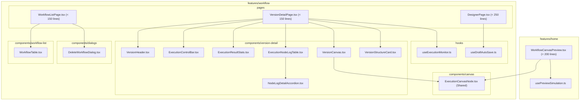

# Design Document: Frontend Component Decomposition

## 1. Overview & Architectural Goals
The objective of Phase 5 is to decompose "God Components" in the FlowPilot frontend into modular, testable, single-responsibility components and custom hooks, adhering strictly to:
- **Clean Architecture & Feature-Based Architecture**: Separation of presentation, state orchestration, and data fetching.
- **File Length Guideline**: Components under 200 lines where practical (target pages: <180 lines).
- **Zero Visual / UX Regression**: Preserve identical DOM structures, accessibility attributes, styles, and behaviors.
- **Strict Typing & shadcn/ui Standard**: Zero `any` casts, mandatory shadcn/ui primitives.

---

## 2. Target Component & Hook Architecture



---

## 3. Detailed Component & Hook Specifications

### 3.1 Shared Canvas Node: `ExecutionCanvasNode.tsx`
- **Location:** `frontend/src/features/workflow/components/canvas/ExecutionCanvasNode.tsx`
- **Unifies:** `RunnerNodeComponent` (from `VersionDetailPage.tsx`) and `PreviewNodeComponent` (from `WorkflowCanvasPreview.tsx`).
- **Data Interface:**
  ```typescript
  export interface ExecutionCanvasNodeData extends Record<string, unknown> {
    label: string;
    category: string;
    iconType: 'webhook' | 'filter' | 'database' | 'mail' | 'action' | 'ai';
    detail: string;
    status: 'idle' | 'running' | 'success' | 'failed' | 'skipped';
    hasTarget: boolean;
    hasSource: boolean;
    outputSummary?: string;
    errorMessage?: string;
    durationMs?: number;
  }
  ```
- **Styling:** Dynamic border highlight based on status (`running`, `success`, `failed`, `skipped`, `idle`). Renders `<Handle>` for source/target, category badge, status spinner / checkmark / error mark, output summary pill, and error pill.

### 3.2 Custom Hook: `useExecutionMonitor.ts`
- **Location:** `frontend/src/features/workflow/hooks/useExecutionMonitor.ts`
- **Responsibilities:**
  - Coordinates URL search params (`?execution=...`) for the active execution run.
  - Subscribes to real-time events via `useExecutionStream` and updates TanStack Query cache with `applyExecutionStreamEvent`.
  - Performs fallback execution polling via `useExecution(selectedExecutionId, 1000, streamState !== 'connected')`.
  - Fetches run history using `useExecutionHistory(workflowId, versionId)`.
  - Manages run execution mutation via `useStartExecution`.
  - Maps per-node execution statuses via `mapExecutionNodeStates`.
- **Interface:**
  ```typescript
  export interface UseExecutionMonitorReturn {
    selectedExecutionId: string | null;
    selectExecution: (id: string) => void;
    executionResult: ExecutionResult | undefined;
    executionError: boolean;
    executionHistory: ExecutionHistoryItem[] | undefined;
    streamState: 'connected' | 'reconnecting' | 'disconnected';
    isPending: boolean;
    handleRun: () => void;
  }
  ```

### 3.3 Version Detail Subcomponents (`features/workflow/components/version-detail/`)
1. **`VersionHeader.tsx`**: Breadcrumb navigation (`Workflows / Phiên bản / vX`), "Mở Designer" external link button.
2. **`ExecutionControlBar.tsx`**: Version title banner, published timestamp, stream status badge, and `EventTriggerInfo` or Run/Rerun trigger button.
3. **`ExecutionResultStats.tsx`**: Overall status card (SUCCESS, FAILED, RUNNING), duration card, startedAt card, and execution ID card with clipboard copy button.
4. **`VersionCanvas.tsx`**: Top toolbar (`workflow_vX.flow`, node/edge counts, Open Designer button) and ReactFlow canvas wrapping `ExecutionCanvasNode`.
5. **`ExecutionNodeLogTable.tsx`**: Table of node execution steps (`nodeId`, `nodeKey`, status badge, startedAt, durationMs), with expand/collapse toggles.
6. **`NodeLogDetailAccordion.tsx`**: Sub-row displaying error banner (if failed) and 2-column input/output formatted JSON viewer.
7. **`VersionStructureCard.tsx`**: Read-only breakdown of frozen node sequence and configurations within the published version.

### 3.4 Custom Hook: `useDraftAutoSave.ts`
- **Location:** `frontend/src/features/workflow/hooks/useDraftAutoSave.ts`
- **Responsibilities:**
  - Manages debounce timer (`saveTimeoutRef`) across node and edge changes.
  - Automatically avoids saving on initial load.
  - Provides `forceSave(nodes, edges)` for flush-saving before workflow publishing.
  - Exposes `isSaving` state synchronized with designer store or mutation.

### 3.5 Dialogs & Workflow List Decomposition
1. **`DeleteWorkflowDialog.tsx`**:
   - Location: `frontend/src/features/workflow/components/dialogs/DeleteWorkflowDialog.tsx`
   - Props: `open`, `workflow: WorkflowSummary | null`, `isDeleting: boolean`, `onConfirm: () => void`, `onCancel: () => void`.
2. **`WorkflowTable.tsx`**:
   - Location: `frontend/src/features/workflow/components/workflow-list/WorkflowTable.tsx`
   - Props: `workflows: WorkflowSummary[]`, `editingId: string | null`, `editingName: string`, `savingName: boolean`, `deleting: boolean`, `onStartRename: (wf: WorkflowSummary) => void`, `onChangeEditingName: (name: string) => void`, `onSaveRename: () => void`, `onCancelRename: () => void`, `onPromptDelete: (wf: WorkflowSummary) => void`, `onOpenDesigner: (id: string) => void`, `onOpenVersions: (id: string) => void`.

### 3.6 Home Preview Decomposition (`features/home/`)
1. **`usePreviewSimulation.ts`**:
   - Location: `frontend/src/features/home/hooks/usePreviewSimulation.ts`
   - Orchestrates simulation timeouts (Webhook -> Filter -> Postgres -> Gmail -> Finished), log accumulator, active tab state (`receipt` | `logs` | `payload`), reset handlers.
2. **`WorkflowCanvasPreview.tsx`**:
   - Uses `ExecutionCanvasNode` as its node type renderer.
   - Employs `usePreviewSimulation` to cleanly decouple presentation from timer orchestration.

---

## 4. Verification & Testing Strategy
- **Unit Tests:**
  - `ExecutionCanvasNode.test.tsx`: Renders icons, badges, handles, status styles.
  - `ExecutionNodeLogTable.test.tsx`: Renders log rows, expands and collapses payload accordion.
  - `useExecutionMonitor.test.tsx`: Mocks hooks, verifies state transitions and start execution trigger.
  - `useDraftAutoSave.test.ts`: Verifies debounced save invocation and immediate `forceSave`.
- **Regression Suite:**
  - Ensure `WorkflowListPage.test.tsx`, `DesignerPage.test.tsx`, and all 34 existing test suites pass with 100% success rate.
  - Run `npm run lint --prefix frontend` with 0 warnings and 0 errors.

