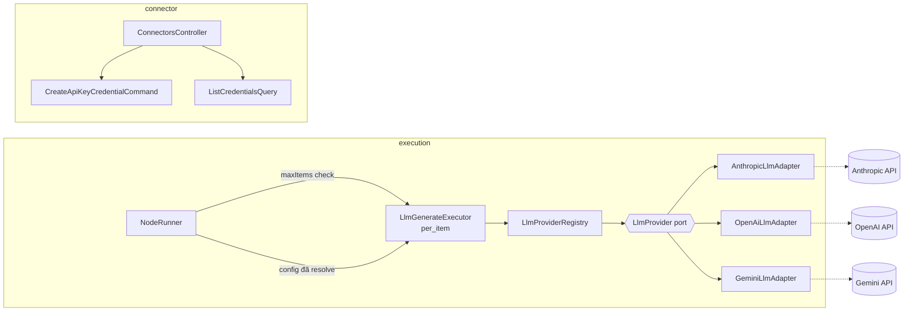
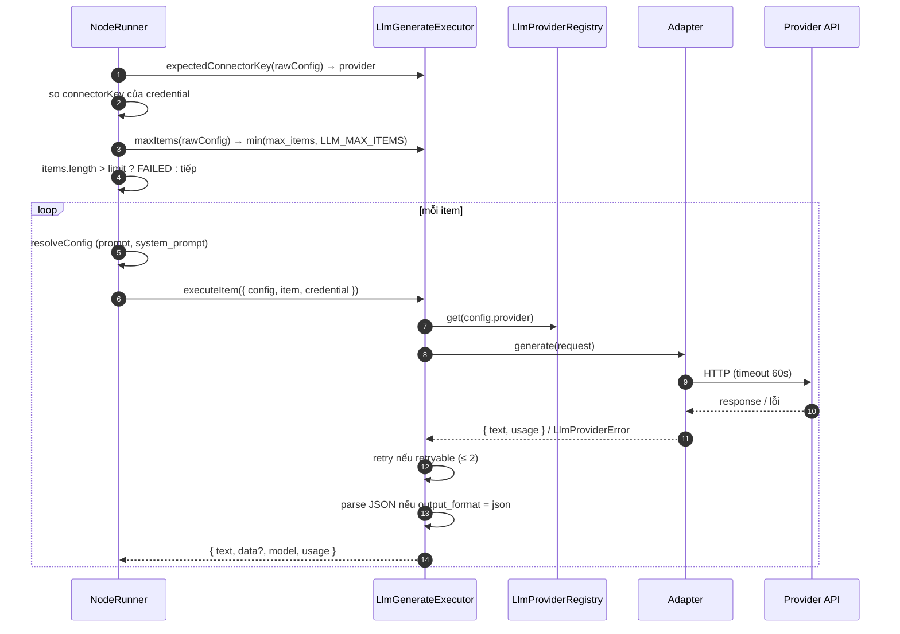

# Technical Design: LLM Node

> Xây trên spec `execution-item-model`: dùng `IPerItemExecutor`, engine resolve biểu thức, `expectedConnectorKey`, `summary` khi lỗi item.

## 1. Kiến trúc tổng thể (Architecture Overview)

Bounded context bị chạm tới:
- **`libs/execution`** — `LlmGenerateExecutor`, provider port + 3 adapter, hook giới hạn item trong engine.
- **`libs/connector`** — tạo / liệt kê credential API key.
- **`libs/node-library`** — thêm category `AI`.
- **`prisma`** — migration enum + seed.
- **Frontend `features/workflow`** — palette, `PropertiesPanel`, credential picker, dialog thêm API key.



Executor **không** render template, **không** lặp, **không** gắn kết quả vào item gốc — engine đã lo.

---

## 2. Database (Prisma)

### 2.1. Migration
```prisma
enum NodeCategory {
  TRIGGER
  LOGIC
  DATA_PROCESSING
  INTEGRATION
  AI
}
```
`prisma migrate dev --name add_ai_node_category` (Postgres: `ALTER TYPE "NodeCategory" ADD VALUE 'AI'`).

### 2.2. Seed (upsert theo stable ID, cập nhật `configSchema` khi đã tồn tại)

**Connectors** (`auth_type: API_KEY`): `anthropic` (Anthropic), `openai` (OpenAI), `gemini` (Google Gemini — API key Google AI Studio, tách khỏi connector OAuth `google`). `config_schema` chung:
```json
{
  "type": "object",
  "required": ["api_key"],
  "properties": {
    "api_key": { "type": "string", "title": "API Key", "x-secret": true, "x-testable": true }
  }
}
```

**Node type** `ai.llm.generate`, category `AI`, `connector_id = null`:
```json
{
  "type": "object",
  "required": ["provider", "credential_id", "model", "prompt"],
  "properties": {
    "provider":      { "type": "string", "title": "Provider", "enum": ["anthropic", "openai", "gemini"] },
    "credential_id": { "type": "string", "title": "Credential", "x-refType": "credential", "x-connectorKeyFrom": "provider" },
    "model":         { "type": "string", "title": "Model" },
    "system_prompt": { "type": "string", "title": "System prompt", "x-allowExpression": true, "x-multiline": true },
    "prompt":        { "type": "string", "title": "Prompt", "x-allowExpression": true, "x-multiline": true },
    "output_format": { "type": "string", "title": "Output format", "enum": ["text", "json"], "default": "text" },
    "max_tokens":    { "type": "integer", "title": "Max tokens", "minimum": 1, "default": 1024 },
    "temperature":   { "type": "number", "title": "Temperature", "minimum": 0 },
    "max_items":     { "type": "integer", "title": "Max items", "minimum": 1, "default": 50 }
  }
}
```

### 2.3. `x-*` hint mới (cập nhật `docs/schema/rule-for-config-schema.md`)

| Hint | Ý nghĩa |
|---|---|
| `x-connectorKeyFrom: "<field>"` | Connector của credential lấy theo giá trị field khác trong cùng config. Dùng thay `x-connectorKey` khi một node phục vụ nhiều connector. Field được tham chiếu không được là biểu thức. |
| `x-multiline: true` | UI render textarea. |

---

## 3. Backend



### 3.1. Engine — hook giới hạn item (mở rộng `execution-item-model`)
Thêm vào `IPerItemExecutor`:
```typescript
// Nhận config THÔ. Trả về số item tối đa node chấp nhận, null = không giới hạn.
maxItems?(rawConfig: Record<string, unknown>): { limit: number; reason: string } | null;
```
`NodeRunner` (nhánh `per_item`), trước vòng lặp:
```
lim = executor.maxItems?.(rawConfig)
if lim && items.length > lim.limit:
  FAILED, errorMessage = `Node received ${items.length} items, exceeds ${lim.reason}`
```
Hook dùng chung — node `per_item` tốn kém khác sau này dùng lại được.

### 3.2. Domain (`libs/execution`)
```typescript
export const NodeKeys = { /* ... */ AI_LLM_GENERATE: 'ai.llm.generate' } as const;
export const ConnectorKeys = { /* ... */ ANTHROPIC: 'anthropic', OPENAI: 'openai', GEMINI: 'gemini' } as const;

export const LlmLimits = {
  DEFAULT_MAX_ITEMS_CEILING: 100, // dùng khi không đặt env LLM_MAX_ITEMS
  REQUEST_TIMEOUT_MS: 60_000,
  MAX_RETRIES: 2,
} as const;
```

### 3.3. Application (`libs/execution`)

**Provider port:**
```typescript
export interface LlmGenerateRequest {
  model: string;
  systemPrompt?: string;
  prompt: string;
  maxTokens: number;
  temperature?: number;
  outputFormat: 'text' | 'json';
  apiKey: string;
}

export interface LlmGenerateResult {
  text: string;
  usage: { inputTokens: number; outputTokens: number } | null;
}

export interface LlmProvider {
  readonly key: string; // 'anthropic' | 'openai' | 'gemini'
  generate(request: LlmGenerateRequest): Promise<LlmGenerateResult>;
}

export class LlmProviderError extends Error {
  constructor(message: string, readonly retryable: boolean) { super(message); }
}
```

**`LlmProviderRegistry`:** map provider key → `LlmProvider`, inject qua token `LLM_PROVIDERS` (giống `NODE_EXECUTORS`).

**`LlmGenerateExecutor`** (`runMode: 'per_item'`):
- Constructor: `(registry: LlmProviderRegistry, maxItemsCeiling: number)`.
- `parseConfig` (zod v4): `provider` enum, `credential_id` uuid, `model` min(1), `prompt` min(1), `system_prompt` optional, `output_format` default `text`, `max_tokens` / `temperature` / `max_items` dùng `z.coerce.number()` (frontend cũ có thể gửi chuỗi) + default.
- `parseCredential`: `z.object({ api_key: z.string().min(1) })`.
- `expectedConnectorKey(raw)` → `raw.provider`.
- `maxItems(raw)` → `max_items` (đã coerce + default) so với `maxItemsCeiling`:
  - `max_items ≤ ceiling` → `{ limit: max_items, reason: 'node max_items 50' }`
  - ngược lại → `{ limit: ceiling, reason: 'platform limit LLM_MAX_ITEMS 100' }`
- `executeItem({ config, credential })`:
  1. `adapter = registry.get(config.provider)` (thiếu → throw).
  2. `result = callWithRetry(() => adapter.generate(request))` — retry khi `LlmProviderError.retryable`, tối đa `MAX_RETRIES`, backoff 1s → 2s.
  3. Output `{ text, model: config.model, usage }` (usage đổi tên `input_tokens`, `output_tokens`).
  4. `json` → `data = parseJsonOutput(text)`: bỏ code fence ```` ```json ... ``` ```` nếu có, `JSON.parse`; lỗi → throw `"LLM returned invalid JSON"`.

### 3.4. Infrastructure (`libs/execution`)
Mỗi adapter implement `LlmProvider`, tạo client theo `apiKey` mỗi request, đặt timeout `REQUEST_TIMEOUT_MS`, **tắt retry nội bộ của SDK** (retry do executor quản lý), map lỗi → `LlmProviderError(retryable = status ∈ {408, 429} ∪ [500, 599] hoặc timeout)`.

| Adapter | SDK | JSON mode | Text | Usage |
|---|---|---|---|---|
| `AnthropicLlmAdapter` | `@anthropic-ai/sdk` | không có JSON mode riêng → thêm chỉ dẫn "Respond with valid JSON only" vào system prompt | ghép các content block `text` | `usage.input_tokens` / `output_tokens` |
| `OpenAiLlmAdapter` | `openai` | `response_format: { type: 'json_object' }` | `choices[0].message.content` | `usage.prompt_tokens` / `completion_tokens` |
| `GeminiLlmAdapter` | `@google/genai` | `responseMimeType: 'application/json'` | `response.text` | `usageMetadata.promptTokenCount` / `candidatesTokenCount` |

`sanitizeErrorText` (engine) thêm pattern: `sk-ant-[A-Za-z0-9_-]{16,}`, `sk-[A-Za-z0-9_-]{16,}`, `AIza[0-9A-Za-z_-]{20,}`.

### 3.5. Connector module (`libs/connector`) — CQRS

| Thành phần | Mô tả |
|---|---|
| `CreateApiKeyCredentialCommand(connectorKey, ownerId, name, apiKey)` + handler | Tìm connector active theo key; `authType !== API_KEY` → `BadRequest`; mã hoá `JSON.stringify({ api_key })` bằng `EncryptionUtil` + `ENCRYPTION_KEY`; lưu qua `ConnectorCredentialRepository.create`; trả DTO không có secret |
| `ListCredentialsQuery(connectorKey, ownerId)` + handler | `{ id, connectorKey, name, createdAt }[]` |
| `ConnectorsController` | `POST` / `GET /api/connectors/:connectorKey/credentials` (JWT, `@CurrentUser`) |
| `CreateApiKeyCredentialDto` | `name` `@IsString() @IsNotEmpty() @MaxLength(255)`, `api_key` `@IsString() @IsNotEmpty()` |
| `CredentialResponseDto` | map từ domain entity — không trả entity ra presentation |

### 3.6. Module assembly
- `ExecutionModule`: đăng ký 3 adapter, `LLM_PROVIDERS`, `LlmProviderRegistry`; `LlmGenerateExecutor` qua factory đọc `LLM_MAX_ITEMS` (không hợp lệ / không đặt → `DEFAULT_MAX_ITEMS_CEILING`); thêm vào `NODE_EXECUTORS`.
- `ConnectorModule`: đăng ký command / query handler mới.
- `.env.example`: thêm `LLM_MAX_ITEMS=100`.

---

## 4. Frontend

### 4.1. Cấu trúc
```text
frontend/src/features/workflow/
├── api/credential.api.ts               # GET/POST /api/connectors/:key/credentials
├── services/credential.service.ts
├── hooks/useCredentials.ts             # useCredentials(connectorKey), useCreateApiKeyCredential()
├── components/
│   ├── PropertiesPanel.tsx             # điều phối, chọn control theo schema
│   ├── config-fields/
│   │   ├── CredentialField.tsx         # OAuth (x-connectorKey) hoặc picker (x-connectorKeyFrom)
│   │   ├── EnumField.tsx               # shadcn Select
│   │   ├── TextField.tsx               # shadcn Input / Textarea (x-multiline), badge fx
│   │   └── NumberField.tsx             # shadcn Input type=number → lưu number
│   └── AddApiKeyDialog.tsx             # shadcn Dialog
└── types/node-type.ts                  # category thêm 'AI'
```

### 4.2. Hành vi
- **Palette / Canvas:** `category` thêm `'AI'` (`node-type.ts`, `workflow.model.ts`); nhóm AI trong `Sidebar`; node AI render như action node.
- **`PropertiesPanel`:** tách render field ra `config-fields/*` (file < 200 dòng); chọn control theo thứ tự `x-refType` / `x-connectorKey` → `enum` → `integer | number` → `string`.
- **Kiểu giá trị:** `handleConfigChange(key, value: unknown)`; `NumberField` lưu `number` (rỗng → xoá key).
- **Credential picker (`x-connectorKeyFrom`):**
  - Đọc `config[from]` (vd. `provider`); chưa có → disabled, gợi ý "Chọn provider trước".
  - `useCredentials(provider)` → shadcn `Select`; mục cuối "+ Thêm API key" mở `AddApiKeyDialog`.
  - Lưu thành công → invalidate `['credentials', provider]`, tự chọn credential vừa tạo.
  - Đổi `provider` → xoá `credential_id`.
- **Gợi ý model:** lấy từ schema bằng hint `x-placeholderByField` (`{ field: "provider", values: { anthropic: "e.g. claude-opus-5-5", ... } }`), UI không hardcode. Chỉ là placeholder: model là text tự do, vì tên model đổi thường xuyên. Gợi ý của OpenAI và Gemini chưa được đối chiếu với danh sách model hiện hành.
- **Field OAuth hiện có (`x-connectorKey`)** giữ hành vi, thay `<button>` thô bằng shadcn `Button`.
- **shadcn cần thêm:** `npx shadcn@latest add input textarea select label`.

---

## 5. Kiểm thử (Testing)

Nguyên tắc: test hành vi qua interface công khai. **Seam chính: `LlmProvider` port** — test executor và engine dùng fake provider, không gọi API thật.

| Mục | Loại | Nội dung | Prior art |
|---|---|---|---|
| `LlmGenerateExecutor` | unit | text / json; JSON lỗi; code fence; retry thành công; retry hết; lỗi không retryable; `maxItems` theo node / theo trần; `expectedConnectorKey`; coerce số | `filter-executor.spec.ts` |
| Engine + LLM | unit | 4 ví dụ (a)–(d) với fake provider + fake Gmail client; vượt `max_items` → FAILED trước khi gọi provider; credential sai provider → FAILED; lỗi không lộ API key | `start-execution.handler.spec.ts` |
| Adapters | unit | SDK client mock: map request / response / usage, JSON mode, phân loại lỗi retryable | — |
| Credential API | e2e | tạo → secret mã hoá, response không có secret; list theo connector; connector OAuth → 400 | `apps/api/test/*.e2e-spec.ts` |
