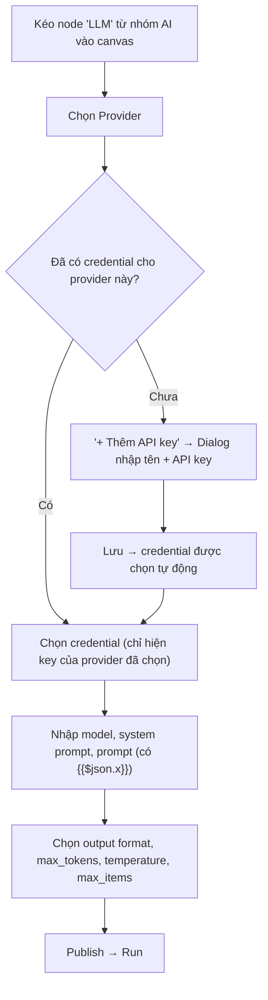

# Feature Specification: LLM Node (Node AI trong workflow)

> **Phụ thuộc:** spec `execution-item-model` (hợp đồng item, bộ resolve biểu thức, paired item, Aggregate node, kiểm tra credential đúng connector). Làm spec đó trước.

## 1. Bối cảnh & Vấn đề (Context & Problem Statement)

Các node hiện có đều làm việc theo luật cứng — đọc dữ liệu, lọc bằng so sánh chuỗi, gửi theo mẫu. Workflow không có bước nào *hiểu* hoặc *tạo ra* văn bản, nên người dùng không thể viết nội dung riêng cho từng dòng, phân loại nội dung tự do, hay tóm tắt nhiều dòng.

PRD mục 4.2 liệt kê nhóm node **AI** ("tóm tắt văn bản, phân loại nội dung"), nhưng catalog chưa có node nào và enum `NodeCategory` chưa có `AI`.

**Giải pháp thống nhất:** thêm node **LLM** (`ai.llm.generate`) thuộc nhóm mới `AI`, thiết kế như một **primitive**: *một prompt vào → một kết quả ra*.

- Node **không biết** dữ liệu đến từ đâu, có bao nhiêu dòng, hay kết quả sẽ đi đâu.
- Lặp theo item, chèn dữ liệu (`{{$json.x}}`, `{{$node["X"].json.y}}`), gộp danh sách (Aggregate) — đều do **engine** lo (spec `execution-item-model`).
- FlowPilot không quyết định node dùng để làm gì — người thiết kế workflow tự viết prompt.

### Ví dụ sử dụng — cùng một node, nhiều cách dùng

**(a) Viết nội dung riêng từng dòng**
```
Manual → Read Customers → Filter → LLM → Gmail
```
- LLM `prompt`: `Viết email nhắc thanh toán cho {{$json.name}}, nợ {{$json.amount}}đ, quá hạn {{$json.days_overdue}} ngày.`
- Gmail `to`: `{{$node["Read Customers"].json.email}}`, `body`: `{{$json.text}}`

**(b) Phân loại rồi lọc**
```
Manual → Read Feedback → LLM (json) → Filter → Gmail
```
- LLM `prompt`: `Phân loại phản hồi: "{{$json.feedback}}". Trả JSON {"label": "positive"|"negative"|"urgent"}.`
- Filter: `field = data.label`, `equals`, `urgent`

**(c) Tóm tắt cả danh sách — gọi LLM đúng 1 lần**
```
Manual → Read Feedback → Aggregate → LLM → Gmail
```
- LLM `prompt`: `Tóm tắt các phản hồi sau thành 5 ý chính: {{$json.items}}`

**(d) Không cần dữ liệu đầu vào**
```
Manual → LLM → Gmail
```
- LLM `prompt`: `Viết một câu chào buổi sáng truyền cảm hứng.`

---

## 2. Hiện trạng hệ thống & Phân tích khoảng trống (Current State & Gap Analysis)

*Giả định spec `execution-item-model` đã xong.*

### 2.1. Cơ sở dữ liệu (Prisma)
- **Đã có:** `node_type_definitions`, `connectors` (`auth_type` có `API_KEY`), `connector_credentials.encrypted_secret` (AES-256-GCM).
- **Thiếu:**
  - ❌ Giá trị `AI` trong enum `NodeCategory` → **cần 1 migration**.
  - ❌ Seed connector `anthropic`, `openai`, `gemini` và node `ai.llm.generate`.

### 2.2. Backend
- **Đã có (sau spec `execution-item-model`):** `IPerItemExecutor`, engine resolve biểu thức, paired item, `expectedConnectorKey`, `summary` khi lỗi item.
- **Thiếu:**
  - ❌ Executor `ai.llm.generate`, provider port và 3 adapter.
  - ❌ **Tạo credential dạng API key**: hiện chỉ luồng OAuth Google tạo được credential; `connectors` controller chỉ có `GET /api/connectors`.
  - ❌ Giới hạn số item cho một node `per_item` (engine chưa có hook).
  - ❌ Che API key dạng `sk-...`, `sk-ant-...`, `AIza...` trong lỗi.

### 2.3. Frontend (`frontend/src/features/workflow`)
- **Đã có:** `Sidebar`, `Canvas` đọc `category`; `PropertiesPanel` render form từ `configSchema.properties`; shadcn `alert`, `badge`, `button`, `card`, `dialog`, `radio-group`, `table`.
- **Thiếu:**
  - ❌ Type `category` chưa có `AI` (`node-type.ts`, `workflow.model.ts`).
  - ❌ Field credential luôn render nút OAuth Google cố định — chưa có credential picker theo connector, chưa có form nhập API key.
  - ❌ Mọi giá trị lưu dạng `string` → field `integer` / `number` cần lưu đúng kiểu.
  - ❌ Chưa có textarea cho prompt dài.
  - ❌ `PropertiesPanel` dùng `<button>`, `<select>`, `<input>` thô — vi phạm quy chuẩn shadcn/ui. Cần thêm `input`, `textarea`, `select`, `label`.

---

## 3. Phạm vi (Scope)

### Trong phạm vi (In-Scope)
- Nhóm node `AI` trong palette, node `ai.llm.generate` (`per_item`).
- 3 provider v1: **Anthropic, OpenAI, Google Gemini** — người dùng chọn provider trước, rồi chọn credential của provider đó.
- Người dùng dùng **API key của chính họ**, lưu mã hoá.
- Output `text` hoặc `json`.
- Token usage trên item output (để người dùng thấy trong log).
- Giới hạn: người dùng tự đặt `max_items` / `max_tokens` (có mặc định); nền tảng giữ trần `max_items`, timeout, retry.
- API tạo / liệt kê credential API key.

### Ngoài phạm vi (Out-of-Scope)
- **Chạy execution nền (BullMQ)** — bước tiếp theo nên làm: execution hiện chạy đồng bộ trong request HTTP, đây là lý do trần `LLM_MAX_ITEMS` phải thấp (100). Khi chạy nền thì nâng trần lên được.
- Trợ lý AI tạo / sửa workflow (FlowPilot AI — "Phase sau").
- Streaming, chat nhiều lượt, tool use, input ảnh / file.
- Gọi song song nhiều item.
- Validate output JSON theo JSON Schema do người dùng định nghĩa.
- Ước tính chi phí theo tiền.
- Lấy danh sách model động từ provider.
- "Test connection" cho credential API key (FR-CF-04).
- Provider tương thích OpenAI với `base_url` tuỳ chỉnh (Ollama, Groq, DeepSeek...).

---

## 4. Luồng trải nghiệm người dùng (UI/UX Flow)



### Form cấu hình node (PropertiesPanel)

| Field | Control | Ghi chú |
|---|---|---|
| Provider | Select | `anthropic` / `openai` / `gemini`; đổi provider → xoá credential đang chọn |
| Credential | Select + "+ Thêm API key" | Chỉ hiện credential của provider đang chọn; chưa chọn provider → disabled |
| Model | Text input | Gợi ý model mặc định theo provider |
| System prompt | Textarea | badge `fx` |
| Prompt | Textarea | badge `fx` |
| Output format | Select | `text` (mặc định) / `json` |
| Max tokens | Number input | mặc định 1024 |
| Temperature | Number input | trống = mặc định của provider |
| Max items | Number input | mặc định 50 |

### Dialog "Thêm API key" (shadcn/ui `Dialog`)
- Tiêu đề: `Thêm API key cho [Provider]`
- Field: `Tên` (vd. "OpenAI cá nhân"), `API key` (input `type=password`)
- Nút: `Huỷ` / `Lưu`
- Sau khi lưu, API key **không bao giờ** được hiển thị lại.

---

## 5. Đặc tả API (API Specification)

### 5.1. Tạo credential API key
- **Endpoint:** `POST /api/connectors/:connectorKey/credentials`
- **Xác thực:** Bearer JWT.
- **Body:**
```json
{ "name": "OpenAI cá nhân", "api_key": "sk-..." }
```
- **Response `201 Created`:**
```json
{
  "id": "7c9e6679-7425-40de-944b-e07fc1f90ae7",
  "connectorKey": "openai",
  "name": "OpenAI cá nhân",
  "createdAt": "2026-10-17T02:00:00.000Z"
}
```
- **Error:** `400` thiếu field / connector không phải `API_KEY`; `401` chưa đăng nhập; `404` không có connector active.

### 5.2. Liệt kê credential của user theo connector
- **Endpoint:** `GET /api/connectors/:connectorKey/credentials`
- **Response `200 OK`:** `{ id, connectorKey, name, createdAt }[]` — chỉ của user hiện tại, **không bao giờ** trả secret.

### 5.3. Thực thi
Không có endpoint mới — chạy qua `POST /api/executions`.

---

## 6. Hợp đồng node (Node Contract)

### 6.1. Config

| Field | Kiểu | Bắt buộc | Mặc định | Biểu thức |
|---|---|---|---|---|
| `provider` | `anthropic` \| `openai` \| `gemini` | có | | không |
| `credential_id` | UUID | có | | không |
| `model` | string | có | | không |
| `system_prompt` | string | không | | **có** |
| `prompt` | string | có | | **có** |
| `output_format` | `text` \| `json` | không | `text` | không |
| `max_tokens` | integer ≥ 1 | không | 1024 | không |
| `temperature` | number ≥ 0 | không | mặc định provider | không |
| `max_items` | integer ≥ 1 | không | 50 | không |

### 6.2. Run mode
`per_item` — engine gọi node một lần cho mỗi item input. Muốn gọi một lần cho cả danh sách → đặt **Aggregate** trước LLM.

### 6.3. Output
Mỗi item input → **đúng 1 item output** (engine gán `pairedItem`):
```json
{
  "text": "Chào An, có lẽ khoản 5.000.000đ đã bị bỏ sót vài ngày...",
  "model": "…",
  "usage": { "input_tokens": 182, "output_tokens": 96 }
}
```
Với `output_format: json`, thêm `data` = kết quả đã parse:
```json
{
  "text": "{\"label\":\"urgent\"}",
  "data": { "label": "urgent" },
  "model": "…",
  "usage": { "input_tokens": 120, "output_tokens": 8 }
}
```
Dữ liệu gốc của item **không bị copy vào output** — node sau lấy lại qua `{{$node["Tên node"].json.x}}`.

---

## 7. Quy tắc nghiệp vụ (Business Rules)

1. **Giới hạn — người dùng tự đặt, nền tảng giữ trần:**
   - `max_items`: người dùng đặt (mặc định 50). Nền tảng có trần `LLM_MAX_ITEMS` (biến môi trường, mặc định 100); giới hạn hiệu lực = `min(max_items, LLM_MAX_ITEMS)`. Lý do giữ trần: execution chạy **đồng bộ** trong request `POST /api/executions` và gọi LLM tuần tự (thường ~5s một lần, xấu nhất 60s × 3 lần thử). 100 item ≈ 8 phút ở mức bình thường; 500 item ≈ 40 phút — request treo quá lâu. Trần sẽ được nâng khi execution chạy nền (BullMQ, đã có trong kiến trúc).
   - `max_tokens`: người dùng đặt (mặc định 1024), **không có trần** — model tự giới hạn, vượt mức thì provider trả lỗi.
   - Timeout mỗi lần gọi: 60 giây. Retry tối đa 2 lần cho 429 / 5xx / timeout; lỗi khác (400, 401) không retry. Cả hai do nền tảng quản lý.
2. **Không cắt bớt âm thầm:** số item input vượt giới hạn hiệu lực → node `FAILED` **trước khi gọi LLM lần nào**, thông báo rõ số item và giới hạn nào bị vượt.
3. **Lỗi giữa chừng:** một lần gọi thất bại sau retry → node `FAILED` (engine ghi `summary` theo spec `execution-item-model`).
4. **JSON không hợp lệ** với `output_format: json` → node `FAILED` ở item đó.
5. **Credential đúng provider:** connector của credential phải bằng `provider` (qua `expectedConnectorKey`); sai → `FAILED`.
6. **Bảo mật API key:** chỉ giải mã trong bộ nhớ lúc gọi provider; không xuất hiện trong node log, execution context, API response, error message.
7. **Chi phí:** token tính trên API key của người dùng; nền tảng chỉ chặn chạy vượt kiểm soát (quy tắc 1–2). `usage` trên output giúp người dùng tự theo dõi.
8. **Bất biến khi publish:** provider, model, prompt nằm trong `definition` của version.

---

## 8. Tiêu chí nghiệm thu (Acceptance Criteria)

1. Palette có nhóm **AI** chứa node **LLM**; seed chạy hai lần không lỗi.
2. Tạo được credential API key cho từng provider; response / danh sách không chứa secret; DB chỉ lưu bản mã hoá.
3. Credential picker chỉ hiện credential của provider đang chọn; đổi provider xoá lựa chọn cũ.
4. Ví dụ (a): mỗi khách nhận email có nội dung LLM sinh, gửi đúng địa chỉ qua `$node["Read Customers"]`.
5. Ví dụ (b): Filter lọc được theo `data.label`.
6. Ví dụ (c): LLM được gọi **đúng 1 lần** cho cả danh sách.
7. Ví dụ (d): LLM chạy được ngay sau Manual Trigger, không cần dữ liệu đầu vào.
8. Output có `usage` và hiển thị trong log execution.
9. Vượt `max_items` / trần `LLM_MAX_ITEMS`, JSON lỗi, credential sai provider, provider lỗi sau retry, config thiếu `prompt` / `model` / `credential_id` → execution `FAILED`, log có lỗi rõ ràng, không lộ API key.
