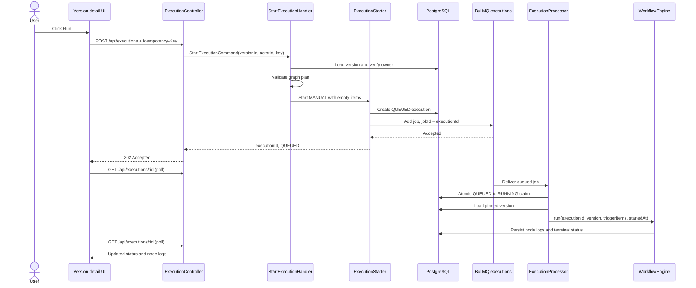
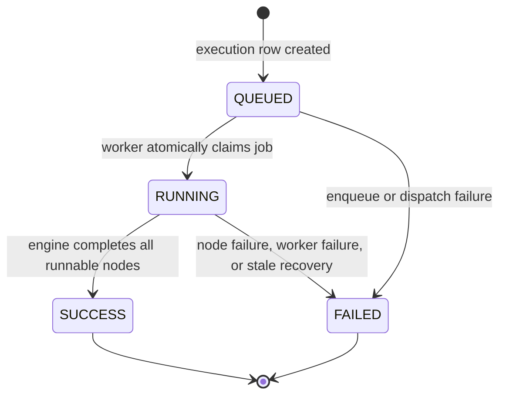

# Asynchronous Manual Execution Design

## Scope and Evidence

This is a proposed design based on the current repository. Verified behavior is
recorded in `spec.md`; this document describes the intended changes.

Relevant existing paths:

- `monolith-backend/libs/execution/src/application/commands/start-execution/start-execution.command.ts`
- `monolith-backend/libs/execution/src/application/commands/enqueue-execution/enqueue-execution.command.ts`
- `monolith-backend/libs/execution/src/application/services/workflow-engine.ts`
- `monolith-backend/libs/execution/src/infrastructure/queue/execution.processor.ts`
- `monolith-backend/libs/execution/src/infrastructure/queue/execution-queue.module.ts`
- `monolith-backend/libs/execution/src/presentation/http/execution.controller.ts`
- `monolith-backend/libs/execution/src/infrastructure/persistence/prisma-execution.repository.ts`
- `frontend/src/features/workflow/pages/VersionDetailPage.tsx`

## Proposed Architecture

Keep the trigger adapters responsible for identity, authorization, trigger
selection, validation, and trigger input. Introduce a shared application
`ExecutionStarter` (name illustrative) that creates the queued execution and
enqueues the common job. `WorkflowEngine` remains the execution engine: it plans
and runs a pinned version, but it does not decide whether a trigger is manual or
webhook and does not enqueue jobs.

`StartExecutionHandler` keeps its existing owner check and graph preflight. It
passes the validated version, `MANUAL`, the authenticated actor ID, and `[]` to
the shared starter. `EnqueueExecutionHandler` remains the webhook CQRS adapter
and passes the selected version, `WEBHOOK`, `null`, and parsed event items. Both
use the same queue port and `ExecutionProcessor`.

Do not have `StartExecutionHandler` invoke `EnqueueExecutionHandler` as a
command. That handler currently hardcodes `WEBHOOK`, has no actor parameter, and
does not perform manual ownership/preflight checks. A shared application service
removes duplicated persistence/enqueue/failure handling without mixing trigger
policies.

### Sequence



### Lifecycle



`CANCELLED` is not a transition in this release. The Prisma enum contains it,
but there is no worker cancellation protocol. Do not expose a cancel button or
write `CANCELLED` until cancellation can stop queued jobs and cooperatively
interrupt running work.

## Queue and Job Contract

Reuse the existing `executions` BullMQ queue. The job remains a transport
envelope, not an execution snapshot:

```ts
interface QueuedExecutionJob {
	executionId: string;
	workflowVersionId: string;
	triggerItems: Item[];
	queuedAt: string;
}
```

The worker loads the immutable version by `workflowVersionId`; it must not
receive or reconstruct a draft definition. Manual input remains `[]`, matching
`StartExecutionHandler` today. Webhook input remains the parsed item list and
continues to be stored in execution context for debugging. Keep job IDs equal to
the execution ID, one queue attempt, and the worker's atomic `QUEUED` claim. A
duplicate job for a terminal or already claimed execution is a no-op and must
not re-run external effects.

## Persistence and Consistency

### Status and time fields

Persist `QUEUED` before calling Redis. `queuedAt` records acceptance/queue time;
`startedAt` is set when the worker successfully claims the execution. The
current schema requires `startedAt` even while queued, and creation currently
uses the request timestamp. Add nullable `queuedAt`, make `startedAt` nullable
until claim, and backfill old rows' `queuedAt` from their current `startedAt`.
Keep old `startedAt` values intact for historical completed rows. Set
`finishedAt` and `durationMs` only at terminal completion; duration measures
worker execution from `startedAt`, not queue wait.

Add an optional persisted idempotency key scoped to `triggeredById` with a
composite unique constraint. Existing rows have no key. The frontend creates a
new random key for each intentional Run action and reuses it only for retries of
that HTTP submission. A same-key/same-version replay returns the prior resource;
a same-key/different-request replay is `409`.

These changes require a Prisma migration and schema update. The existing
`CANCELLED` database enum requires no migration for this work. Existing status
and node log values remain valid.

### PostgreSQL and Redis failure windows

PostgreSQL and Redis cannot participate in one atomic transaction. Use this
ordered minimum:

1. Insert the execution row in `QUEUED` state in PostgreSQL.
2. Add the BullMQ job with `jobId = executionId`.
3. If enqueue returns an error, conditionally transition that still-unstarted
	 row to `FAILED` and return an error response.
4. On worker startup and periodically, find old `QUEUED` rows and idempotently
	 ensure their BullMQ job exists. `jobId = executionId` and the worker's atomic
	 claim protect against duplicate delivery.
5. Continue using the failed-job hook and stale `RUNNING` recovery, but make
	 stale recovery conditional and observable. The current bootstrap sweep uses
	 a fixed age threshold; avoid failing a legitimately long-running active job
	 solely because it exceeds that threshold. A lease/heartbeat is the stronger
	 future model.

If enqueueing must be guaranteed across process death at every instruction, a
transactional outbox is the stronger solution: insert execution and outbox row
in one Postgres transaction, then dispatch and mark the outbox row. That is a
larger addition and is not required for the initial version if the queued-row
reconciler is implemented and monitored.

The queue currently uses `attempts: 1` and `maxStalledCount: 0`, intentionally
avoiding automatic replay because actions such as email can be non-idempotent.
Keep that behavior. Do not claim exactly-once execution. Database idempotency
prevents duplicate submission and job claiming prevents duplicate processing,
but cannot undo or make an external side effect transactional.

## Backend Responsibilities

- **StartExecutionHandler:** authenticate through the existing guarded
	controller; load the version, verify `workflowOwnerId`, and run
	`WorkflowEngine.plan()` before acceptance. Pass only validated trigger data to
	the starter.
- **EnqueueExecutionHandler:** keep webhook-specific version/input selection;
	delegate common create/enqueue/error handling to the starter.
- **ExecutionStarter:** create a `QUEUED` row with trigger type, actor, context,
	and timestamps; enqueue the common job; mark failed if enqueue reports an
	error; return the persisted execution identity.
- **ExecutionProcessor:** preserve atomic claim, pinned version lookup, worker
	concurrency, no automatic retries, `WorkflowEngine.run()`, and failure
	handling. Add queued-row reconciliation as a queue adapter/application
	operation rather than leaking BullMQ into controllers.
- **ExecutionRepository:** add owner-scoped execution reads, paginated workflow
	history, idempotency lookup/create behavior, queued-time persistence, and
	conditional recovery operations. Keep Prisma behind the repository.
- **WorkflowEngine and NodeRunner:** keep workflow semantics shared. For truthful
	live node status, add a start/update log operation so `RUNNING` is persisted
	before executor work and the same log becomes `SUCCESS` or `FAILED` afterward.
	Existing `NodeRunner` only returns a final log after execution. If that
	instrumentation is deferred, show overall `RUNNING` and completed node logs,
	but do not guess which node is active.

## API and Authorization

Keep `POST /api/executions` and change its success status from 201 to 202. Add
`GET /api/executions/:id` for a status and full result, plus
`GET /api/workflows/:workflowId/executions` for version-filtered history.
Follow the existing `{ success, data }` envelope and use DTO/query validation.

Every read must join through execution -> workflow and enforce owner identity.
The current result repository method accepts only an execution ID, so do not
reuse it directly in an unguarded GET. Return not-found for absent or
non-owned executions if that is the repository's anti-enumeration convention.
The existing JWT guard remains on all routes.

Return `queuedAt` and nullable `startedAt` in the start/read DTO. Include
`workflowId`, `workflowVersionId`, and `triggerType`; the current Prisma result
mapping does not include them even though the frontend result interface lists
workflow identifiers.

## Frontend Design

### State and data flow

Replace the single local `executionResult` as the authoritative source with
React Query resources:

- `useStartExecution`: POST mutation. On acceptance, write the returned
	execution summary into the cache and set its ID as selected.
- `useExecution(executionId)`: GET query. Poll every 1 to 2 seconds while
	`QUEUED` or `RUNNING`; stop when terminal or on query error after normal retry
	handling.
- `useExecutionHistory(workflowId, workflowVersionId)`: paginated history query;
	invalidate/refetch after a start and terminal transition.
- Selected execution: encode the ID in the page query string (for example,
	`?execution=<id>`). This survives refresh and supports browser navigation.

Keep API calls in `execution.api.ts`, error conversion in
`execution.service.ts`, and query/mutation orchestration in hooks. Do not import
BullMQ concepts into the browser.

### Run and feedback

- Disable Run and show a submitting indicator only while the POST is in flight.
- After `202`, restore the Run button; show the selected run as `QUEUED` and
	start polling. Do not leave a loading state tied to the entire workflow.
- A later Run creates a distinct history item with a fresh idempotency key. A
	double-click or transport retry for the same intent reuses the same key.
- Show validation/authorization/queue errors inline or in the existing
	notification pattern. Avoid `alert()` for routine async lifecycle feedback.

### Canvas and logs

Initialize nodes as pending/idle for the selected execution. Apply each server
response by node ID:

- no log while queued: pending;
- persisted `RUNNING` log: running (only after backend instrumentation exists);
- `SUCCESS`, `FAILED`, and `SKIPPED` logs: their matching visual states;
- no log after a terminal run: not reached/pending unless the backend records an
	explicit skipped result.

The existing log table already expands input/output/error data. Retain that
behavior, but render partial logs while the run is active and select logs from
the selected execution only. Render overall queue wait, started/finished time,
duration, status, and copyable execution ID. Multiple active runs may be
available in history; switching must not overwrite one execution's cache with
another's result.

### Refresh and transport choice

On initial page load, read the execution ID from the URL, fetch the resource,
populate the canvas/log table, and poll if it is active. If there is no selected
ID, optionally select the latest history item without automatically starting a
run. For the first release, use React Query polling, not SSE or WebSocket. The
existing application has no execution event transport, and polling is simpler
to authorize, test, resume after refresh, and operate. Revisit SSE only if
measured polling load or required update latency justifies it.

### Cancellation

Do not add cancellation UX in this migration. Removing a waiting job may race
with the worker claim; interrupting an active node may not undo an external
effect. Future cancellation needs conditional `QUEUED -> CANCELLED`, queue job
removal, cooperative worker cancellation, and explicit node/external action
semantics before exposing a button.

## Testing Design

- Unit test `ExecutionStarter` for MANUAL and WEBHOOK inputs, QUEUED creation,
	job payload, idempotency behavior, enqueue failure, and conditional failure
	update.
- Unit test `StartExecutionHandler` to preserve owner, version, and graph
	validation; verify it delegates and never calls `WorkflowEngine.run()`.
- Extend webhook execution tests to prove delegation preserves its current
	parsed input behavior and job payload.
- Test `ExecutionProcessor` claim-once, version missing, node success/failure,
	failed-job handling, and stale/queued recovery without replaying completed
	side effects.
- Integration-test Prisma migration and owner-scoped GET/list, pagination,
	status transitions, and unique idempotency behavior against PostgreSQL.
- E2E-test `POST` returns 202 while execution is queued, then poll GET until a
	terminal state; cover queue failure, auth, invalid/foreign versions, duplicate
	key replay, and worker failure.
- Frontend tests cover accepted response, submit-only pending state, polling
	stop conditions, canvas mapping for each node status, result switching,
	history selection, URL refresh restoration, and request failures.

## Decision Summary

| Decision | Recommendation | Reason |
|---|---|---|
| Queue | Reuse `executions` | Existing payload, worker, configuration, and failure handling already fit both trigger types. |
| Shared logic | Add a shared application starter; keep both trigger handlers | The webhook handler hardcodes its trigger type and cannot safely stand in for manual policy. |
| Start response | HTTP 202 | The run is accepted for asynchronous work, not completed by the request. |
| Updates | React Query polling | Lowest operational cost and refresh-friendly; no existing event transport. |
| Cancellation | Defer | Worker and external effects are not cooperatively cancellable today. |
| Reliability | Idempotency plus queue reconciliation first; outbox if stronger durability is required | Covers duplicate requests and process interruption without claiming Postgres/Redis atomicity. |
