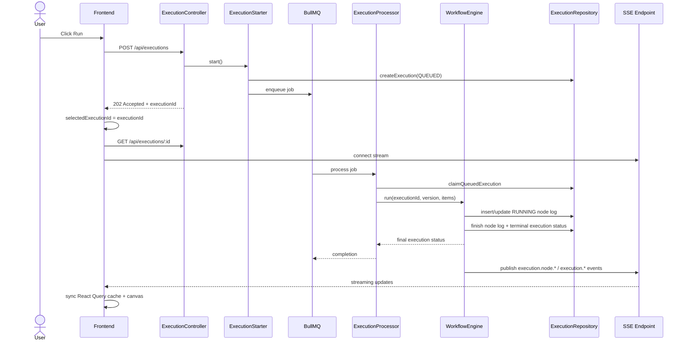
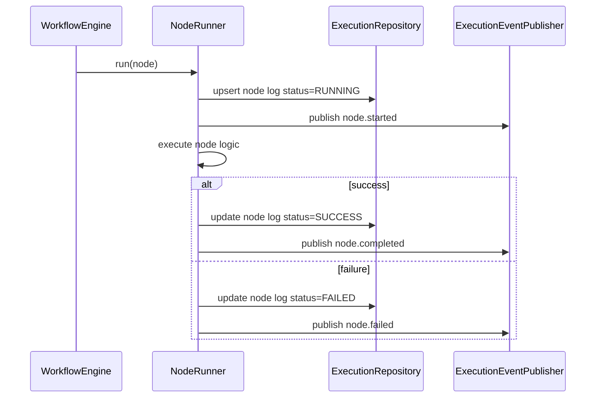

# Real-Time Execution Monitoring Design

## Existing architecture relevant to this feature

The current backend already provides the core execution primitives that this feature can reuse:

- `ExecutionController` exposes `POST /api/executions`, `GET /api/executions/:executionId`, and `GET /api/executions?workflow_id=...` under the JWT guard.
- `ExecutionStarter` creates an execution record as `QUEUED` and enqueues a BullMQ job without directly running workflow logic in the HTTP request.
- `ExecutionProcessor` claims queued runs with `claimQueuedExecution`, loads the pinned workflow version, and calls `WorkflowEngine.run(...)`.
- `WorkflowEngine.run()` executes the graph node-by-node, persists node logs, and finalizes the execution state with `finishExecution(...)`.
- `ExecutionRepository` is the persistence boundary and remains the authoritative state store.
- `ExecutionNodeLog` rows persist `status`, `input`, `output`, `errorMessage`, `startedAt`, `finishedAt`, and `durationMs`.
- The frontend uses `React Query` and a service layer, with `useExecution` polling the execution API until the status is terminal.

This means the system already has the right persistence boundaries for the monitoring feature, but it lacks a live event flow and an explicit in-flight node state indicator.

## Proposed architecture

### 1. Keep PostgreSQL as the source of truth

The execution record and node log tables remain the system of record. SSE is only a delivery channel for user-facing updates. The backend should write state changes to PostgreSQL before publishing the corresponding event. This preserves read consistency and makes reconnects safe.

### 2. Introduce a transport-agnostic execution event publisher

Create an internal abstraction such as:

```ts
export interface ExecutionEventPublisher {
  publish(executionId: string, event: ExecutionEvent): Promise<void>;
  subscribe(executionId: string, listener: (event: ExecutionEvent) => void): () => void;
}
```

This keeps `WorkflowEngine` and the persistence layer independent from HTTP/SSE. The engine does not need to know whether the event is transported by in-process listeners, Redis Pub/Sub, or a future queue-based mechanism.

The initial implementation can use an in-memory emitter inside the monolith. This is adequate when the app runs as a single process and the stream is a UX convenience. The design should still allow a Redis Pub/Sub backend later without requiring a rewrite of the engine or the API layer.

### 3. Persist node state before publishing node lifecycle events

The current `NodeRunner.run()` produces a final log only once the node completes. To expose the accurate `RUNNING` state, the engine should insert or update an `ExecutionNodeLog` row before running the node body and then update that same record after success or failure.

Recommended pattern:

- Determine a stable per-execution, per-node identity based on `executionId + nodeId`.
- Before executing, create or update the node log row with `status = RUNNING`, `startedAt = now`, `finishedAt = null`, and the input snapshot.
- Execute the node.
- On success, update the row to `SUCCESS`, set output and finished time, and emit `node.completed`.
- On failure, update the row to `FAILED`, store `errorMessage`, finish time, and emit `node.failed`.
- If a node is skipped, create a log row with `status = SKIPPED` without tracking it as `RUNNING`.

This preserves the app’s current execution semantics while making active state observable.

## Backend component responsibilities

### Execution module

- `ExecutionStarter`: queue acceptance and idempotency semantics.
- `ExecutionProcessor`: worker lifecycle and claim handling.
- `WorkflowEngine`: orchestration of node execution and state changes.
- `NodeRunner`: node execution, error capture, and state transitions.
- `ExecutionRepository`: writes execution and node status to PostgreSQL.
- `ExecutionEventPublisher`: emits execution and node lifecycle events.

### SSE controller / transport

- Accepts authenticated clients.
- Verifies execution ownership before subscribing.
- Maintains a subscription registry keyed by execution ID.
- Emits the latest snapshot on connect and then streams subsequent events until the execution is terminal or the client disconnects.
- Cleans up the subscription when the client disconnects or the stream ends.

### Authorization boundaries

The API remains behind the existing JWT guard. The subscriber lookup must also verify that the requester owns the workflow associated with the execution before establishing the stream.

## Event publishing abstraction

### Event model

```ts
export type ExecutionEventType =
  | 'execution.queued'
  | 'execution.started'
  | 'node.started'
  | 'node.completed'
  | 'node.failed'
  | 'node.skipped'
  | 'execution.completed'
  | 'execution.failed';

export interface ExecutionEvent {
  event: ExecutionEventType;
  executionId: string;
  workflowId?: string;
  workflowVersionId?: string;
  nodeId?: string;
  nodeKey?: string;
  status?: string;
  startedAt?: string;
  finishedAt?: string;
  durationMs?: number;
  input?: unknown;
  output?: unknown;
  errorMessage?: string | null;
  ts: string;
}
```

### Ordering and idempotency

The system should guarantee the following ordering requirements:

1. `execution.queued` before `execution.started`.
2. `execution.started` before the first `node.started` event.
3. `node.started` before `node.completed` or `node.failed` for the same node.
4. `execution.completed` or `execution.failed` only after the final node state is persisted.
5. Duplicate events are tolerated, but the frontend must use the latest known state and ignore stale older event payloads when timestamps are older than the persisted state.

A small event timestamp or monotonic sequence counter can be included if the frontend needs stronger deduplication, but the first implementation can rely on the persisted `startedAt` / `finishedAt` fields and `updatedAt` semantics.

## Node state persistence strategy

The existing schema already stores node metrics in `execution_node_logs`, which is sufficient for the initial monitoring design. The missing piece is not a new table but a guarantee that a node log exists before the node runs.

### Proposed write pattern

```ts
await repository.upsertNodeRunningState({
  executionId,
  nodeId,
  nodeKey,
  status: 'RUNNING',
  input,
  startedAt: now,
});

const result = await runner.execute(...);

await repository.finishNodeExecution({
  executionId,
  nodeId,
  status: result.success ? 'SUCCESS' : 'FAILED',
  output,
  errorMessage,
  finishedAt: now,
});
```

This pattern ensures the node log can be treated as a current state record instead of a final artifact. Because the same record is reused for the lifecycle, we avoid duplicate log records and keep the record shape consistent with the query APIs and the canvas state mapper.

## SSE subscription architecture

### Authentication

The current app stores JWT access tokens in browser local storage and sends them as `Authorization` headers for REST calls. Native browser `EventSource` cannot attach arbitrary request headers, so the monitoring stream must not rely on `EventSource` with bearer headers. The preferred options are:

1. Use a secure same-site cookie session for the SSE route; or
2. Exchange a short-lived stream token via the authenticated API and then open the stream through a server-side proxy that can validate the token from a secure cookie or a signed server-side session.

The first version should avoid placing bearer tokens in query strings or fragments. A secure cookie-based session is the simplest compatible solution when the app is already served from the same origin.

### Subscription lifecycle

- Client opens the SSE endpoint after fetching the initial execution snapshot.
- Backend verifies ownership and registers the client subscription keyed by execution ID.
- Client receives the current snapshot and subsequent event updates.
- When the execution is terminal, the server sends a final event and closes the stream.
- On network interruption, the browser reconnects to the server and replays the latest snapshot before resuming the stream.

### Event delivery rules

- Global execution events and node events are both valid stream types.
- The stream should include a replay-safe `eventId` or timestamp to allow deduplication on reconnect.
- The server should not deliver a stale `node.started` after a later `node.completed` for the same node; state should be derived from persisted state and the event order.

## API and response contracts

### Execution snapshot endpoint

`GET /api/executions/:executionId`

Returns the execution plus the current node logs, similar to the existing implementation. This remains the canonical read model for both the monitor and the historical inspection view.

### List executions endpoint

`GET /api/executions?workflow_id=...` remains the history list. It returns summary items ordered by time and supports pagination.

### SSE stream endpoint

`GET /api/executions/:executionId/events`

This returns a text/event-stream response and uses the authenticated session. It streams execution and node events. It should be authorized and should reject non-owner access with the existing forbidden semantics.

## Frontend component structure

### Data layer

- `execution.service.ts`: HTTP + stream client API wrappers.
- `useExecutionSnapshot()`: fetches the current execution and keeps the snapshot in React Query.
- `useExecutionEvents(executionId)`: owns the SSE connection lifecycle.
- `useExecutionHistory()`: lists execution history for a workflow.
- `useStartExecution()`: starts the run and selects the returned execution.

### UI layer

- `ExecutionHistoryList`: shows recent executions and supports selection.
- `WorkflowCanvasMonitor`: maps execution node states to the canvas graph and highlights the running node.
- `NodeInspectorPanel`: renders node details and tabs for input, output, and logs.
- `ExecutionMonitorStatus`: shows connection state and last updated timestamp.

### React Query synchronization

The frontend should maintain separate state for:

- `selectedExecutionId`
- `selectedNodeId`
- SSE connection status

The selected execution is independent from the selected node. When a new execution is accepted, the client sets `selectedExecutionId` and fetches a snapshot before connecting. When a node event arrives, the client updates the relevant execution cache entry rather than replacing the entire state tree. This avoids flicker and keeps the canvas and node inspector in sync.

## Reconnection and consistency strategy

1. Fetch the current snapshot on selection or reconnect.
2. Connect the SSE stream after the snapshot is in place.
3. On stream reconnect, resume receiving updates and re-apply the newest event state.
4. If the client receives an older event than the latest persisted state, ignore it.
5. If the execution reaches a terminal state while the client is disconnected, the next snapshot fetch or reconnect will reconcile the final state.

This gives eventual consistency without requiring the client to store a complex event log. The server remains the final authority and the client is responsible for idempotent merging.

## Testability and quality gates

This feature is intentionally designed to be testable without broad mocking. The implementation should prefer real integration points, especially for execution and queue semantics, and should only mock the transport layer when the test is about browser event handling or auth boundaries.

### Backend quality gates

- Execute the real execution lifecycle against a test database and queue or a lightweight in-memory queue equivalent that preserves the same state transitions.
- Verify the `RUNNING` node log is created before the node body executes and that it is updated on completion.
- Assert on persisted values, not only on mock calls, especially for node log counts and execution status values.
- Validate ordering: a `node.started` event must not be emitted after `node.completed` for the same node.

### Frontend quality gates

- Use React Query test utilities and a realistic execution snapshot payload to validate cache updates.
- Verify that `selectedExecutionId` and `selectedNodeId` are independent and that Run selects the new execution without resetting the node detail state unexpectedly.
- Validate the stream lifecycle through a browser-like client, including connect, reconnect, terminal-state closure, and cleanup on unmount.

### TDD workflow for this feature

1. Write a failing backend test for the node lifecycle or queue transition.
2. Write a failing frontend test for the selected execution or stream reconnect behavior.
3. Implement the minimal backend or frontend fix.
4. Validate the behavior with the focused test suite.
5. Refactor only after the tests pass and continue to keep assertions tied to real behavior.

## Sequence diagrams

### Manual run and monitoring flow



### Node lifecycle state transition



## Database changes and migration considerations

The initial feature should not require a new schema for the core monitoring flow if the existing `execution` and `execution_node_logs` tables are extended in the minimal way already implied by the current records:

- keep `Execution.status` as the authoritative lifecycle state
- keep `ExecutionNodeLog.status` as the authoritative node state
- add or reuse a consistent `startedAt` to identify in-flight node work
- ensure the node log row is updated instead of duplicated if the same node runs once in a single execution

If a later version needs historical event replay or richer auditability, a dedicated `execution_events` table can be added. That would be a separate optimization and not part of the first monitoring implementation.

## Important technical trade-offs

### In-memory emitter vs Redis Pub/Sub

An in-memory emitter is sufficient for a single-process monolith and supports the required real-time UX with minimal complexity. It does not, however, fan out across multiple app instances. Redis Pub/Sub is the next step if the execution workers and API servers are scaled horizontally.

For this repo, the recommended approach is:

- start with an in-process event publisher behind an interface
- keep the interface transport-agnostic
- defer Redis Pub/Sub until there is a real multi-instance deployment requirement

This keeps the first version small while preserving a clean migration path.

### Polling vs SSE

The app already uses polling for execution status. Polling is simpler and works with the current API model. SSE is the preferred live-transport for the real-time monitor because it allows the backend to push updates to the client without polling. The design still keeps a fallback snapshot refresh strategy so that the app remains resilient when streaming is interrupted.

### Snapshot-before-stream vs stream-first

The safest UX is to fetch the current snapshot first and then establish the stream. This reduces the chance of a race where the browser connects and misses a state change between the request and the stream start. If a stream is started first, the server must still send an initial snapshot or event replay to ensure consistent state.

## Summary

The existing execution code already gives the platform a durable execution lifecycle and a queryable node log model. The missing piece is not an entirely new execution engine. The missing piece is a small eventing layer, a state-per-node `RUNNING` record, and a secure authenticated stream that the frontend consumes into `React Query` state. This is the minimal design that satisfies the monitoring requirement without overbuilding the architecture.
