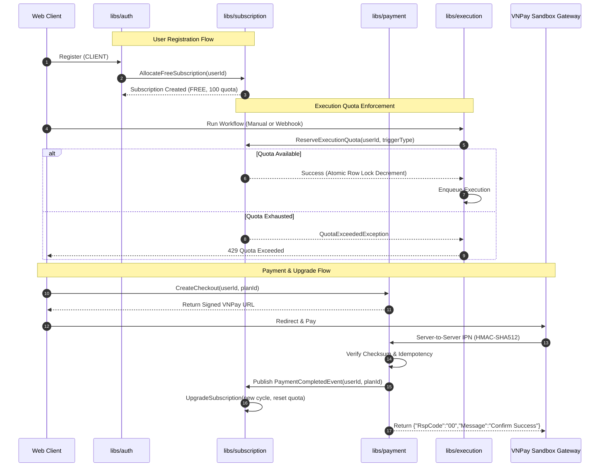

# Technical Design: Subscription & Billing with VNPAY

## 1. Modular Monolith Architecture & Boundaries

Following `AGENTS.md` and `docs/backend/coding.standard.md`, the billing capabilities are partitioned into two dedicated libraries:

```text
monolith-backend/
├── libs/
│   ├── payment/                  <-- Independent payment gateway adapter & orders
│   │   ├── src/
│   │   │   ├── domain/           <-- PaymentOrder, PaymentProvider enum, OrderStatus
│   │   │   ├── application/      <-- CreateOrderCommand, ProcessIpnCommand, VNPaySigner
│   │   │   ├── infrastructure/   <-- PrismaPaymentOrderRepository, VNPayService
│   │   │   └── presentation/     <-- VNPayController (IPN & Return endpoints)
│   │
│   ├── subscription/             <-- Plan catalog, subscription lifecycle & quota
│   │   ├── src/
│   │   │   ├── domain/           <-- Subscription, Plan, Usage, QuotaReservation
│   │   │   ├── application/      <-- ReserveQuotaCommand, UpgradeSubscriptionHandler
│   │   │   ├── infrastructure/   <-- PrismaSubscriptionRepository, QuotaEnforcer
│   │   │   └── presentation/     <-- BillingController (Client dashboard APIs)
│   │
│   └── execution/                <-- Integrates with Subscription via QuotaReservationPort
│       └── src/application/services/execution-starter.ts
```

### Module Responsibilities & Collaboration



---

## 2. Database Schema (Prisma)

Add the following models to `monolith-backend/prisma/schema.prisma`:

```prisma
// ----------------------------------------------------------------------------
// Subscription & Billing Module
// ----------------------------------------------------------------------------

enum PlanCode {
  FREE
  STARTER
  PRO
  BUSINESS
}

enum SubscriptionStatus {
  ACTIVE
  EXPIRED
  CANCELLED
}

enum PaymentOrderStatus {
  PENDING
  COMPLETED
  FAILED
}

enum PaymentProvider {
  VNPAY
}

model SubscriptionPlan {
  id           String    @id @default(uuid()) @db.Uuid
  code         PlanCode  @unique
  name         String    @db.VarChar(100)
  priceVnd     Int       @map("price_vnd")
  monthlyQuota Int       @map("monthly_quota")
  isActive     Boolean   @default(true) @map("is_active")
  createdAt    DateTime  @default(now()) @map("created_at") @db.Timestamptz
  updatedAt    DateTime  @updatedAt @map("updated_at") @db.Timestamptz

  subscriptions Subscription[]
  paymentOrders PaymentOrder[]

  @@map("subscription_plans")
}

model Subscription {
  id                 String             @id @default(uuid()) @db.Uuid
  userId             String             @unique @map("user_id") @db.Uuid
  user               User               @relation(fields: [userId], references: [id], onDelete: Cascade)
  planId             String             @map("plan_id") @db.Uuid
  plan               SubscriptionPlan   @relation(fields: [planId], references: [id])
  status             SubscriptionStatus @default(ACTIVE)
  currentPeriodStart DateTime           @map("current_period_start") @db.Timestamptz
  currentPeriodEnd   DateTime           @map("current_period_end") @db.Timestamptz
  nextPlanId         String?            @map("next_plan_id") @db.Uuid
  autoRenew          Boolean            @default(true) @map("auto_renew")
  createdAt          DateTime           @default(now()) @map("created_at") @db.Timestamptz
  updatedAt          DateTime           @updatedAt @map("updated_at") @db.Timestamptz

  usages SubscriptionUsage[]

  @@index([userId])
  @@index([status])
  @@map("subscriptions")
}

model SubscriptionUsage {
  id             String       @id @default(uuid()) @db.Uuid
  subscriptionId String       @map("subscription_id") @db.Uuid
  subscription   Subscription @relation(fields: [subscriptionId], references: [id], onDelete: Cascade)
  periodStart    DateTime     @map("period_start") @db.Timestamptz
  periodEnd      DateTime     @map("period_end") @db.Timestamptz
  totalQuota     Int          @map("total_quota")
  usedQuota      Int          @default(0) @map("used_quota")
  manualUsage    Int          @default(0) @map("manual_usage")
  webhookUsage   Int          @default(0) @map("webhook_usage")
  scheduleUsage  Int          @default(0) @map("schedule_usage")
  createdAt      DateTime     @default(now()) @map("created_at") @db.Timestamptz
  updatedAt      DateTime     @updatedAt @map("updated_at") @db.Timestamptz

  @@index([subscriptionId, periodStart, periodEnd])
  @@map("subscription_usages")
}

model PaymentOrder {
  id            String             @id @default(uuid()) @db.Uuid
  orderCode     String             @unique @map("order_code") @db.VarChar(64) // vnp_TxnRef
  userId        String             @map("user_id") @db.Uuid
  user          User               @relation(fields: [userId], references: [id])
  planId        String             @map("plan_id") @db.Uuid
  plan          SubscriptionPlan   @relation(fields: [planId], references: [id])
  amountVnd     Int                @map("amount_vnd")
  status        PaymentOrderStatus @default(PENDING)
  provider      PaymentProvider    @default(VNPAY)
  transactionNo String?            @map("transaction_no") @db.VarChar(64) // vnp_TransactionNo
  bankCode      String?            @map("bank_code") @db.VarChar(32)     // vnp_BankCode
  responseCode  String?            @map("response_code") @db.VarChar(16) // vnp_ResponseCode
  payDate       DateTime?          @map("pay_date") @db.Timestamptz
  createdAt     DateTime           @default(now()) @map("created_at") @db.Timestamptz
  updatedAt     DateTime           @updatedAt @map("updated_at") @db.Timestamptz

  @@index([userId])
  @@index([orderCode])
  @@index([status])
  @@map("payment_orders")
}
```

---

## 3. Atomic Quota Reservation Strategy

To prevent race conditions when concurrent webhooks or manual executions occur:
1. `ExecutionStarter.start(...)` resolves `workflowOwnerId`.
2. Within a PostgreSQL transaction, query the active `SubscriptionUsage`:
   ```sql
   SELECT id, total_quota, used_quota, manual_usage, webhook_usage
   FROM subscription_usages
   WHERE subscription_id = :subscriptionId
     AND period_start <= NOW()
     AND period_end >= NOW()
   FOR UPDATE;
   ```
3. Evaluate `used_quota < total_quota`:
   - If `true`: Increment `used_quota = used_quota + 1` and corresponding trigger usage column (`manual_usage` or `webhook_usage`), commit transaction, proceed to enqueue execution.
   - If `false`: Roll back transaction, throw `QuotaExceededException` (mapped to HTTP 429).

---

## 4. VNPay Integration Details

Conforming to `docs/integration/vnpay-integration.md`:

### Parameters & Checksum Construction:
- Sort keys alphabetically using US-ASCII order.
- Parameters:
  - `vnp_Version`: `2.1.0`
  - `vnp_Command`: `pay`
  - `vnp_TmnCode`: configured merchant code
  - `vnp_Amount`: `order.amountVnd * 100`
  - `vnp_CurrCode`: `VND`
  - `vnp_TxnRef`: `orderCode`
  - `vnp_OrderInfo`: `Thanh toan goi cuoc FlowPilot ${plan.name}`
  - `vnp_OrderType`: `other`
  - `vnp_Locale`: `vn`
  - `vnp_ReturnUrl`: frontend display return URL
  - `vnp_IpAddr`: client IP
  - `vnp_CreateDate`: `yyyyMMddHHmmss` (Vietnam GMT+7)
  - `vnp_ExpireDate`: creation time + 15 minutes
- Secure Hash: `HMAC-SHA512` over URL-encoded query string using secret key.

### IPN Response Protocol:
- If signature invalid: `{"RspCode":"97","Message":"Invalid Checksum"}`
- If order not found: `{"RspCode":"01","Message":"Order not Found"}`
- If order already processed: `{"RspCode":"02","Message":"Order already confirmed"}`
- If amount mismatch: `{"RspCode":"04","Message":"Invalid Amount"}`
- If success: Update order to `COMPLETED`, trigger upgrade, return `{"RspCode":"00","Message":"Confirm Success"}`

---

## 5. API Contracts

### Client Billing Endpoints
- `GET /api/v1/billing/subscription/me`:
  - Response:
    ```json
    {
      "plan": { "code": "PRO", "name": "Pro" },
      "status": "ACTIVE",
      "currentPeriodStart": "2026-11-28T00:00:00.000Z",
      "currentPeriodEnd": "2026-12-28T00:00:00.000Z",
      "totalQuota": 5000,
      "usedQuota": 120,
      "remainingQuota": 4880,
      "usageBreakdown": { "manual": 20, "webhook": 100, "schedule": 0 }
    }
    ```
- `GET /api/v1/billing/plans`: List all active plans with prices and quotas.
- `POST /api/v1/billing/checkout`:
  - Body: `{ "planCode": "PRO" }`
  - Response: `{ "orderCode": "ORD_173277...", "paymentUrl": "https://sandbox.vnpayment.vn/..." }`
- `POST /api/v1/billing/subscription/downgrade`:
  - Body: `{ "targetPlanCode": "STARTER" }`
  - Response: `{ "message": "Downgrade scheduled for next cycle" }`
- `POST /api/v1/billing/subscription/switch-to-free`:
  - Valid only when status is `EXPIRED`.
  - Response: `{ "message": "Switched to Free plan successfully" }`
- `GET /api/v1/billing/payments/history`: List past `PaymentOrder`s for current user.

### Payment Webhook Endpoints
- `GET /api/v1/payments/vnpay/return`: Validates checksum and redirects user to frontend `/billing/payment-result?status=...`.
- `GET /api/v1/payments/vnpay/ipn`: Server-to-server webhook callback from VNPay.

### Admin Billing Endpoints (`@Roles(UserRole.ADMIN)`)
- `GET /api/v1/admin/billing/plans`: List all plans.
- `PATCH /api/v1/admin/billing/plans/:id`: Update price, quota, or status.
- `GET /api/v1/admin/billing/subscriptions`: Search and paginate all user subscriptions.
- `GET /api/v1/admin/billing/payments`: Search and paginate all payment orders.

---

## 6. Material Test Seams

1. **`QuotaReservationPort` (in `libs/execution`)**: Interface consumed by `ExecutionStarter`. In unit tests for execution, mock this port to return success or throw `QuotaExceededException`.
2. **`VNPaySignerPort` (in `libs/payment`)**: Generates and validates HMAC-SHA512. Tested with official VNPay test vectors.
3. **`PaymentOrderRepository` & `SubscriptionRepository`**: Database isolation using mock Prisma clients in unit tests and test databases in integration tests.
4. **Time Seam**: Billing periods and expiration use a testable date provider to simulate cycle end and month-to-month resets.
